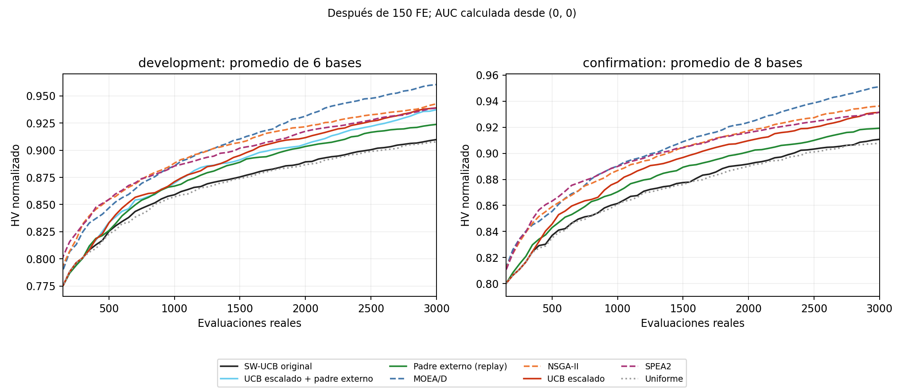
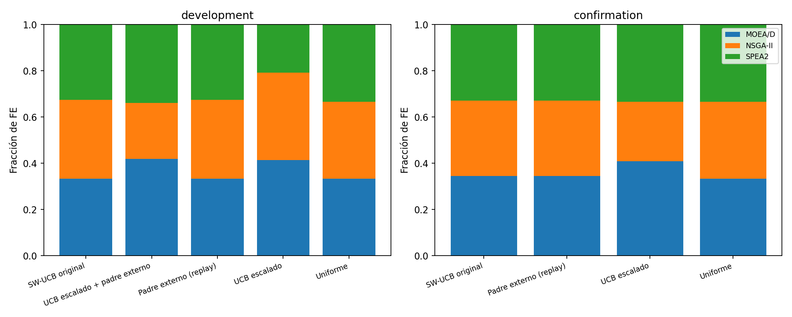

# Portafolio MO-JSSP: campaña experimental del 15 de octubre de 2026

Se completaron tres iteraciones aisladas. Motivo de cierre: **reproducible_improvement**. Las conclusiones se limitan al generador, perfiles, presupuestos e instancias evaluados.

## Resultado y decisiones

- **UCB escalado: conservar como selector experimental respaldado.** Puertas prospectivas: `{"full_8_bases_3_seeds": true, "HV_CI_positive": true, "AUC_CI_positive": true, "HV_win_6_of_8": true, "AUC_win_6_of_8": true, "genetic_diversity_retained": true, "runtime_under_1_30": true}`.
- **Padre externo, replay: conservar como evidencia causal bajo asignación externa; no como política autónoma.** Puertas prospectivas: `{"full_8_bases_3_seeds": true, "HV_CI_positive": true, "AUC_CI_positive": true, "HV_win_6_of_8": true, "AUC_win_6_of_8": true, "genetic_diversity_retained": true, "runtime_under_1_30": true}`.
  La permutación exacta de HV con Holm no cruza .05 (p=0.05469); aunque alguna puerta bootstrap pase, ese respaldo estadístico es limitado y no se presenta como superioridad concluyente.
- **Combinación: descartar para adopción.** Frente a UCB escalado en desarrollo, ΔHV -0.001742 [-0.007745, +0.003813]; ΔAUC -0.002773 [-0.008144, +0.002597]. Mezclar dos mecanismos útiles no garantiza sinergia. El tratamiento queda sólo para reproducir el resultado negativo.

**Frente a individuales:** la diferencia pareada de UCB escalado frente a MOEA/D en confirmación es -0.019687 [-0.028799, -0.009729] de HV. Se conserva este contraste incluso si favorece al individual; la aprobación de una mejora del portafolio no equivale a vencer a cada algoritmo.

## Auditoría, reproducibilidad y condiciones

Checkout experimental independiente, rama `experiment/pareto-archive-cooperation`, HEAD inicial `1d695f3`. No se cambió de rama, no se modificó el repositorio original y no hubo push. Los dos elementos untracked preexistentes se preservaron. No había procesos Python activos al comenzar.

El archivo global original sólo acumula resultados. En los 18 casos de desarrollo se verificó igualdad exacta de los genotipos no dominados del uniforme a 3000 FE con la unión de los tres individuales a 1000 FE cada uno: **agregación pasiva, no cooperación activa**. Los cinco controles se reprodujeron después de introducir los hooks desactivados: mismos frentes, asignaciones, recompensas y métricas en todos los bloques de una base/semilla.

La suite original pasó 361 pruebas y 174 subpruebas. Tras los mecanismos pasó 370 y 174. Las pruebas nuevas cubren FE reales, cortes arbitrarios, validación de agendas, invariantes de MOEA/D, ausencia de consumo de RNG con el hook desactivado, rechazo de mezcla entre instancias, invariancia de escala UCB y revisitas. Véase también la validación final registrada.

Se generaron seis bases de desarrollo y ocho de confirmación interna, independientes y con semillas nuevas, sin acceder al test final del proyecto. Las instancias históricas completas no estaban disponibles: sus resultados no se usaron como controles. Cada corrida consumió 3000 FE reales, población 30 y bloques de 50; cotas analíticas originales, referencia (1.1,1.1,1.1), inicialización incluida y semillas de brazos master/master+1/master+2. Las semillas se promediaron por base antes de inferir. Protocolos, manifiesto, código congelado y hashes están en este directorio.

**Procedencia del código:** el proceso de línea base cargó los módulos de HEAD antes de los cambios. Su campo raw `source_sha256` leído del disco durante la ejecución puede reflejar ediciones posteriores; `baseline_execution_provenance.json` corrige esa interpretación sin alterar ninguna corrida, y `code/baseline/` preserva el código. Los procesos posteriores capturan hashes al inicio.

## Desarrollo: controles y tres iteraciones

| Método | n | HV | AUC-HV | s/corrida | Vectores únicos | Diversidad genotípica |
|---|---:|---:|---:|---:|---:|---:|
| MOEA/D | 18 | 0.960445 | 0.892293 | 5.013 | 53.61 | 0.4129 |
| NSGA-II | 18 | 0.942723 | 0.887727 | 5.909 | 52.50 | 0.5252 |
| SPEA2 | 18 | 0.938732 | 0.884564 | 5.903 | 55.67 | 0.5113 |
| Uniforme | 18 | 0.907685 | 0.856279 | 5.347 | 36.67 | 0.5147 |
| SW-UCB original | 18 | 0.909787 | 0.858273 | 5.326 | 38.22 | 0.5190 |
| Padre externo, replay | 18 | 0.923783 | 0.868430 | 6.625 | 41.72 | 0.5705 |
| UCB escalado | 18 | 0.939038 | 0.875472 | 5.881 | 47.33 | 0.5807 |
| Escalado + padre externo | 18 | 0.937296 | 0.872699 | 5.214 | 46.50 | 0.5909 |

La familia completa de tres candidatos frente al original se ajusta por Holm en `analysis_development_final.json`. El desarrollo es exploratorio y selecciona candidatos; sus intervalos o valores p interinos no se presentan como confirmación.

I1 cambió exclusivamente el segundo padre cada diez cruces, con donante extranjero del Pareto global elegido por máxima distancia mínima normalizada al frente local. Reprodujo exactamente la traza de asignación de su control: el cambio de calidad no se puede atribuir a más FE por brazo. No hay reemplazo masivo de poblaciones, transferencia de objetivos a hijos nuevos ni alteración de pesos; toda descendencia pasa por la evaluación y selección nativas.

**Límite del replay:** el control que proporciona la traza consume otras 3000 FE en esa instancia/semilla. Ambas corridas se contabilizan en el presupuesto de campaña. Las 3000 FE del tratamiento son su coste condicional a una asignación externa ya disponible, no el coste de una política autónoma desde cero: control + tratamiento requieren 6000 FE. Sus contrastes contra individuales describen calidad bajo asignación controlada, no superioridad desplegable a igual coste total. I1 prueba transferencia real de información; no resuelve por sí sola su integración online. I3 sí ejecuta feedback cooperativo vivo a 3000 FE.

I2 cambió sólo la escala de explotación UCB: media de ΔHV dividida por el máximo absoluto reciente común. Ventana 10 y c=.07 permanecen fijos; los ΔHV registrados son crudos. Las observaciones viejas usan el mismo denominador de la decisión actual y las ventanas de ceros conservan exploración. Los brazos ausentes de la ventana recuperan UCB infinito. No se aplica una preferencia fija por MOEA/D.

I3 añadió el mismo padre externo al selector escalado con feedback vivo. Su control es I2. Los cambios de asignación son consecuencia de la intervención; no se presenta este contraste como una comparación de reparto fijo. Falló el criterio prospectivo de mejorar simultáneamente HV y AUC frente a su padre.

## Confirmación congelada

| Método | n | HV | AUC-HV | s/corrida | Vectores únicos | Diversidad genotípica |
|---|---:|---:|---:|---:|---:|---:|
| MOEA/D | 24 | 0.951055 | 0.892458 | 10.343 | 42.00 | 0.4104 |
| NSGA-II | 24 | 0.936247 | 0.887201 | 11.093 | 39.21 | 0.5107 |
| SPEA2 | 24 | 0.931566 | 0.887347 | 10.658 | 40.04 | 0.4980 |
| Uniforme | 24 | 0.907719 | 0.862234 | 10.724 | 34.62 | 0.5226 |
| SW-UCB original | 24 | 0.910688 | 0.863775 | 10.669 | 33.42 | 0.5224 |
| Padre externo, replay | 24 | 0.919227 | 0.871660 | 11.159 | 36.33 | 0.5843 |
| UCB escalado | 24 | 0.931368 | 0.878448 | 10.826 | 40.00 | 0.5828 |

Plan congelado: ocho bases nuevas (5x5 hasta 50x50), tres semillas por base, comparaciones prospectivas escalado/original y padre externo/original. Métodos rotados por caso; el replay debe seguir al control original. Los siguientes intervalos son bootstrap de bases, no de semillas; p es permutación exacta bilateral y Holm cubre los dos contrastes HV congelados. HV y AUC están correlacionados; las métricas secundarias y los análisis por perfil son exploratorios.

| Mecanismo vs original | ΔHV [IC95%] | ΔAUC [IC95%] | Bases HV G/E/P | p HV Holm | Tiempo relativo | Diversidad relativa |
|---|---|---|---|---:|---:|---:|
| UCB escalado | +0.020680 [+0.014153, +0.027457] | +0.014673 [+0.010179, +0.019526] | [8, 0, 0] | 0.01562 | 1.015 | 1.116 |
| Padre externo, replay | +0.008539 [+0.001626, +0.013894] | +0.007885 [+0.005458, +0.011074] | [7, 0, 1] | 0.05469 | 1.046 | 1.118 |

### Condiciones por base: HV medio

| Base | Original | Uniforme | Escalado | Padre externo | Mejor individual observado |
|---|---:|---:|---:|---:|---|
| confirmation_00_5x5 | 1.080726 | 1.080561 | 1.108597 | 1.101922 | SPEA2 (1.125785) |
| confirmation_01_10x10 | 0.937495 | 0.929898 | 0.967112 | 0.925201 | MOEA/D (0.998454) |
| confirmation_02_20x10 | 0.980453 | 0.974603 | 1.016284 | 0.991031 | MOEA/D (1.027626) |
| confirmation_03_10x20 | 0.795232 | 0.789917 | 0.809007 | 0.801544 | MOEA/D (0.843175) |
| confirmation_04_20x20 | 0.856621 | 0.854324 | 0.882078 | 0.867936 | MOEA/D (0.907217) |
| confirmation_05_30x20 | 0.853652 | 0.854462 | 0.868065 | 0.866782 | MOEA/D (0.904203) |
| confirmation_06_40x20 | 0.943044 | 0.941454 | 0.955404 | 0.952338 | MOEA/D (0.974641) |
| confirmation_07_50x50 | 0.838280 | 0.836536 | 0.844397 | 0.847066 | MOEA/D (0.849344) |

- Pérdidas de HV observadas de UCB escalado frente al original: ninguna en las medias de estas bases.
- Pérdidas de HV observadas de Padre externo, replay frente al original: `confirmation_01_10x10` (-0.012294).

| Base | Tiempo escalado/original | Tiempo padre/original | Diversidad escalado/original | Diversidad padre/original |
|---|---:|---:|---:|---:|
| confirmation_00_5x5 | 1.378 | 1.353 | 1.079 | 1.114 |
| confirmation_01_10x10 | 0.979 | 1.058 | 1.133 | 1.157 |
| confirmation_02_20x10 | 0.950 | 1.090 | 1.146 | 1.213 |
| confirmation_03_10x20 | 1.029 | 1.026 | 1.168 | 1.123 |
| confirmation_04_20x20 | 0.931 | 1.148 | 1.187 | 1.129 |
| confirmation_05_30x20 | 1.006 | 1.017 | 1.083 | 1.085 |
| confirmation_06_40x20 | 1.000 | 1.023 | 1.044 | 1.040 |
| confirmation_07_50x50 | 1.026 | 1.031 | 1.099 | 1.095 |

El mejor individual por base es un **oráculo descriptivo**: se identifica a posteriori, no es una política disponible sin información adicional. Los JSON incluyen contrastes contra cada individual y contra uniforme. Tamaño y perfil están confundidos; estas observaciones no justifican una regla causal basada en tamaño o dificultad.

### Asignación, complementariedad y estancamiento

| Método | FE MOEA/D % | FE NSGA-II % | FE SPEA2 % | FE tras dos ΔHV=0 | Recuperaciones positivas | Máximo de bloques ociosos, media |
|---|---:|---:|---:|---:|---:|---:|
| SW-UCB original | 34.4 | 32.7 | 32.8 | 250.0 | 0.88 | 5.04 |
| Uniforme | 33.3 | 33.3 | 33.3 | 172.9 | 0.88 | 2.00 |
| Padre externo, replay | 34.4 | 32.7 | 32.8 | 72.9 | 0.75 | 5.04 |
| UCB escalado | 40.8 | 25.8 | 33.3 | 220.8 | 0.17 | 10.00 |

Un ΔHV global nulo puede indicar redundancia con otro brazo, incluso si hubo progreso interno. El gasto tras dos ceros es diagnóstico, no prueba de inutilidad. Las revisitas evitan eliminar permanentemente brazos complementarios; la mejora de calidad no autoriza afirmar que todo gasto en estancamiento haya disminuido.

| Método | HV exclusivo MOEA/D | HV exclusivo NSGA-II | HV exclusivo SPEA2 |
|---|---:|---:|---:|
| SW-UCB original | 0.010419 | 0.005540 | 0.006183 |
| Uniforme | 0.008086 | 0.003858 | 0.005315 |
| Padre externo, replay | 0.003979 | 0.003482 | 0.002996 |
| UCB escalado | 0.035772 | 0.017451 | 0.019510 |

Se calcula contribución exclusiva como HV(unión) − HV(unión sin el brazo), sobre frentes de soluciones realmente evaluadas. Las contribuciones exclusivas no suman el HV total, porque hay volumen compartido. Con cooperación, el algoritmo receptor genera el hijo; la primera observación de su genotipo no reconstruye su ascendencia genética. Una caída del HV exclusivo puede expresar mayor solapamiento; no implica por sí sola pérdida de diversidad o de utilidad.

### Eficiencia por FE

| Método | Corridas que alcanzan HV final original | FE medios hasta umbral, censura en 3000 | Segundos medios con la misma censura |
|---|---:|---:|---:|
| Padre externo, replay | 19/24 | 2262.5 | 7.568 |
| MOEA/D | 24/24 | 1622.9 | 6.106 |
| NSGA-II | 22/24 | 1895.8 | 8.189 |
| UCB escalado | 22/24 | 2062.5 | 7.205 |
| SPEA2 | 20/24 | 1841.7 | 6.658 |
| Uniforme | 3/24 | 2993.8 | 10.708 |

El umbral se usa sólo para análisis posterior; nunca guía la búsqueda. Las corridas que no lo alcanzan están censuradas y se computan en 3000 FE, no como éxitos. AUC integra desde (0,0) por trapecios cada 50 FE. Los tiempos incluyen trabajo de los brazos, archivo e instrumentación online; las métricas finales se cronometran aparte. Se mide desde el primer bloque; carga de DZN y construcción de objetos quedan fuera, por lo que no es tiempo extremo a extremo. Tampoco representa una medida aislada de overhead del orquestador. El escritorio compartido puede introducir variación temporal; se rotaron los métodos para reducirla.

### Diversidad

| Método | Rango Cmax normalizado | Rango tardanza | Rango energía | Vecino medio |
|---|---:|---:|---:|---:|
| SW-UCB original | 0.04516 | 0.03781 | 0.15059 | 0.00392 |
| Uniforme | 0.04702 | 0.03951 | 0.14876 | 0.00388 |
| Padre externo, replay | 0.05516 | 0.04696 | 0.16872 | 0.00456 |
| UCB escalado | 0.04017 | 0.03289 | 0.16274 | 0.00317 |

Se conservan número de vectores distintos, rango de cada objetivo, distancia media al vecino y distancia Hamming genotípica normalizada de cada población (archivo reproductivo en SPEA2). Más distancia entre vecinos puede significar dispersión o huecos: no se identifica automáticamente con mejor cobertura. Los conteos de procedencia se mantienen separados de diversidad y de ascendencia. No se impone una cuota arbitraria de autoría a cada algoritmo. Las distancias genotípicas de poblaciones se calcularon en ejecución: no se guardaron las poblaciones reproductivas completas. Recalcularlas exige repetir la semilla y el código congelado; los archivos Pareto por sí solos no bastan. La fórmula se verificó además con un fixture analítico de tres genotipos y las cinco reproducciones de control coincidieron en estas medidas.

## Presupuesto, validez y límites

Se consumieron **951,000 FE de búsqueda** incluyendo 15.000 FE de reproducción; 44.29 minutos de tiempo experimental medido. La auditoría independiente realizó 20,131 reevaluaciones adicionales, separadas y sin alimentar la búsqueda. Se verificaron 312 corridas, sus 60 bloques, todos los genotipos de checkpoints y archivos locales, factibilidad de agendas, objetivos, normalización, HV, AUC, contribuciones y replay. El techo fue 1.200.000 FE y 45 minutos medidos.

El control temporal se realiza antes de cada corrida atómica: exceso final de 0.00 segundos, sin admitir nuevas corridas tras superar el tope. Véase `runtime_cap_accounting_note.json`.

Limitaciones: presupuesto de 3000 FE pequeño para 2500 operaciones; tres semillas por base; generador único; perfiles y escala confundidos; sin estudio de sensibilidad amplio. I1 no aísla máximo-mínimo frente a donante aleatorio ni demuestra que la cadencia de diez cruces sea óptima. Los intervalos bootstrap tienen poca resolución con ocho bases. La prueba de permutación por cambios de signo requiere simetría bajo la nula. No se afirma optimalidad, superioridad universal ni que el portafolio venza a todos los individuales. La confirmación es interna y no sustituye el test final independiente. No se reajustaron parámetros con la confirmación.

## Fundamento y siguiente hipótesis

Li, Fialho, Kwong y Zhang (2014), [Adaptive Operator Selection With Bandits for a MOEA Based on Decomposition](https://colalab.ai/publications/LiFKZ14.pdf), DOI 10.1109/TEVC.2013.2239648, motiva crédito reciente dependiente de escala y exploración ante recompensas no estacionarias. Nuestra normalización por máximo no es una reproducción de FRRMAB. La cooperación heterogénea con trazabilidad tiene antecedentes en otros dominios ([preprint contextual](https://arxiv.org/abs/2607.13200)); no transfiere garantías de rendimiento a MO-JSSP.

Primera prueba pendiente, **no ejecutada**: activar el padre externo con SW-UCB original y feedback vivo, para distinguir el efecto del replay de la interacción con el escalado. Requeriría nueva campaña; no se infiere su éxito a partir de I1. Hipótesis adicional, **no ejecutada ni usada para seleccionar**: separar el valor del donante del crédito inmediato del receptor podría evitar que la cooperación desplace presupuesto hacia brazos que reciben buenas semillas pero no generan progreso sostenible. Requeriría trazabilidad de ascendencia real y una nueva campaña preregistrada; estas corridas no prueban ese mecanismo.

## Reproducir

Desde este checkout con Python 3.12 y las versiones registradas de pytest/numpy/scipy/matplotlib:

```powershell
python -m venv --system-site-packages .venv
.\.venv\Scripts\Activate.ps1
python -m pip install -r results/portfolio_loop_20261015/requirements-experiment.txt
python -m pytest -q
python scripts/run_portfolio_loop.py --phase prepare
python scripts/run_portfolio_loop.py --phase baseline
python scripts/run_portfolio_loop.py --phase guidance
python scripts/run_portfolio_loop.py --phase scaled
python scripts/run_portfolio_loop.py --phase combined
python scripts/reproduce_portfolio_baseline.py
python scripts/run_portfolio_loop.py --phase baseline --split confirmation --methods moead nsga2 spea2 uniform adaptive guidance scaled
```

Las corridas completas se omiten sin sobrescribirlas. Para repetir desde cero, use una copia aislada del código congelado y un directorio de salida nuevo; no borre ni edite los resultados originales. Los análisis y auditorías usan creación exclusiva de archivos: cambie la etiqueta/directorio al repetir. El protocolo y las hipótesis conservan la secuencia de decisiones.




