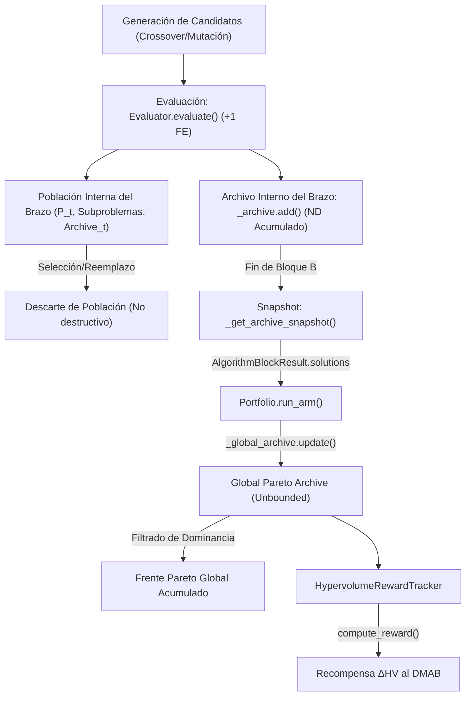

# Auditoría Técnica del Archivo Pareto Global

**Proyecto:** Portafolio Algorítmico Aplicado al Problema de Programación de Job Shop Multiobjetivo (MO-JSSP)  
**Módulo Auditado:** Archivo Pareto Global e Integración con Algoritmos  
**Fecha:** 2026-10-15  
**Entorno:** `mojssp-pareto-cooperation` (Commit `ea044c0`)

---

## 1. Reconstrucción del Flujo de Soluciones

Se auditó línea por línea el ciclo de vida de una solución candidata desde su creación hasta su persistencia en el archivo global.



### 1.1. Las Cuatro Colecciones de Soluciones

Es crucial distinguir matemáticamente los cuatro conjuntos presentes en la arquitectura:

1. **Conjunto de Soluciones Evaluadas ($\mathcal{S}_{\text{eval}}$):**
   - Toda solución $x = (\pi, v)$ decodificada por `Decoder.decode()` sobre la que se invoca `Evaluator.evaluate()`.
   - Cada llamada incrementa estrictamente el contador de evaluaciones reales: `evals_used += 1` y `self._total_evaluations += 1`.
   - Ubicaciones:
     - NSGA-II: [`NSGA2Arm.run()`](file:///C:/Users/lenin/Documents/Ingeniería/2026-1/TG1/mojssp-pareto-cooperation/src/mojssp/arms.py#L165-L173).
     - MOEA/D: [`MOEADArm.run()`](file:///C:/Users/lenin/Documents/Ingeniería/2026-1/TG1/mojssp-pareto-cooperation/src/mojssp/moead.py#L493-L511).
     - SPEA2: [`SPEA2Arm.run()`](file:///C:/Users/lenin/Documents/Ingeniería/2026-1/TG1/mojssp-pareto-cooperation/src/mojssp/spea2.py#L411-L428).

2. **Conjunto de Soluciones Conservadas en la Población del Brazo ($\mathcal{P}_{\text{arm}}$):**
   - NSGA-II: Mantiene una población $P_t$ de tamaño fijo $N = 30$. Las soluciones dominadas o con menor crowding distance son descartadas durante la selección ambiental generacional ([`arms.py#L250-L257`](file:///C:/Users/lenin/Documents/Ingeniería/2026-1/TG1/mojssp-pareto-cooperation/src/mojssp/arms.py#L250-L257)).
   - MOEA/D: Mantiene un arreglo de subproblemas de tamaño fijo $N = 30$. Si un hijo no mejora el valor escalar de descomposición de sus vecinos, es descartado de la población ([`moead.py#L585-L600`](file:///C:/Users/lenin/Documents/Ingeniería/2026-1/TG1/mojssp-pareto-cooperation/src/mojssp/moead.py#L585-L600)).
   - SPEA2: Mantiene una población $P_t$ y un archivo ambiental acotado $\bar{P}_t$ de tamaño $N = 30$, donde se truncan soluciones con menor distancia euclidiana al $k$-ésimo vecino ([`spea2.py#L435-L440`](file:///C:/Users/lenin/Documents/Ingeniería/2026-1/TG1/mojssp-pareto-cooperation/src/mojssp/spea2.py#L435-L440)).

3. **Conjunto de Soluciones Entregadas al Portafolio ($S_k$):**
   - Al finalizar el bloque de presupuesto $B$, el brazo **no** entrega su población viva ni su archivo acotado.
   - Cada brazo posee una instancia interna de `ParetoArchive()` (`self._archive` o `self._external_archive`) donde añade **todas y cada una de las soluciones evaluadas**:
     - `NSGA2Arm`: `self._archive.add(sol, sched, objs)` ([`arms.py#L171`](file:///C:/Users/lenin/Documents/Ingeniería/2026-1/TG1/mojssp-pareto-cooperation/src/mojssp/arms.py#L171)).
     - `MOEADArm`: `self._archive.add(sol, sched, objs)` ([`moead.py#L508`](file:///C:/Users/lenin/Documents/Ingeniería/2026-1/TG1/mojssp-pareto-cooperation/src/mojssp/moead.py#L508)).
     - `SPEA2Arm`: `self._external_archive.add(sol, sched, objs)` ([`spea2.py#L420`](file:///C:/Users/lenin/Documents/Ingeniería/2026-1/TG1/mojssp-pareto-cooperation/src/mojssp/spea2.py#L420)).
   - El resultado devuelto al portafolio es un snapshot defensivo no acotado:
     $$S_k = ND(\mathcal{S}_{\text{eval}}^{(arm)}(k))$$
   - **Hallazgo verificado:** Ninguna solución no dominada descubierta por un brazo es descartada antes de llegar al portafolio.

4. **Conjunto de Soluciones Conservadas en el Archivo Global ($A_t$):**
   - El portafolio actualiza su `_global_archive` mediante `self._global_archive.update(result.solutions.entries)` ([`portfolio.py#L169`](file:///C:/Users/lenin/Documents/Ingeniería/2026-1/TG1/mojssp-pareto-cooperation/src/mojssp/portfolio.py#L169)).
   - $A_t$ contiene el frente de Pareto no dominado global acumulado sobre todos los bloques y todos los brazos:
     $$A_t = ND\left(\bigcup_{k=1}^t S_k\right) = ND\left(\bigcup_{k=1}^t \mathcal{S}_{\text{eval}}(k)\right)$$

---

## 2. Invariantes del Archivo Pareto Global

Se verificó el comportamiento de la clase [`ParetoArchive`](file:///C:/Users/lenin/Documents/Ingeniería/2026-1/TG1/mojssp-pareto-cooperation/src/mojssp/pareto_archive.py#L47-L184) frente a los requisitos teóricos y matemáticos:

### 2.1. Unicidad del Archivo por Corrida
- En [`Portfolio.__init__()`](file:///C:/Users/lenin/Documents/Ingeniería/2026-1/TG1/mojssp-pareto-cooperation/src/mojssp/portfolio.py#L47), se inicializa una única instancia: `self._global_archive = ParetoArchive()`.
- La actualización ocurre **después de cada bloque** de evaluación en [`run_arm()`](file:///C:/Users/lenin/Documents/Ingeniería/2026-1/TG1/mojssp-pareto-cooperation/src/mojssp/portfolio.py#L169), no únicamente al final de la corrida.
- `_global_archive` nunca se limpia ni se reinicia durante la ejecución; solo se reinicia en una llamada explícita a [`reset()`](file:///C:/Users/lenin/Documents/Ingeniería/2026-1/TG1/mojssp-pareto-cooperation/src/mojssp/portfolio.py#L182-L189).

### 2.2. Filtrado de Dominancia en 3 Objetivos
- Se utiliza la función pura [`dominates(u, v)`](file:///C:/Users/lenin/Documents/Ingeniería/2026-1/TG1/mojssp-pareto-cooperation/src/mojssp/dominance.py#L1-L32), que implementa la definición de Pareto en minimización:
  $$u \prec v \iff (\forall i \in \{1, 2, 3\}: u_i \le v_i) \land (\exists j \in \{1, 2, 3\}: u_j < v_j)$$
- En [`ParetoArchive.add_entry()`](file:///C:/Users/lenin/Documents/Ingeniería/2026-1/TG1/mojssp-pareto-cooperation/src/mojssp/pareto_archive.py#L141-L155):
  1. Si el candidato es dominado por cualquier miembro existente, se descarta (`return False`).
  2. Si el candidato no es dominado, se eliminan todos los miembros existentes que resulten dominados por el nuevo candidato:
     ```python
     self._entries = [existing for existing in self._entries if not dominates(entry.objectives, existing.objectives)]
     ```
  3. Se inserta el candidato.

### 2.3. Tratamiento de Duplicados de Genotipo y de Vectores Objetivo
- **Genotipos idénticos:** Se descartan de inmediato ([`pareto_archive.py#L137-L139`](file:///C:/Users/lenin/Documents/Ingeniería/2026-1/TG1/mojssp-pareto-cooperation/src/mojssp/pareto_archive.py#L137-L139)):
  ```python
  for existing in self._entries:
      if existing.solution == entry.solution:
          return False
  ```
- **Vectores objetivo idénticos con distinto genotipo:** **Se conservan ambos**. Como `dominates(A, B)` requiere al menos una desigualdad estricta, si $f(A) = f(B)$, ninguno domina al otro. Ambos genotipos se preservan para mantener diversidad estructural.

### 2.4. Capacidad y Truncamiento
- `ParetoArchive` es **completamente no acotado** (`unbounded`). No existe límite de capacidad ni truncamiento artificial por crowding o distancia.

### 2.5. Conservación de Soluciones de Brazos Anteriores
- Una solución aportada por un algoritmo en el bloque $k_1$ permanece en el archivo global indefinidamente, incluso si ese algoritmo no vuelve a ser seleccionado por el DMAB, salvo que sea dominada estrictamente por una solución posterior de cualquier brazo.

### 2.6. Inmutabilidad y Estabilidad
- Cada elemento en el archivo es una instancia inmutable de [`ArchiveEntry`](file:///C:/Users/lenin/Documents/Ingeniería/2026-1/TG1/mojssp-pareto-cooperation/src/mojssp/pareto_archive.py#L14-L45) (`@dataclass(frozen=True)`).
- `solution`, `schedule` y `objectives` no pueden ser mutados tras su inserción.
- Las consultas al archivo devuelven tuplas o copias defensivas ([`pareto_archive.py#L70-L72`](file:///C:/Users/lenin/Documents/Ingeniería/2026-1/TG1/mojssp-pareto-cooperation/src/mojssp/pareto_archive.py#L70-L72)).

