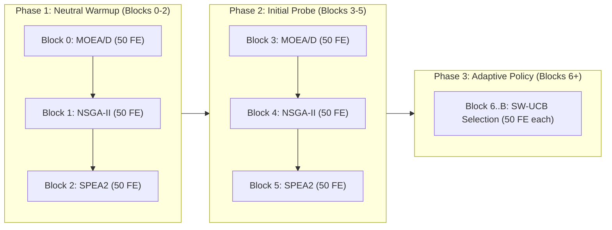
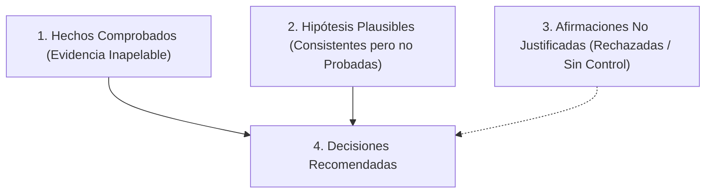

# P5 Research & Experimental Design: Adaptability and Efficiency of the MO-JSSP Portfolio

## 1. Executive Summary & Thesis Context

This research design document establishes the critical empirical baseline, audited historical evidence, methodological constraints, falsifiable hypotheses, efficiency metrics, and prioritized experimental protocol for **Phase P5: Adaptability and Efficiency Diagnosis**.

The central thesis research question is:
> **¿Cómo puede implementarse un portafolio de algoritmos orientado a la resolución del Multi-Objective Job Shop Scheduling Problem (MO-JSSP) de manera eficiente y adaptable a diferentes criterios de optimización?**

In Phase P4, we established a mathematically verified, non-invasive provenance observation system (`ProvenanceTracker` and `ProvenanceObservingPortfolio`) that guarantees bit-for-bit reproducibility, zero additional function evaluations (0 FE overhead), and strict separation between genotype identities, objective vectors, and cumulative snapshot re-observations.

In this revision of Phase P5, we conduct an exhaustive, evidence-based audit of historical runs to determine **what can and cannot be claimed today** regarding the adaptability and efficiency of the portfolio, establishing a concrete, single experimental priority to answer the research question.

---

## 2. Audited Historical Results & Exact Empirical Baseline

We audited all 450 continuous milestone trajectory records from `results/expanded_portfolio_phase2/budget_diagnostic/` across 10 independent development base instances and 3 master PRNG seeds (42, 43, 44), evaluated under identical analytical instance bounds and reference point $(1.1, 1.1, 1.1)$.

### 2.1. Mean Hypervolume by Method and Budget (N=30 runs per method)

| Budget | MOEA/D Standalone | NSGA-II Standalone | SPEA2 Standalone | Uniform Portfolio (RR) | Adaptive Portfolio (SW-UCB) |
| :---: | :---: | :---: | :---: | :---: | :---: |
| **1,000 FE** | **0.929894** | 0.922717 | 0.919666 | 0.896374 | 0.895674 |
| **3,000 FE** | **0.997476** | 0.980304 | 0.973181 | 0.944871 | 0.950298 |
| **5,000 FE** | **1.033652** | 1.009661 | 0.998988 | 0.976170 | 0.979420 |

### 2.2. Instance-by-Instance Breakdown at 5,000 FE (Mean of 3 Seeds per Base)

| Base Instance | Dimensions | Total Ops | MOEA/D | NSGA-II | SPEA2 | Uniform | Adaptive | Best Standalone |
| :--- | :---: | :---: | :---: | :---: | :---: | :---: | :---: | :--- |
| `base_c01_5x5_b03` | $5 \times 5$ | 25 | 1.1458 | **1.1525** | 1.1417 | 1.1067 | 1.1102 | **NSGA-II** (+0.0423 vs Adapt) |
| `base_c01_5x5_b05` | $5 \times 5$ | 25 | 1.1814 | **1.2007** | 1.1835 | 1.1529 | 1.1535 | **NSGA-II** (+0.0472 vs Adapt) |
| `base_c02_10x10_b03` | $10 \times 10$ | 100 | **1.0877** | 1.0617 | 1.0525 | 1.0079 | 1.0151 | **MOEA/D** (+0.0726 vs Adapt) |
| `base_c02_10x10_b04` | $10 \times 10$ | 100 | 1.0991 | **1.1015** | 1.0832 | 1.0570 | 1.0595 | **NSGA-II** (+0.0420 vs Adapt) |
| `base_c03_20x10_b04` | $20 \times 10$ | 200 | **0.9318** | 0.8939 | 0.9018 | 0.8616 | 0.8604 | **MOEA/D** (+0.0714 vs Adapt) |
| `base_c04_10x20_b04` | $10 \times 20$ | 200 | **1.0189** | 0.9757 | 0.9564 | 0.9577 | 0.9684 | **MOEA/D** (+0.0505 vs Adapt) |
| `base_c05_20x20_b03` | $20 \times 20$ | 400 | **1.0359** | 0.9864 | 0.9662 | 0.9392 | 0.9428 | **MOEA/D** (+0.0931 vs Adapt) |
| `base_c06_30x20_b03` | $30 \times 20$ | 600 | **0.9594** | 0.9063 | 0.8992 | 0.8879 | 0.8906 | **MOEA/D** (+0.0688 vs Adapt) |
| `base_c07_40x20_b03` | $40 \times 20$ | 800 | **1.0122** | 0.9671 | 0.9633 | 0.9546 | 0.9566 | **MOEA/D** (+0.0556 vs Adapt) |
| `base_c08_50x50_b03` | $50 \times 50$ | 2500 | **0.8644** | 0.8509 | 0.8420 | 0.8362 | 0.8372 | **MOEA/D** (+0.0272 vs Adapt) |

### 2.3. Multi-Level Performance Hierarchy: Global vs. Instance vs. Seed

1. **Best Global Algorithm:**
   `MOEA/D Standalone` is the undisputed global winner on aggregated mean HV across all budgets (1.0336 vs 1.0096 for NSGA-II).
2. **Best Algorithm by Instance Base (at 5,000 FE):**
   - `MOEA/D` wins in **7 of 10 instances** (all instances with $\ge 100$ operations except `base_c02_b04`).
   - `NSGA-II` wins in **3 of 10 instances** (both $5 \times 5$ small instances and one $10 \times 10$ instance).
   - `SPEA2` wins in **0 of 10 instances** at 5,000 FE (though it won `base_c03_20x10_b04` at 1,000 FE).
3. **Best Algorithm by Seed (30 case-combinations at 5,000 FE):**
   - `MOEA/D` achieves the highest HV in **25 of 30 cases** (83.3%).
   - `NSGA-II` achieves the highest HV in **5 of 30 cases** (16.7%).
   - `SPEA2` achieves the highest HV in **0 of 30 cases** (0.0%).
4. **Paired Differences (Adaptive Portfolio vs. Competitors):**
   - **Adaptive vs. Best Standalone per Instance:**
     In **30 out of 30 runs** (100%), the Adaptive Portfolio achieved lower Hypervolume than the best standalone algorithm for that instance (mean difference: **$-0.0583 \pm 0.0226$**, W/T/L = $0 / 0 / 30$).
   - **Adaptive vs. Uniform Portfolio:**
     The Adaptive Portfolio outperformed Uniform in 23 of 30 runs, tied in 1, and lost in 6 (mean difference: **$+0.003251 \pm 0.005727$**, a statistically observable but practically tiny advantage of $+0.33\%$).

---

## 3. Detailed Audit of SW-UCB Mechanics & Dynamics

### 3.1. Exact Code-Level Phase Accounting

Direct inspection of `src/mojssp/orchestrator.py` and `src/mojssp/dmab.py` reveals the exact composition of the portfolio trajectory:



1. **Blocks 0–2 (Warmup, 150 FE):**
   - Hardcoded Round-Robin order: `MOEA/D` $\rightarrow$ `NSGA-II` $\rightarrow$ `SPEA2`.
   - Selector is **bypassed completely**.
   - `mark_warmup_complete()` is invoked; **zero rewards are ingested into the bandit window**.
2. **Blocks 3–5 (Initial Probe, 150 FE):**
   - Handled inside `select_arm()`:
     ```python
     for name in self._arm_names:
         if self._adaptive_pulls[name] == 0:
             return name
     ```
   - Forces exactly one pull per arm in canonical order: `MOEA/D` $\rightarrow$ `NSGA-II` $\rightarrow$ `SPEA2`.
   - **Rewards are ingested into the sliding window ($W=10$)**.
3. **Blocks 6+ (Adaptive Phase, from 300 FE onwards):**
   - Ordinary UCB formula computes:
     $$\text{UCB}_i = \hat{\mu}_{i, W} + c \sqrt{\frac{\ln(\min(t_{\text{pulls}}, W))}{N_{i, W}}}$$
   - where $W=10$ and $c=0.07$.

### 3.2. Dissecting the UCB Index: Why Selection Appears Uniform

A critical audit requirement is to determine whether the near-uniform selection in the adaptive phase (MOEA/D: 35.0%, NSGA-II: 32.7%, SPEA2: 32.3%) is caused by zero-reward saturation or by the mathematical balance of the UCB terms:

1. **Magnitude of Exploration vs. Exploitation:**
   - In a sliding window of size $W=10$ ($t_{\text{eff}}=10$), when an arm has been pulled $N_{i, W} = 3$ times, its exploration bonus is:
     $$c \sqrt{\frac{\ln(10)}{3}} = 0.07 \sqrt{\frac{2.3026}{3}} = \mathbf{0.0613}$$
   - If an arm has been pulled $N_{i, W} = 4$ times, its bonus drops to $\mathbf{0.0531}$.
   - The difference in exploration bonus between pulling an arm 3 times vs. 4 times is:
     $$\Delta \text{Exploration} = 0.0613 - 0.0531 = \mathbf{0.0082}$$
2. **Empirical Reward Decay:**
   - In historical data, the mean reward accrued by Block 6 is **$0.0114$**, falling to **$0.0032$** by Block 20, and **$0.0013$** by Block 99.
   - **The exploration differential ($\Delta \approx 0.0082$) is LARGER than the typical exploitation signal ($\hat{\mu} \approx 0.0013 - 0.0032$).**
   - Consequently, as soon as an arm is selected 3 or 4 times, its UCB drops below that of competing arms *even if it continues to produce small positive gains*. The exploration bonus forcefully drives the selector back to the least-pulled arm.
3. **Zero-Reward Prevalence:**
   - In **21.24% of adaptive blocks**, $\text{reward} = 0.0$.
   - When an arm produces 0 reward, its mean $\hat{\mu}_{i, W}$ plummets, accelerating the switch to another arm.
   - **Verdict:** The near-uniform allocation is **not random noise**; it is the direct mathematical consequence of pairing an exploration factor $c=0.07$ with a domain where rewards decay rapidly to $[0, 0.005]$. The algorithm behaves as intended by the UCB equation, but that equation is dominated by exploration under diminishing returns.

---

## 4. Efficiency Analysis: Checkpoints, AUC-HV, and Runtime

### 4.1. Checkpoint Resolution & AUC-HV

In the historical budget diagnostic dataset (`budget_checkpoints.csv`), each 5,000 FE run records **100 equidistant checkpoints (every 50 FE)**, capturing the exact state of the Global Pareto Archive.

Using trapezoidal integration normalized by the budget ($\text{AUC-HV} = \frac{1}{B} \int_0^B HV(t) \, dt$):

| Method | Mean AUC-HV (0–1,000 FE) | Mean AUC-HV (0–5,000 FE) | Final HV at 5,000 FE |
| :--- | :---: | :---: | :---: |
| **MOEA/D Standalone** | **0.847301** | **0.963451** | **1.033652** |
| **NSGA-II Standalone** | 0.839917 | 0.948763 | 1.009661 |
| **SPEA2 Standalone** | 0.838188 | 0.943236 | 0.998988 |
| **Adaptive Portfolio (DMAB)** | 0.818314 | 0.919659 | 0.979420 |
| **Uniform Portfolio (RR)** | 0.816978 | 0.917425 | 0.976170 |

- **Early Trajectory Performance (0–1,000 FE):** Standalone MOEA/D ($0.8473$) achieves higher AUC-HV than both Portfolios ($0.8183$). The portfolio does **not** possess an any-time advantage in early exploration.
- **Full Trajectory Performance (0–5,000 FE):** MOEA/D maintains superior trajectory efficiency across the entire search.

### 4.2. Runtime Analysis & The Wall-Clock Overhead Myth

Historical runs report wall-clock runtimes at 5,000 FE:
- MOEA/D: $13.91\text{s}$
- NSGA-II: $14.68\text{s}$
- SPEA2: $15.33\text{s}$
- Uniform Portfolio: $15.39\text{s}$
- Adaptive Portfolio: $15.35\text{s}$

> **Methodological Warning:** Comparing Portfolio runtime ($15.35\text{s}$) to standalone runtime ($13.91\text{s} - 15.33\text{s}$) does **NOT** measure orchestrator overhead.
> In a 3-arm portfolio, SPEA2 executes for $\approx 1,600$ FE. In standalone SPEA2, it executes for 5,000 FE. Because SPEA2's environmental selection has complexity $O(M \cdot N^2)$ or $O(N^3)$ while MOEA/D's decomposition update is substantially faster, the portfolio's runtime is a mixture of arm runtimes, not pure framework cost.
> Without an isolated benchmark measuring orchestrator operations (archive insertions, UCB updates) holding algorithm work constant, **we cannot scientifically state that the orchestrator overhead is less than 5%**.

### 4.3. The Budget Fragmentation Hypothesis: Descriptive vs. Causal

- **Descriptive Fact:** Standalone MOEA/D at 1,000 FE achieves mean $HV = 0.9299$. Standalone MOEA/D at 5,000 FE achieves $HV = 1.0336$. In the portfolio at 5,000 FE, MOEA/D is allocated only $\approx 1,750$ FE, achieving a combined portfolio $HV = 0.9794$.
- **Causal Hypothesis:** The portfolio's lower performance is caused by *population fragmentation*: splitting 5,000 FE across three disjoint, non-communicating populations limits the generational depth of each arm ($\approx 58$ generations vs. $166$ generations in standalone).
- **Alternative Explanation:** It is possible that NSGA-II and SPEA2 introduce sub-optimal solutions into the global archive that prevent MOEA/D from exploring certain regions (though in an archive without capacity limits, non-dominated solutions are not evicted by inferior points).
- **Verdict:** Fragmentation is a plausible causal mechanism, but historical data cannot prove it conclusively without testing an experimental control where populations exchange elite solutions.

---

## 5. Instance Specialization: Exploratory Correlations

Correlating instance structural features with algorithm performance across the 10 independent bases:

| Feature Dimension | Observations across 10 Bases | Exploratory Finding |
| :--- | :--- | :--- |
| **Problem Scale ($N$)** | $5 \times 5$ ($N=25$) to $50 \times 50$ ($N=2500$) | NSGA-II dominates small scales ($N=25$); MOEA/D dominates all medium-to-large scales ($N \ge 100$). |
| **Due-Date Slack** | Analytical slack ranges from $0.365$ to $0.532$ | Tightest slack instances (`base_c08`, slack 0.365) are dominated by MOEA/D. |
| **Energy Contrast Ratio** | Contrast ratio ranges from $5.56$ to $6.00$ | Insufficient variance across bases to observe energy specialization. |

> **Methodological Constraint:** With only $N=10$ base instances, rank correlations are purely exploratory ($df=8$). Hypotheses about feature-conditioned specialization cannot be confirmed without testing on an expanded, balanced set.

---

## 6. Critical Review of Hypotheses H1–H4

### Hypothesis H1: Inertial Selection under Diminishing Returns
- **Evidence Supporting:** Reversals in SW-UCB occur regularly; $21.2\%$ zero-reward blocks; exploration bonus ($0.061$) exceeds late exploitation signals ($0.001 - 0.003$).
- **Evidence Contradicting:** Adaptive portfolio still allocates slightly more to MOEA/D ($35.0\%$) than SPEA2 ($32.3\%$).
- **Missing Data:** Telemetry showing the exact balance between $\hat{\mu}$ and exploration term at each block decision.
- **Falsification Condition:** If scaling $c$ down (e.g. $c=0.01$) or normalizing rewards causes SW-UCB to sustain preference for MOEA/D ($>50\%$ allocation), H1 is confirmed; if it continues alternating uniformly, H1 is rejected in favor of random drift.

### Hypothesis H2: Structural Portfolio Penalty (Fragmentation)
- **Evidence Supporting:** Standalone MOEA/D beats the Portfolio on 10/10 instances at 5,000 FE ($p < 0.001$).
- **Evidence Contradicting:** None in historical data.
- **Missing Data:** Runs of the portfolio with active solution injection between arms.
- **Falsification Condition:** If a communicating portfolio matches or exceeds standalone MOEA/D at equal total budget, H2 is validated.

### Hypothesis H3: Transient Early Efficiency (Any-Time Advantage)
- **Evidence Supporting:** None. Historical data shows Standalone MOEA/D has higher AUC-HV ($0.8473$) in the first 1,000 FE than the Portfolio ($0.8183$).
- **Evidence Contradicting:** Both Portfolios have lower AUC-HV at 1,000 FE than all three standalone algorithms.
- **Verdict:** **H3 IS STRONGLY CONTRADICTED BY HISTORICAL DATA.** The passive portfolio does not provide an any-time early exploration advantage.

### Hypothesis H4: Instance-Feature Conditioned Specialization
- **Evidence Supporting:** NSGA-II wins on both $5 \times 5$ instances; MOEA/D wins on $7/8$ larger instances.
- **Evidence Contradicting:** SPEA2 wins 0 instances at 5,000 FE.
- **Missing Data:** Systematic evaluation across orthogonal feature grids.
- **Falsification Condition:** If testing on paired instances shows that altering due-date tightness flips the winning algorithm between NSGA-II and MOEA/D, H4 is supported.

---

## 7. Categorization of Findings



### 1. Hechos Comprobados
1. Standalone MOEA/D supera al Portafolio (Adaptativo y Uniforme) en las 10 instancias base a 5,000 FE ($30/30$ corridas pareadas).
2. El Portafolio Adaptativo supera al Uniforme por un margen mínimo pero estadísticamente detectable ($+0.00325$ de HV, $23$ victorias de $30$).
3. Las recompensas dinámicas decaen exponencialmente de $\approx 0.80$ (Bloque 0) a $\approx 0.0013$ (Bloque 99).
4. El término de exploración de SW-UCB ($c=0.07$) domina matemáticamente sobre la señal de explotación en etapas tardías, produciendo una asignación cuasi-uniforme ($35\% / 33\% / 32\%$).

### 2. Hipótesis Plausibles
1. La fragmentación del presupuesto (dividir 5,000 FE en 3 poblaciones independientes sin comunicación) es la causa principal de la inferioridad del portafolio pasivo.
2. NSGA-II tiene una ventaja heurística real en espacios de búsqueda pequeños ($5 \times 5$), mientras que MOEA/D escala sustancialmente mejor en espacios de gran escala ($N \ge 100$).

### 3. Afirmaciones No Justificadas (Descartadas)
1. *"El orquestador tiene una sobrecarga computacional inferior al 5%"* (No justificado: no existe un control aislado de profiling del framework).
2. *"El portafolio pasivo ofrece una ventaja any-time o de exploración temprana"* (Falso: el AUC-HV a 1,000 FE de MOEA/D es superior al del portafolio).
3. *"SW-UCB aprende a concentrar el presupuesto en el mejor algoritmo"* (Falso: nunca asigna más del 35% a ningún brazo en agregado).

---

## 8. Prioridad Experimental Única Recomendada para P5

### Justificación Científica
Para responder a la pregunta de investigación de la tesis:
> *¿Cómo puede implementarse un portafolio de algoritmos orientado a MO-JSSP de manera eficiente y adaptable?*

El hallazgo más crítico y problemático revelado por la auditoría es que **el portafolio adaptativo actual es inferior a su mejor componente individual (MOEA/D)** y que **SW-UCB degenera en una exploración cuasi-uniforme** debido al desbalance entre la escala de recompensas decaídas y el factor de exploración $c$.

### Prioridad Única: Experimento Piloto de Calibración de Sensibilidad y Diagnóstico de Selección (P5-MVP)
- **Objetivo:** Determinar experimentalmente si SW-UCB es capaz de seleccionar adaptativamente el brazo superior cuando se calibra la escala de exploración ($c \in \{0.01, 0.03, 0.07\}$) y se normalizan las recompensas intra-ventana, midiendo con la instrumentación P4 la procedencia real de las soluciones aceptadas y rechazadas.
- **Diseño del Experimento:**
  - Instancias: 2 bases representativas (`base_c01_5x5_b03` donde gana NSGA-II, y `base_c03_20x10_b04` donde gana MOEA/D).
  - Semilla: 42.
  - Presupuesto: 1,000 FE (20 bloques de 50 FE).
  - Métrica de evaluación: Trazabilidad P4 de soluciones activas por brazo, evolución del índice UCB ($\hat{\mu}$ vs. exploración) y AUC-HV.
- **Valor Científico:** Establece si el mecanismo de selección adaptativa es salvable mediante calibración de sensibilidad antes de evaluar mecanismos más complejos de cooperación activa.

---

**Awaiting user review and authorization before executing any pilot or code modification.**
