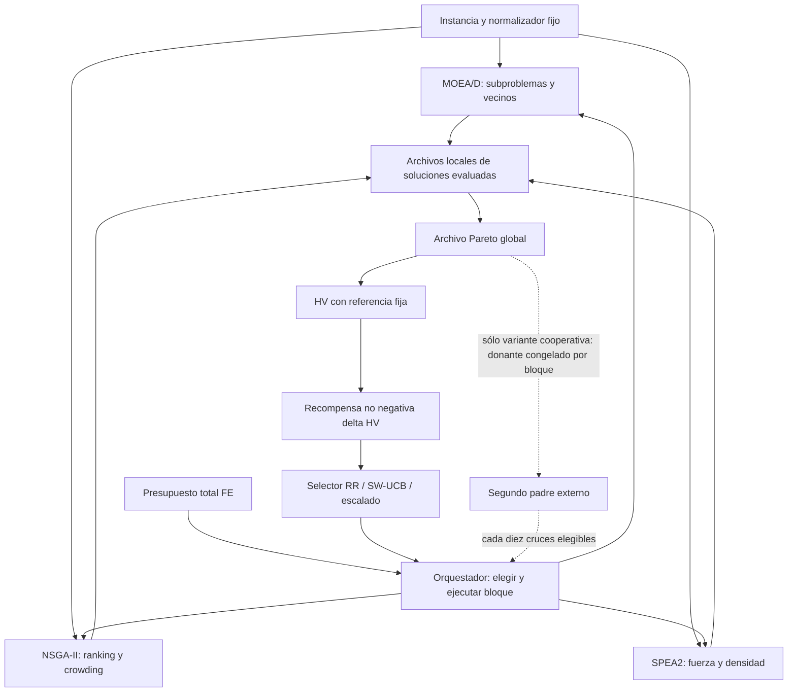

# Arquitectura y definiciones del problema

## Modelo y representación

Cada operación tiene máquina fija, precedencia dentro del trabajo, release y varios modos (duración, energía). El genotipo incluye una secuencia de trabajos con repeticiones y un vector de modos por operación canónica. POX conserva las multiplicidades. El decodificador serial usa:

\[
S_{jk}=\max(C_{j,k-1},a_{M_{jk}},r_{jk}),\qquad C_{jk}=S_{jk}+p_{jkv}.
\]

Esto conserva precedencias, disponibilidad de máquina, releases y ejecución no interrumpida. No hay asignación flexible de máquina en estos datos JSP2. Se minimizan \(C_{max}=\max_j C_j\), \(T=\sum_j\max(0,C_j-d_j)\) y \(E=\sum_o e_{o,v_o}\). El due date del trabajo procede de la última operación en orden tecnológico, no del máximo due date de la fila. La energía implementada suma energías de procesamiento por modo; no se añade un modelo nuevo de energía ociosa. Los archivos no declaran unidades físicas homogéneas: se usan unidades de tiempo y energía de la instancia, sin afirmar kWh.

## Flujo de un bloque y control de FE

```mermaid
flowchart LR
 A[FE remanentes] --> B[Elegir brazo y limitar bloque]
 B --> C[Opcional: preparar donante extranjero]
 C --> D[Reanudar estado del brazo]
 D --> E[Crear hijo factible, decodificar, evaluar]
 E --> F[Contabilizar una FE por evaluación]
 F --> G[Actualizar selección nativa y archivo local]
 G --> H[Unir archivo global y calcular HV]
 H --> J[Registrar delta HV y actualizar selector]
 J --> K[Siguiente bloque o detener]
```

Las poblaciones no se reinicializan al cambiar de brazo. La inicialización consume FE. En la campaña reciente hay tres bloques neutrales de 50 FE y después una prueba adaptativa de un bloque por brazo; warmup no aprende recompensas en el selector. El archivo global informa la selección mediante HV incluso sin transferencia genética. Esa comunicación de crédito no implica que los algoritmos lean sus genotipos.

## Cinco mecanismos diferentes

| Mecanismo | Qué recibe cada algoritmo | Qué cambia |
|---|---|---|
| Unión pasiva | Nada del otro brazo | Sólo salida Pareto global |
| Archivo compartido como indicador | El selector observa HV global | Crédito y asignación |
| Selección adaptativa | Más o menos bloques de ejecución | Profundidad de búsqueda |
| Padre externo | Un genotipo del archivo global | Variación genética |
| PH | Ningún genotipo nuevo | Memoria del selector tras alarma |

Un archivo común no prueba cooperación genética. La unión de individuales usa 3B FE; un portafolio real reparte B FE. Una solución producida tras cruce externo se acredita al receptor que la evalúa. La primera observación no identifica todos sus ancestros.

Fuentes de implementación: `src/mojssp/io.py`, `decoder.py`, `evaluator.py`, `portfolio.py`, `orchestrator.py`, `cooperation.py`; copias y hashes en [evidencia](evidence/preservation_before.json).
