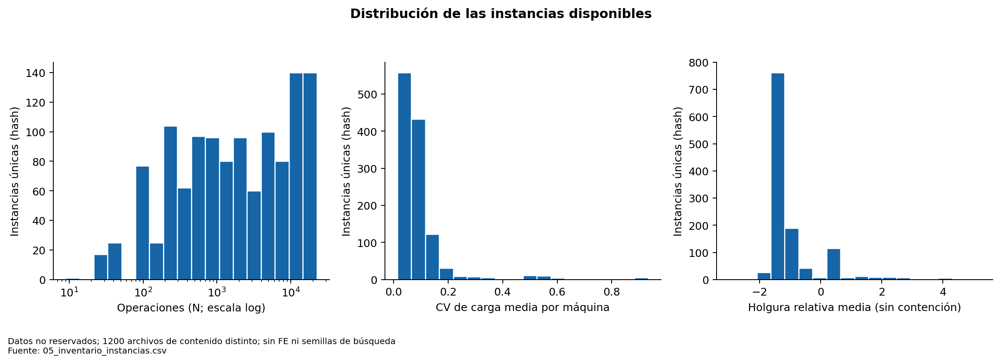
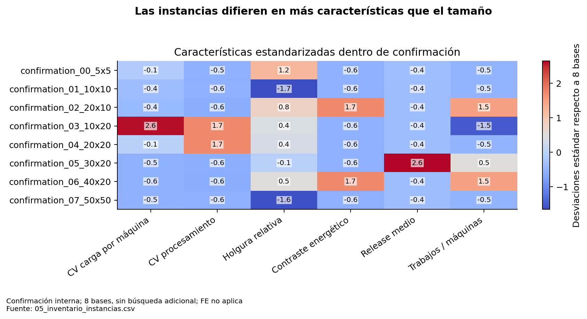
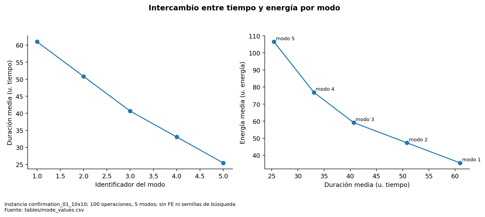

# Inventario completo y características estructurales

Se localizaron **2746 copias .dzn y 1336 contenidos distintos por SHA-256** en datos y directorios de instancias de los cuatro checkouts relacionados. El inventario incluye archivos históricos archivados de hasta **150×150 = 22500 operaciones**, además del conjunto expandido, perfiles f86, variantes pareadas, validación y las 14 bases recientes. Tener un archivo no implica disponer de un resultado experimental para él.

| split | feature_status | n_unique | n_copies |
| --- | --- | --- | --- |
| confirmation | parsed | 8 | 8 |
| development | parsed | 126 | 250 |
| historical_or_unassigned | parsed | 1066 | 2216 |
| holdout_test | reserved_metadata_only | 80 | 160 |
| validation | parse_error | 50 | 100 |
| validation | parsed | 6 | 12 |

El conjunto expandido declara **200 variantes, 40 bases: desarrollo 120 variantes de 24 bases y holdout 80 variantes de 16 bases**. Se inventarían las reservadas con metadatos, sin abrir su contenido para calcular características ni resultados. La campaña reciente añade 6 bases de desarrollo y 8 de confirmación interna. Esas ocho no son el test final. Los archivos sin split explícito se etiquetan `historical_or_unassigned`; no se convierten en confirmación a posteriori.

Hay 50 contenidos con errores de lectura bajo `data/invalid`, preservados sin corregir. No se presume que esos errores fueran generados intencionalmente para pruebas. `parsed` significa que se pudo caracterizar bajo el formato JSP2; no certifica factibilidad de cualquier calendario ni resuelve la instancia. Las copias idénticas comparten una fila y conservan todas las rutas en `copies`. [Detalle por archivo](tables/instance_file_copies.csv), [inventario por contenido](05_inventario_instancias.csv).

## Definiciones calculadas

| Familia | Definición operacional |
|---|---|
| Dimensión | J, M, N=J×M del formato, modos mínimo/máximo, J/M, operaciones por trabajo y máquina |
| Procesamiento | Por operación se promedia duración entre sus modos; media, DE poblacional y CV entre operaciones. Se guardan también media/min/max de todos los modos |
| Cargas | Lₘ=Σₒ∈ₘ promedio de duración por modos; CV(L), max(L)/media(L), vector completo por máquina |
| Concentración | HHI de cantidades de operaciones por máquina, Σ(nₘ/N)²; aquí las rutas completas la fijan en 1/M. El desequilibrio temporal puede variar aunque el conteo sea uniforme |
| Fechas | Estadísticos de releases por operación y due date de última operación tecnológica; finalización aislada más rápida qⱼ por recurrencia max(release,fin previo)+mínimo tiempo |
| Holgura | sⱼ=(dⱼ−qⱼ)/Σmínimo tiempo del trabajo; proporción ajustada sⱼ≤0. Es un criterio explícito y conservador: no incluye contención entre trabajos |
| Energía | Media/CV entre energías medias por operación; razón max/min entre modos; energía del modo más rápido menos la del más lento |
| Conflicto | Correlación de Pearson tiempo–energía **dentro de cada operación**, luego promedio. Evita confundir operaciones grandes con modos rápidos |
| Estructura | Cadena máxima, cargas, holgura, cota inferior/superior de Cmax y energía; descriptores, no demostración de dificultad real |

Cada operación requiere una máquina fija y cada trabajo visita M máquinas en estos datos. La longitud de precedencias es M. El número de modos se documenta, pero es constante (5) en las bases de comparación principales: no puede estimarse su efecto algorítmico con esas corridas.

## Confirmación interna: características reales

| instance | jobs | machines | operations | modes_max | jobs_machines_ratio | processing_cv | machine_load_cv | relative_slack_mean | energy_mode_contrast_mean |
| --- | --- | --- | --- | --- | --- | --- | --- | --- | --- |
| confirmation_00_5x5 | 5.0000 | 5.0000 | 25.0000 | 5.0000 | 1.0000 | 0.2477 | 0.1453 | 0.6204 | 2.9986 |
| confirmation_01_10x10 | 10.0000 | 10.0000 | 100.0000 | 5.0000 | 1.0000 | 0.2370 | 0.0816 | -0.1664 | 2.9960 |
| confirmation_02_20x10 | 20.0000 | 10.0000 | 200.0000 | 5.0000 | 2.0000 | 0.2297 | 0.0681 | 0.5008 | 37.4627 |
| confirmation_03_10x20 | 10.0000 | 20.0000 | 200.0000 | 5.0000 | 0.5000 | 0.8884 | 0.8746 | 0.3972 | 2.9988 |
| confirmation_04_20x20 | 20.0000 | 20.0000 | 400.0000 | 5.0000 | 1.0000 | 0.8876 | 0.1662 | 0.3876 | 2.9995 |
| confirmation_05_30x20 | 30.0000 | 20.0000 | 600.0000 | 5.0000 | 1.5000 | 0.2343 | 0.0336 | 0.2707 | 3.0013 |
| confirmation_06_40x20 | 40.0000 | 20.0000 | 800.0000 | 5.0000 | 2.0000 | 0.2272 | 0.0330 | 0.4352 | 37.5394 |
| confirmation_07_50x50 | 50.0000 | 50.0000 | 2500.0000 | 5.0000 | 1.0000 | 0.2362 | 0.0375 | -0.1525 | 2.9999 |

El lector vectorizado permite caracterizar el archivo histórico grande sin optimizar. Se contrastó con el lector de dominio y sus cotas en bases recientes, históricas y dos de las mayores instancias; los errores numéricos máximos fueron 1.42×10⁻¹⁴. Véase [independent_feature_checks](tables/independent_feature_checks.csv). No se infiere que una mayor carga o un mayor N cause necesariamente menor calidad normalizada.

**Figura 08. Distribución de las instancias disponibles.** Datos no reservados; 1200 archivos de contenido distinto; sin FE ni semillas de búsqueda. Los perfiles derivados están correlacionados; este histograma describe el inventario, no una muestra independiente. Fuente: [05_inventario_instancias.csv](05_inventario_instancias.csv).

**Figura 21. Las instancias difieren en más características que el tamaño.** Confirmación interna; 8 bases, sin búsqueda adicional; FE no aplica. La estandarización sirve para comparar columnas con unidades distintas; no es un índice de dificultad. Fuente: [05_inventario_instancias.csv](05_inventario_instancias.csv).

**Figura 22. Intercambio entre tiempo y energía por modo.** Instancia confirmation_01_10x10; 100 operaciones, 5 modos; sin FE ni semillas de búsqueda. El ejemplo describe modos existentes. El número de modos no varía entre las bases comparadas. Fuente: [tables/mode_values.csv](tables/mode_values.csv).

## Línea paralela y estado externo

Existe además una línea P5/P6 de sensibilidad de c e inyección directa de incumbentes, distinta del padre externo. P7 seguía produciendo resultados durante la auditoría. Se documenta en [apéndice 32](32_linea_paralela_P5_P6_P7.md), con un corte parcial fijo, sin mezclar presupuestos ni incorporarlo como confirmación. El conteo de instancias corresponde al inicio: desapareció externamente `mojssp-dmab - copia`, mientras el repositorio original `mojssp-dmab` y este checkout conservaron su estado. Véase [preservación](00_preservacion_trazabilidad.md).
