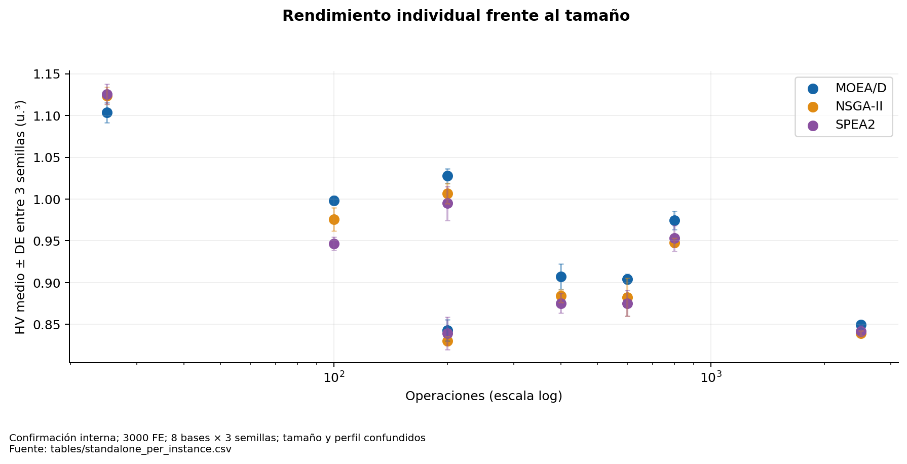
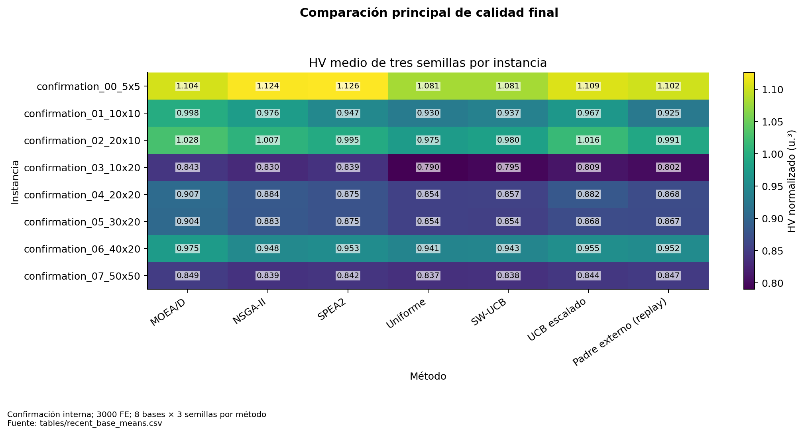

# Qué algoritmo funciona mejor por tamaño

La tabla siguiente compara sólo **confirmación interna reciente a 3000 FE**. Primero se promedian las tres semillas por base. Cada base pesa igual. Los cortes se definieron por el diseño dimensional, sin mirar ganadores.

| size | n_base_clusters | MOEA/D | NSGA-II | SPEA2 | Mayor media |
| --- | --- | --- | --- | --- | --- |
| grande | 3 | 0.909396 | 0.889883 | 0.890158 | MOEA/D |
| mediana | 1 | 0.907217 | 0.884035 | 0.875291 | MOEA/D |
| pequena | 4 | 0.993259 | 0.984074 | 0.976691 | MOEA/D |

MOEA/D tiene mayor HV medio en las tres categorías. Esto no demuestra una especialización universal: pequeña contiene cuatro bases heterogéneas; mediana sólo una; grande tres. En la menor base individual (5×5), SPEA2 obtiene la mayor media y NSGA-II también supera a MOEA/D. En las otras siete gana MOEA/D. La agrupación “pequeña” oculta esa excepción.

## Instancias y ganadores exactos

| instance | operations | n_seeds | MOEA/D | NSGA-II | SPEA2 | winner |
| --- | --- | --- | --- | --- | --- | --- |
| confirmation_00_5x5 | 25 | 3 | 1.103784 | 1.123806 | 1.125785 | SPEA2 |
| confirmation_01_10x10 | 100 | 3 | 0.998454 | 0.975746 | 0.946627 | MOEA/D |
| confirmation_02_20x10 | 200 | 3 | 1.027626 | 1.006583 | 0.995092 | MOEA/D |
| confirmation_03_10x20 | 200 | 3 | 0.843175 | 0.830160 | 0.839260 | MOEA/D |
| confirmation_04_20x20 | 400 | 3 | 0.907217 | 0.884035 | 0.875291 | MOEA/D |
| confirmation_05_30x20 | 600 | 3 | 0.904203 | 0.882655 | 0.875301 | MOEA/D |
| confirmation_06_40x20 | 800 | 3 | 0.974641 | 0.947817 | 0.953246 | MOEA/D |
| confirmation_07_50x50 | 2500 | 3 | 0.849344 | 0.839176 | 0.841927 | MOEA/D |

## Diferencias históricas que no deben ocultarse

En Fase 1, con 1000 FE y ocho bases por cinco perfiles, NSGA-II presenta ventajas medias en ciertas geometrías intermedias-altas. El presupuesto, las semillas y las bases son otros. No corresponde sumar esas filas a la confirmación de 3000 FE ni concluir que un algoritmo “dejó de especializarse”. El [archivo de ganadores](tables/best_algorithm_by_instance.csv) contiene todas las campañas compatibles por separado; [algorithm_by_size](tables/algorithm_by_size.csv) muestra tamaños de muestra, media, DE e intervalos.

Las desviaciones de las semillas en la figura describen variación estocástica de esa base. No representan incertidumbre sobre todas las instancias de igual dimensión. Harían falta varias bases independientes por geometría y perfiles cruzados para esa afirmación.

**Figura 09. Rendimiento individual frente al tamaño.** Confirmación interna; 3000 FE; 8 bases × 3 semillas; tamaño y perfil confundidos. Hay dos geometrías con 200 operaciones. No se ajusta una regla de especialización a ocho observaciones. Fuente: [tables/standalone_per_instance.csv](tables/standalone_per_instance.csv).

**Figura 01. Comparación principal de calidad final.** Confirmación interna; 3000 FE; 8 bases × 3 semillas por método. Las filas muestran heterogeneidad entre bases. El HV absoluto no mide dificultad universal. Fuente: [tables/recent_base_means.csv](tables/recent_base_means.csv).
