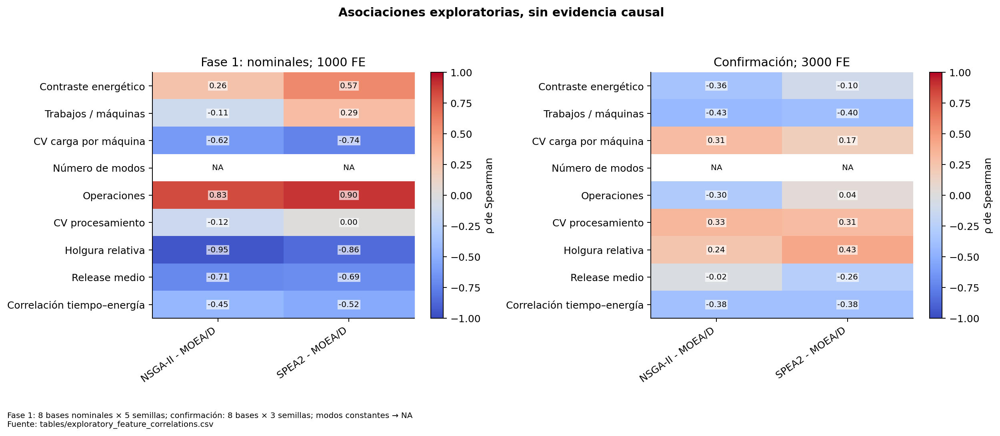
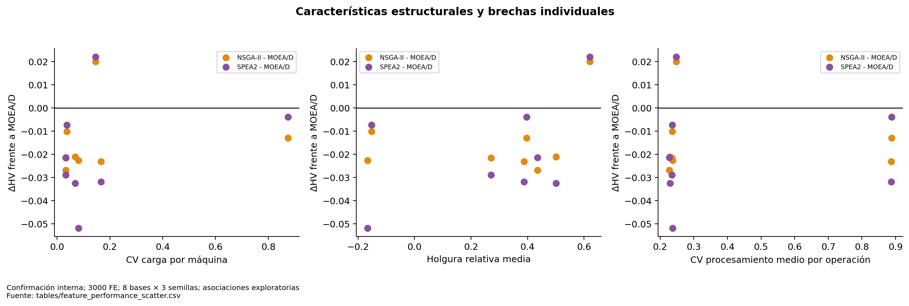

# Rendimiento y características de instancia

Se estudió la diferencia HV(NSGA-II o SPEA2) − HV(MOEA/D), no sólo el HV absoluto. Las correlaciones de Spearman usan medias de semillas por base; Fase 1 restringe este análisis a los ocho perfiles nominales para no presentar 40 variantes correlacionadas como independientes. Se conservan separadas las campañas y los presupuestos. No se ajusta un modelo de nueve predictores con ocho observaciones.

Los descriptores incluyen operaciones, J/M, CV de carga por máquina, holgura, CV de procesamiento, contraste energético, releases y correlación tiempo–energía. El número de modos es constante y se marca no estimable. Las correlaciones son exploratorias sin pruebas de selección de variables ni reivindicación causal.

## Contrastes emparejados de perfiles históricos

Fase 1 permite comparar cada tratamiento con su propia base nominal. Para separar el cambio de rendimiento relativo se calcula:

Δrel=(HV_alg−HV_MOEAD)_perfil−(HV_alg−HV_MOEAD)_base.

Se promedian cinco semillas antes de calcular diferencias entre las ocho bases. Se corrigen conjuntamente ocho contrastes (4 perfiles × 2 algoritmos). Esto controla dependencia de variantes, pero no convierte los cambios de HV entre instancias normalizadas de forma distinta en pérdida física de tiempo o energía.

| profile | contrast | n_base_clusters | mean_delta | ci_low | ci_high | wins | losses | p_signflip | p_holm |
| --- | --- | --- | --- | --- | --- | --- | --- | --- | --- |
| tard_med | NSGA-II - MOEA/D | 8 | -0.000422 | -0.003165 | 0.002698 | 3 | 5 | 0.781250 | 1.000000 |
| tard_med | SPEA2 - MOEA/D | 8 | 0.001398 | -0.002293 | 0.004927 | 4 | 4 | 0.500000 | 1.000000 |
| tard_high | NSGA-II - MOEA/D | 8 | 0.002615 | -0.000813 | 0.006336 | 5 | 3 | 0.234375 | 1.000000 |
| tard_high | SPEA2 - MOEA/D | 8 | 0.004573 | -0.001809 | 0.011028 | 5 | 3 | 0.203125 | 1.000000 |
| nrg_strong | NSGA-II - MOEA/D | 8 | 0.011700 | 0.003337 | 0.023105 | 6 | 2 | 0.031250 | 0.187500 |
| nrg_strong | SPEA2 - MOEA/D | 8 | 0.008058 | -0.002689 | 0.023600 | 5 | 3 | 0.351562 | 1.000000 |
| btnk_high | NSGA-II - MOEA/D | 8 | 0.014506 | 0.008054 | 0.021239 | 8 | 0 | 0.007812 | 0.062500 |
| btnk_high | SPEA2 - MOEA/D | 8 | 0.013489 | 0.006127 | 0.020936 | 7 | 1 | 0.015625 | 0.109375 |

El cuello de botella aumenta la ventaja relativa de NSGA-II frente a MOEA/D en las ocho bases (+0.014506 HV medio), señal consistente. Tras Holm sobre ocho contrastes, p=.0625: merece contraste dirigido, no una regla confirmada de especialización. El perfil energético fuerte también muestra una señal nominal para NSGA-II, debilitada al corregir multiplicidad. Los cambios de fechas tienen incertidumbre que incluye cero en estos contrastes relativos.

En la campaña reciente tamaño y perfil se asignan juntos: 20×10 con energía fuerte, 10×20 con cuello de botella, 20×20 con duración variable y 30×20 con releases altos. Una correlación no identifica cuál de ellos explica la diferencia. Además, las cotas analíticas modifican la escala entre perfiles. Los mismos métodos sí comparten normalización dentro de cada instancia.

Fuentes: [profile_relative_effects_by_base](tables/profile_relative_effects_by_base.csv), [exploratory_feature_correlations](tables/exploratory_feature_correlations.csv), [feature_performance_scatter](tables/feature_performance_scatter.csv).

**Figura 14. Asociaciones exploratorias, sin evidencia causal.** Fase 1: 8 bases nominales × 5 semillas; confirmación: 8 bases × 3 semillas; modos constantes → NA. Las diferencias entre campañas y perfiles impiden usar estas correlaciones como un selector entrenado. Fuente: [tables/exploratory_feature_correlations.csv](tables/exploratory_feature_correlations.csv).

**Figura 18. Características estructurales y brechas individuales.** Confirmación interna; 3000 FE; 8 bases × 3 semillas; asociaciones exploratorias. Tamaño, perfil y configuración del generador no están cruzados factorialmente en esta campaña. Fuente: [tables/feature_performance_scatter.csv](tables/feature_performance_scatter.csv).
