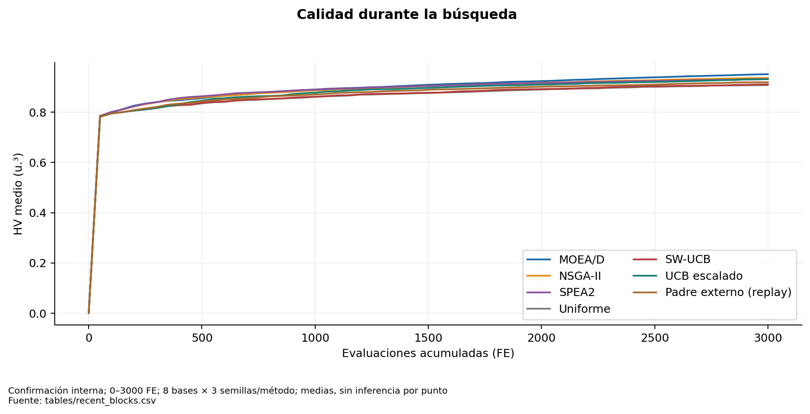
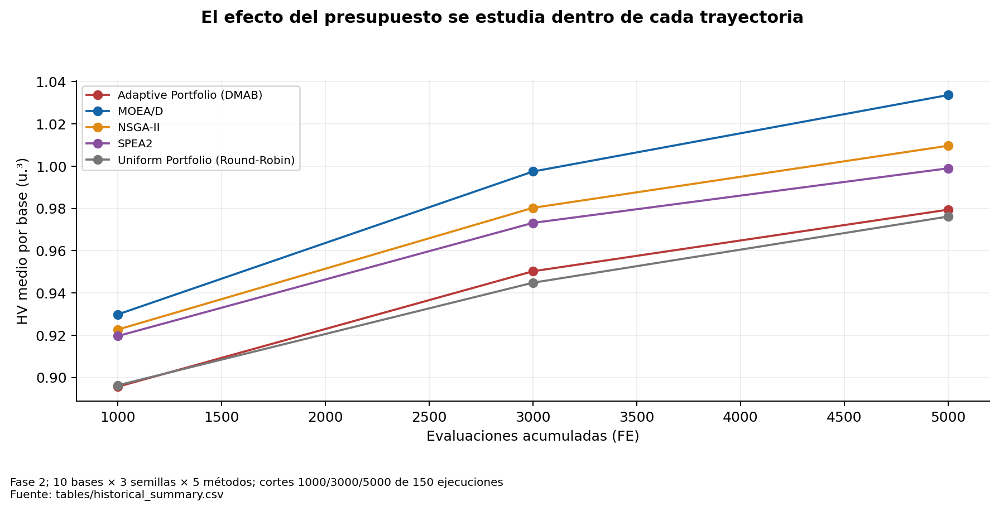

# Comparación integral por condiciones compatibles

## Comparación principal: confirmación reciente

3000 FE por ejecución, población 30, bloques 50, ocho bases nuevas y tres semillas por base. Media con peso igual por base. El padre externo usa una asignación obtenida de otra ejecución: la tabla muestra el coste del tratamiento, no el del par control+tratamiento.

| Método | HV | AUC-HV | Tiempo (s) | Vectores únicos | Diversidad genética |
| --- | --- | --- | --- | --- | --- |
| SW-UCB original | 0.910688 | 0.863775 | 10.669425 | 33.416667 | 0.522403 |
| Padre externo con replay | 0.919227 | 0.871660 | 11.159364 | 36.333333 | 0.584256 |
| MOEA/D | 0.951055 | 0.892458 | 10.342937 | 42.000000 | 0.410422 |
| NSGA-II | 0.936247 | 0.887201 | 11.093345 | 39.208333 | 0.510718 |
| UCB escalado | 0.931368 | 0.878448 | 10.825721 | 40.000000 | 0.582817 |
| SPEA2 | 0.931566 | 0.887347 | 10.658174 | 40.041667 | 0.498004 |
| Uniforme | 0.907719 | 0.862234 | 10.723841 | 34.625000 | 0.522602 |

MOEA/D lidera HV y AUC medios. Escalado mejora el portafolio original y uniforme, pero no supera en promedio a los tres individuales. NSGA-II y SPEA2 también tienen AUC media mayor que escalado. La diversidad genética más alta del portafolio no compensa automáticamente esa brecha de calidad.

## Diagnóstico histórico, sin mezclar presupuestos

| budget | method | n_base_clusters | mean_hv | sd_hv | mean_seconds |
| --- | --- | --- | --- | --- | --- |
| 1000 | Adaptive Portfolio (DMAB) | 10 | 0.895674 | 0.080687 | 2.847333 |
| 1000 | MOEA/D | 10 | 0.929894 | 0.095252 | 2.554326 |
| 1000 | NSGA-II | 10 | 0.922717 | 0.088311 | 2.746716 |
| 1000 | SPEA2 | 10 | 0.919666 | 0.086333 | 2.822224 |
| 1000 | Uniform Portfolio (Round-Robin) | 10 | 0.896374 | 0.082811 | 2.842687 |
| 3000 | Adaptive Portfolio (DMAB) | 10 | 0.950298 | 0.101235 | 8.966583 |
| 3000 | MOEA/D | 10 | 0.997476 | 0.104116 | 8.086690 |
| 3000 | NSGA-II | 10 | 0.980304 | 0.112566 | 8.603693 |
| 3000 | SPEA2 | 10 | 0.973181 | 0.106626 | 8.957935 |
| 3000 | Uniform Portfolio (Round-Robin) | 10 | 0.944871 | 0.099915 | 8.988331 |
| 5000 | Adaptive Portfolio (DMAB) | 10 | 0.979420 | 0.105080 | 15.348296 |
| 5000 | MOEA/D | 10 | 1.033652 | 0.098234 | 13.911648 |
| 5000 | NSGA-II | 10 | 1.009661 | 0.115866 | 14.685187 |
| 5000 | SPEA2 | 10 | 0.998988 | 0.111839 | 15.332571 |
| 5000 | Uniform Portfolio (Round-Robin) | 10 | 0.976170 | 0.104618 | 15.389468 |

La ventaja de MOEA/D histórico respecto al portafolio original no desaparece al pasar de 1000 a 5000 FE. Eso contradice una explicación basada exclusivamente en arranque: puede influir profundidad, asignación o complementariedad insuficiente. No identifica por sí solo sus causas.

Las otras cohortes (benchmark técnico, Fase 1, PH y versiones F8) se publican en [historical_summary](tables/historical_summary.csv), con su presupuesto y composición. Los métodos de PH no comparten las variantes de perfil ni todas las semillas con Fase 2. No se integran como si sus HV medios midieran un mismo ensayo. Tampoco hay una campaña reciente de 10000 FE que permita concluir superioridad a ese presupuesto.

## Métricas disponibles y límites

HV, FE, archivo y tiempo existen en cohortes principales. AUC reciente se recalculó con los 60 bloques. Los rangos y distancias en objetivos, y las distancias genéticas finales, son diagnósticos diferentes. Los archivos históricos guardan vectores pero no todos los genotipos ni poblaciones. No se completa con números inventados la diversidad genotípica histórica.

Las tablas de medias, medianas, DE, IC y contrastes están en [recent_summary](tables/recent_summary.csv), [recent_paired_statistics](tables/recent_paired_statistics.csv) y [exploratory_all_pairwise](tables/exploratory_all_pairwise.csv). El conjunto principal es confirmación interna; resultados de desarrollo y perfiles son exploratorios.

**Figura 03. Calidad durante la búsqueda.** Confirmación interna; 0–3000 FE; 8 bases × 3 semillas/método; medias, sin inferencia por punto. Las trayectorias proceden de registros cada 50 FE; el origen (0,0) forma parte de AUC. Fuente: [tables/recent_blocks.csv](tables/recent_blocks.csv).

**Figura 13. El efecto del presupuesto se estudia dentro de cada trayectoria.** Fase 2; 10 bases × 3 semillas × 5 métodos; cortes 1000/3000/5000 de 150 ejecuciones. No tratar 450 cortes como ejecuciones independientes. El piloto de 1000 FE tampoco es una réplica nueva de calidad. Fuente: [tables/historical_summary.csv](tables/historical_summary.csv).

## Línea paralela y estado externo

Existe además una línea P5/P6 de sensibilidad de c e inyección directa de incumbentes, distinta del padre externo. P7 seguía produciendo resultados durante la auditoría. Se documenta en [apéndice 32](32_linea_paralela_P5_P6_P7.md), con un corte parcial fijo, sin mezclar presupuestos ni incorporarlo como confirmación. El conteo de instancias corresponde al inicio: desapareció externamente `mojssp-dmab - copia`, mientras el repositorio original `mojssp-dmab` y este checkout conservaron su estado. Véase [preservación](00_preservacion_trazabilidad.md).

## AUC histórica reconstruida

Se integraron los checkpoints de 50 FE de las 150 trayectorias continuas, desde (0,0), por separado para cada presupuesto. Las filas no son réplicas nuevas y conservan redondeo de origen de los checkpoints.

| budget | algorithm | auc_hv |
| --- | --- | --- |
| 1000 | Adaptive Portfolio (DMAB) | 0.838271 |
| 1000 | MOEA/D | 0.867423 |
| 1000 | NSGA-II | 0.859945 |
| 1000 | SPEA2 | 0.858296 |
| 1000 | Uniform Portfolio (Round-Robin) | 0.836935 |
| 3000 | Adaptive Portfolio (DMAB) | 0.896678 |
| 3000 | MOEA/D | 0.934454 |
| 3000 | NSGA-II | 0.924389 |
| 3000 | SPEA2 | 0.920384 |
| 3000 | Uniform Portfolio (Round-Robin) | 0.894801 |
| 5000 | Adaptive Portfolio (DMAB) | 0.923650 |
| 5000 | MOEA/D | 0.967475 |
| 5000 | NSGA-II | 0.952769 |
| 5000 | SPEA2 | 0.947258 |
| 5000 | Uniform Portfolio (Round-Robin) | 0.921416 |

Fuente: [historical_auc_recomputed.csv](tables/historical_auc_recomputed.csv).
