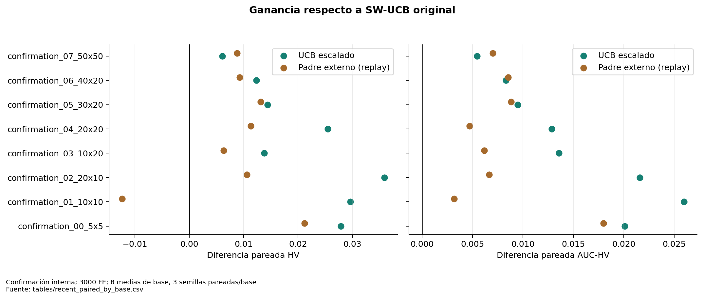

# Estadística, incertidumbre y unidad de análisis

La unidad independiente es la **base de instancia**. Se promedian semillas dentro de base; en Fase 1 también perfiles al comparar rendimiento global. Sus 600 corridas equivalen a ocho clústeres independientes, no 600 bases. En confirmación reciente n=8 con 24 corridas por método; en desarrollo n=6. Fase 2 tiene n=10, 150 trayectorias, 450 cortes dependientes.

## Familia principal predefinida

Dos candidatos frente a SW-UCB en HV final de confirmación, Holm de dos pruebas. Se recalculan diferencias pareadas, bootstrap de bases (20000 remuestreos, semilla analítica 20261016), prueba exacta de inversión de signos de la media (2⁸), victorias/empates/derrotas y dᶻ.

| treatment | n_bases | mean_delta | ci_low | ci_high | p_signflip | p_holm_confirmatory_hv | wins | losses | cohen_dz |
| --- | --- | --- | --- | --- | --- | --- | --- | --- | --- |
| scaled | 8 | 0.020680 | 0.014084 | 0.027370 | 0.007812 | 0.015625 | 8 | 0 | 1.994887 |
| guidance | 8 | 0.008539 | 0.001655 | 0.013961 | 0.054688 | 0.054688 | 7 | 1 | 0.898190 |

El escalado presenta ΔHV=+0.020680 e IC positivo, con p ajustado .015625. El padre externo tiene ΔHV=+0.008539 e IC bootstrap positivo, pero p ajustado .054688. No se elige la prueba que produzca “significativo”: sus distintos resultados se muestran juntos. La prueba de signos sin magnitudes para guía da .070312, frente a .054688 de inversión de signos de la media.

La prueba de inversión de signos exige intercambiabilidad/simetría bajo la hipótesis nula; no es idéntica al test binomial de signos ni prueba causal por sí sola. dᶻ divide por la DE de diferencias entre bases y puede ser inestable con n pequeño. Los IC bootstrap son aproximados, condicionados a la colección de bases y no simultáneos. Los IC descriptivos de HV absoluto mezclan estructura y escala de normalización; para cambios convienen IC de diferencias pareadas.

## Análisis secundarios y exploratorios

AUC, tiempo, archivo y diversidad se reportan como secundarios con sus IC; no se declararon todos confirmatorios al 5%. Se incluyen Friedman exploratorio y comparaciones por pares con Holm **por cohorte y presupuesto** en [omnibus_tests](tables/omnibus_tests.csv) y [exploratory_all_pairwise](tables/exploratory_all_pairwise.csv). Un omnibus significativo no demuestra que cada método sea mejor que todos los demás. Los contrastes de ocho perfiles relativos tienen su propia familia de ocho pruebas en [profile_relative_effects](tables/profile_relative_effects.csv).

Las p de Wilcoxon calculadas con SciPy pueden usar métodos distintos en presencia de ceros/empates; la tabla conserva además el contraste exacto de inversión de signos. Las p históricas de PH documentadas (.146484, .320312, .578125 tras Holm) se citan como análisis histórico, no como una nueva confirmación. No confundir ausencia de significación con equivalencia.

No se realizó metaanálisis de campañas, selección de variables ni ajuste del portafolio. La nueva semilla de bootstrap puede cambiar ligeramente los límites frente al informe del día 15 sin cambiar los resultados crudos. Los intervalos de una categoría con una sola base son degenerados y **no estiman** incertidumbre entre bases.

**Figura 02. Ganancia respecto a SW-UCB original.** Confirmación interna; 3000 FE; 8 medias de base, 3 semillas pareadas/base. Escalado mejora HV y AUC en las ocho bases; padre externo pierde HV en una. Fuente: [tables/recent_paired_by_base.csv](tables/recent_paired_by_base.csv).
