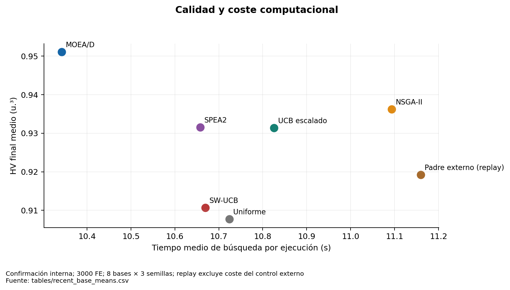
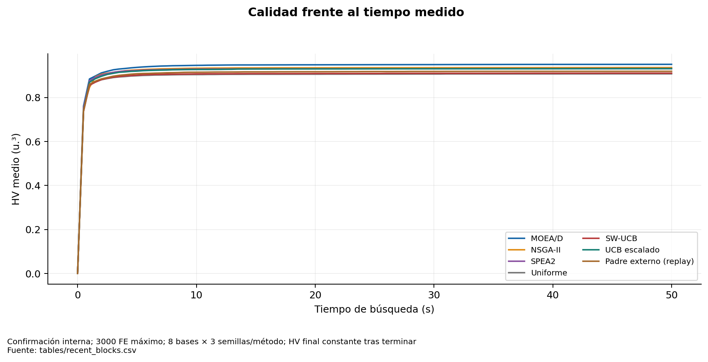

# Coste computacional y rendimiento por presupuesto

## Calidad y tiempo a 3000 FE

| Método | HV | AUC-HV | Tiempo (s) |
| --- | --- | --- | --- |
| SW-UCB original | 0.910688 | 0.863775 | 10.669425 |
| Padre externo con replay | 0.919227 | 0.871660 | 11.159364 |
| MOEA/D | 0.951055 | 0.892458 | 10.342937 |
| NSGA-II | 0.936247 | 0.887201 | 11.093345 |
| UCB escalado | 0.931368 | 0.878448 | 10.825721 |
| SPEA2 | 0.931566 | 0.887347 | 10.658174 |
| Uniforme | 0.907719 | 0.862234 | 10.723841 |

Frente a SW-UCB original, escalado aumenta el tiempo medio de búsqueda un **1.46%** y padre externo un **4.59%**, usando el cociente de medias. No son porcentajes medios por instancia ni medidas aisladas de overhead. En 5×5, escalado aumenta el tiempo **37.8%**: la condición global de coste no garantiza una mejora temporal en todas las bases. Los tiempos no son un benchmark de hardware portátil y los datos previos se midieron en otro contexto temporal.

## FE para alcanzar el HV final del control original

| method | reached | runs | mean_capped_FE | mean_capped_seconds |
| --- | --- | --- | --- | --- |
| adaptive | 24 | 24 | 2972.916667 | 10.634409 |
| guidance | 19 | 24 | 2262.500000 | 7.568149 |
| moead | 24 | 24 | 1622.916667 | 6.105859 |
| nsga2 | 22 | 24 | 1895.833333 | 8.188654 |
| scaled | 22 | 24 | 2062.500000 | 7.205376 |
| spea2 | 20 | 24 | 1841.666667 | 6.658151 |
| uniform | 3 | 24 | 2993.750000 | 10.707555 |

El escalado alcanza el objetivo pareado en 22/24 ejecuciones. La media de FE truncada a 3000 es 2062.5, pero los dos casos que no llegan están censurados. No significa que todos alcancen el objetivo en ese presupuesto ni que exista un ahorro garantizado. La comparación completa está en [threshold_baseline_final_hv](tables/threshold_baseline_final_hv.csv); conservar tasa de éxito y distribución, no sólo media truncada.

El tratamiento de padre externo cuesta 3000 FE, pero obtener la asignación SW-UCB específica requiere otras 3000 FE desde cero. Si se presenta como procedimiento completo, son 6000 FE y suma de ambos tiempos. La comparación con control de replay es causal para el cambio de variación condicionado a esa asignación; no prueba eficiencia total de una política autónoma de 3000 FE.

No hay cronómetros separados que permitan atribuir exactamente segundos a selección, normalización, archivo, donante y selección ambiental. `block_seconds` incluye la ejecución del brazo; `elapsed` captura el proceso de búsqueda. Se reporta el tiempo total y se evita deducir overhead mediante diferencias entre algoritmos con frentes de distinto tamaño.

La auditoría actual consume **0 FE de optimización**. Recalcular HV desde objetivos guardados no busca soluciones. El informe original contabiliza 936000 FE de tratamientos, 15000 de reproducción y auditorías por separado; estos costes no se vuelven a cargar como nuevas corridas.

**Figura 04. Calidad y coste computacional.** Confirmación interna; 3000 FE; 8 bases × 3 semillas; replay excluye coste del control externo. El tiempo incluye algoritmos y gestión online; no permite aislar el coste del selector. Fuente: [tables/recent_base_means.csv](tables/recent_base_means.csv).

**Figura 23. Calidad frente al tiempo medido.** Confirmación interna; 3000 FE máximo; 8 bases × 3 semillas/método; HV final constante tras terminar. Se conserva el último HV al concluir cada corrida: no se extrapolan mejoras ni se promedian sólo las ejecuciones lentas. Fuente: [tables/recent_blocks.csv](tables/recent_blocks.csv).
