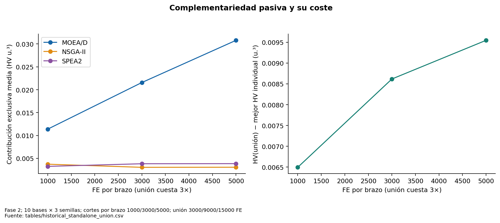

# Complementariedad observada y beneficio real

**Sí existe complementariedad geométrica observada. No se ha demostrado que baste para compensar el presupuesto dividido.** Los archivos de los tres algoritmos contienen soluciones diferentes; la unión mejora el HV del mejor archivo aislado en muchos casos. Sin embargo, esa unión compara tres búsquedas completas y cuesta tres veces el presupuesto de cada una.

## Medida canónica

Sea Aᵢ el archivo completo guardado de cada brazo y U=ND(∪Aᵢ). La contribución exclusiva es

MCᵢ = HV(U) − HV(ND(∪ⱼ≠ᵢ Aⱼ)).

Al retirar i, se recuperan las soluciones de otros archivos que estaban dominadas por él. Restar sus puntos del frente U ya filtrado pierde esos sustitutos y sobreestima MCᵢ. Se detectó ese defecto en el cierre histórico; los resultados originales no se modificaron aquí. El recálculo actual coincide con la tabla histórica canónica.

| FE_per_arm | arm | contribucion_exclusiva | ganancia_union |
| --- | --- | --- | --- |
| 1000 | MOEA/D | 0.011384 | 0.006493 |
| 1000 | NSGA-II | 0.003728 | 0.006493 |
| 1000 | SPEA2 | 0.003252 | 0.006493 |
| 3000 | MOEA/D | 0.021573 | 0.008617 |
| 3000 | NSGA-II | 0.003043 | 0.008617 |
| 3000 | SPEA2 | 0.003826 | 0.008617 |
| 5000 | MOEA/D | 0.030796 | 0.009547 |
| 5000 | NSGA-II | 0.003065 | 0.009547 |
| 5000 | SPEA2 | 0.003849 | 0.009547 |

A 5000 FE por individual (15000 para la unión), los aportes exclusivos medios son aproximadamente .030796, .003065 y .003849 para MOEA/D, NSGA-II y SPEA2. La ganancia de unión sobre el mejor individual a ese B es .009547. Estos números no son un beneficio gratuito de un portafolio de 5000 FE. Tampoco se suman los MC como HV total: el volumen cubierto en común permanece sin asignación exclusiva.

En el portafolio reciente se calcula la misma eliminación sobre los archivos locales **realmente obtenidos bajo su asignación**. El valor no predice qué pasaría si se retirara un algoritmo y se reasignaran sus FE: es un contrafactual geométrico, no una ablación de búsqueda. La complementariedad puede variar al cambiar cuánto ejecuta cada brazo.

## Cuatro afirmaciones distintas

| Concepto | Evidencia actual |
|---|---|
| Complementariedad observada | Archivos y HV exclusivos positivos, heterogéneos por base |
| Especialización regional | Ejemplos y descriptores de regiones; falta persistencia por semillas y bases |
| Especialización por tipo | Señales de perfiles; insuficiente validación independiente |
| Beneficio del portafolio | Escalado mejora su control, pero los individuales siguen siendo referencias más fuertes |

En los 42 pares recientes, el uniforme a 3000 FE equivale a la unión de los tres flujos individuales a 1000 FE con semillas alineadas, según la auditoría conservada. Es una demostración de agregación pasiva, no de cooperación activa.

Fuentes: [historical_standalone_union](tables/historical_standalone_union.csv), [recent_complementarity](tables/recent_complementarity.csv), [corrección histórica](../pareto_cooperation_research/metrics_correction_report.md).

**Figura 20. Complementariedad pasiva y su coste.** Fase 2; 10 bases × 3 semillas; cortes por brazo 1000/3000/5000; unión 3000/9000/15000 FE. Ganancia de unión positiva no demuestra que un portafolio gane al mejor individual a igual FE total. Fuente: [tables/historical_standalone_union.csv](tables/historical_standalone_union.csv).

## Línea paralela y estado externo

Existe además una línea P5/P6 de sensibilidad de c e inyección directa de incumbentes, distinta del padre externo. P7 seguía produciendo resultados durante la auditoría. Se documenta en [apéndice 32](32_linea_paralela_P5_P6_P7.md), con un corte parcial fijo, sin mezclar presupuestos ni incorporarlo como confirmación. El conteo de instancias corresponde al inicio: desapareció externamente `mojssp-dmab - copia`, mientras el repositorio original `mojssp-dmab` y este checkout conservaron su estado. Véase [preservación](00_preservacion_trazabilidad.md).
