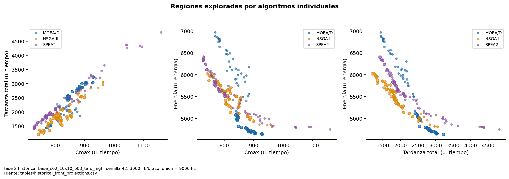
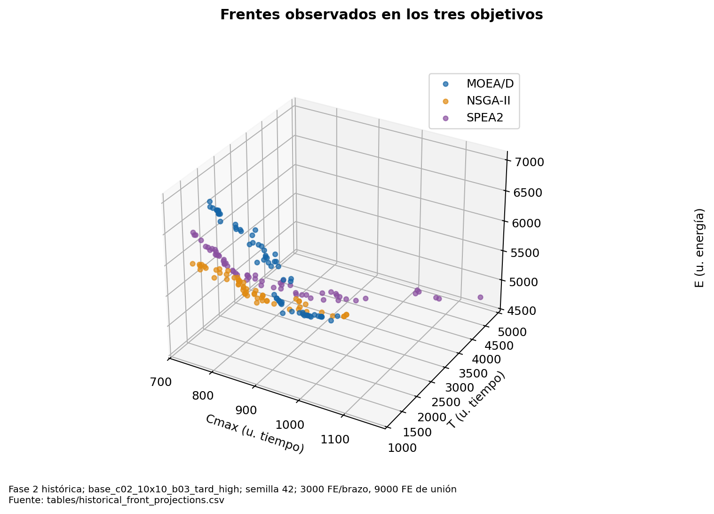
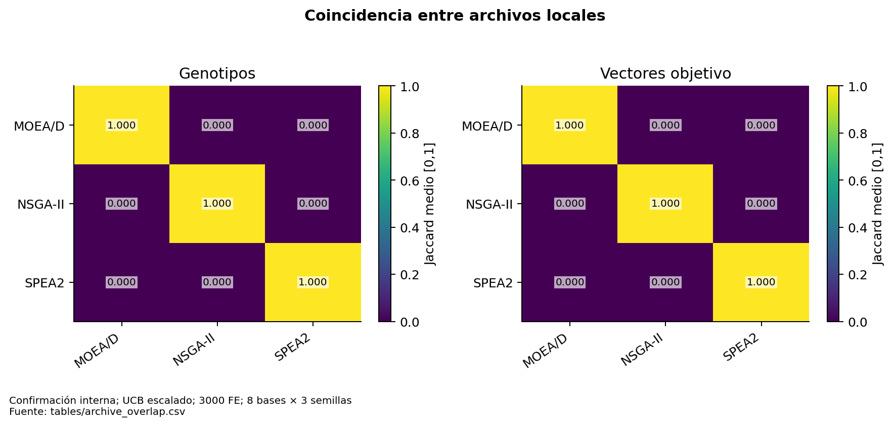

# Regiones del espacio objetivo y diversidad

Se muestran frentes **observados**, no el Pareto óptimo verdadero. Las proyecciones 2D pueden ocultar dominancia en la tercera coordenada. Un punto extremo en Cmax puede empeorar E; una nube visualmente más amplia puede añadir muy poco HV exclusivo.

Las figuras ilustrativas usan la base histórica `base_c02_10x10_b03_tard_high`, semilla 42, 3000 FE por individual. Se eligió una base histórica identificada, no un gráfico agregado de objetivos de instancias incompatibles. La unión cuesta 9000 FE. El CSV conserva valores físicos de instancia y normalizados, algoritmo y pertenencia al ND conjunto.

**Figura 07. Regiones exploradas por algoritmos individuales.** Fase 2 histórica; base_c02_10x10_b03_tard_high; semilla 42; 3000 FE/brazo, unión = 9000 FE. Círculos huecos: soluciones que sobreviven en la unión. Ejemplo ilustrativo, no generalización. Fuente: [tables/historical_front_projections.csv](tables/historical_front_projections.csv).

**Figura 19. Frentes observados en los tres objetivos.** Fase 2 histórica; base_c02_10x10_b03_tard_high; semilla 42; 3000 FE/brazo, 9000 FE de unión. No se conoce el frente Pareto óptimo. Esta visualización compara aproximaciones evaluadas. Fuente: [tables/historical_front_projections.csv](tables/historical_front_projections.csv).

La diversidad en objetivos se describe mediante número de vectores distintos, rango por objetivo y distancia euclidiana media al vecino más cercano tras normalizar. El rango no mide cobertura uniforme ni convergencia. NN puede aumentar por dispersión o por pérdida de puntos; disminuir por mayor densidad útil o por concentración. Se debe leer junto con HV y cardinalidad, no etiquetar automáticamente “mayor NN = mejor”.

La diversidad genética registrada es la media de distancias entre pares de la población interna de cada brazo: fracción de posiciones distintas en secuencia y modos, promediadas con peso 1/2. Se promedia por brazo en la campaña. Las poblaciones internas de MOEA/D, NSGA-II y SPEA2 tienen semánticas de selección distintas. El número mide dispersión genotípica, no diversidad de calendarios fenotípicamente distintos: dos genotipos pueden decodificar de manera similar.

Los archivos finales sí permiten volver a calcular solapamiento exacto genotípico/objetivo. No permiten reconstruir toda la población usada para la diversidad registrada ni todos los hijos evaluados y descartados; reproducirlos exigiría nuevas corridas, excluidas de esta tarea. Los descriptores de rango por base están en [objective_ranges](tables/objective_ranges.csv) y los frentes en [recent_final_fronts](tables/recent_final_fronts.csv).

No se ha identificado una región que pertenezca establemente a un algoritmo para todas las bases o perfiles. Para demostrarlo se necesita definir regiones antes del contraste, estimar ocupación y aporte exclusivo por base/semilla y comprobar persistencia, controlando FE. Los gráficos actuales fundamentan exploración, no esa generalización.

**Figura 16. Coincidencia entre archivos locales.** Confirmación interna; UCB escalado; 3000 FE; 8 bases × 3 semillas. Jaccard exacto bajo no implica cobertura volumétrica distinta: puntos diferentes pueden dominar regiones parecidas. Fuente: [tables/archive_overlap.csv](tables/archive_overlap.csv).
