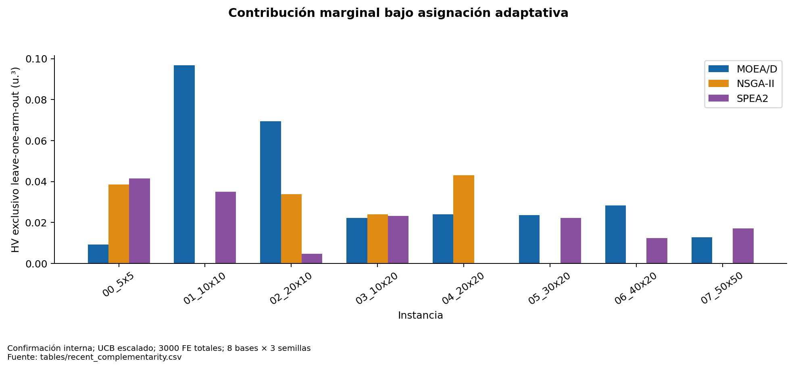

# Aporte exclusivo, procedencia y solapamiento

Las siguientes medias usan ocho bases y tres semillas de confirmación a 3000 FE totales. Los archivos locales contienen los resultados de cada receptor bajo la asignación ejecutada. Un genotipo presente en dos archivos cuenta como compartido y la eliminación de un brazo conserva la copia del otro.

| method | arm | MC | genotipos_exclusivos_ND | compartidos |
| --- | --- | --- | --- | --- |
| adaptive | MOEA/D | 0.010419 | 14.083333 | 0.000000 |
| adaptive | NSGA-II | 0.005540 | 9.041667 | 0.000000 |
| adaptive | SPEA2 | 0.006183 | 11.250000 | 0.000000 |
| guidance | MOEA/D | 0.003979 | 17.208333 | 0.000000 |
| guidance | NSGA-II | 0.003482 | 8.791667 | 0.000000 |
| guidance | SPEA2 | 0.002996 | 11.250000 | 0.000000 |
| scaled | MOEA/D | 0.035772 | 18.250000 | 0.000000 |
| scaled | NSGA-II | 0.017451 | 10.083333 | 0.000000 |
| scaled | SPEA2 | 0.019510 | 13.708333 | 0.000000 |

No se equipara el brazo receptor con origen genético completo. `first_observed_final` es el primer brazo en cuyo archivo se observó el genotipo durante el registro por bloques; no captura todos los hijos descartados ni su genealogía. `guidance_events` identifica receptor, donante y padre nativo sustituido. Un hijo del donante puede tener crédito de generación del receptor y ascendencia de otro brazo. Son datos distintos.

El recálculo offline de todos los MC recientes discrepa de los valores guardados como máximo 4.44×10⁻¹⁶. El Jaccard exacto por genotipos y vectores se publica por par de brazos en [archive_overlap](tables/archive_overlap.csv). Cero coincidencias no prueba ausencia de solapamiento volumétrico ni regiones completamente separadas.

Hay tres escalas temporales disponibles: recompensas por bloque (ganancia secuencial dependiente del orden), MC de archivos recientes finales y MC de uniones individuales históricas a 1000/3000/5000 FE. **No hay archivos locales completos por cada bloque reciente** para calcular un MC temporal canónico continuo. Asignar a un brazo la suma de ΔHV de sus bloques no sustituye ese análisis: una ganancia temprana puede volverse redundante después.

Las contribuciones por instancia, semilla y presupuesto están en [recent_complementarity](tables/recent_complementarity.csv) y [historical_standalone_union](tables/historical_standalone_union.csv). Para estudiar si una región cambia con las características se necesita cruzar perfiles con bases independientes y guardar archivos locales/procedencia por checkpoint. Esa optimización queda como trabajo posterior.

**Figura 06. Contribución marginal bajo asignación adaptativa.** Confirmación interna; UCB escalado; 3000 FE totales; 8 bases × 3 semillas. No sumar estas contribuciones como HV total. Son archivos locales observados, no un experimento de eliminar brazos. Fuente: [tables/recent_complementarity.csv](tables/recent_complementarity.csv).
