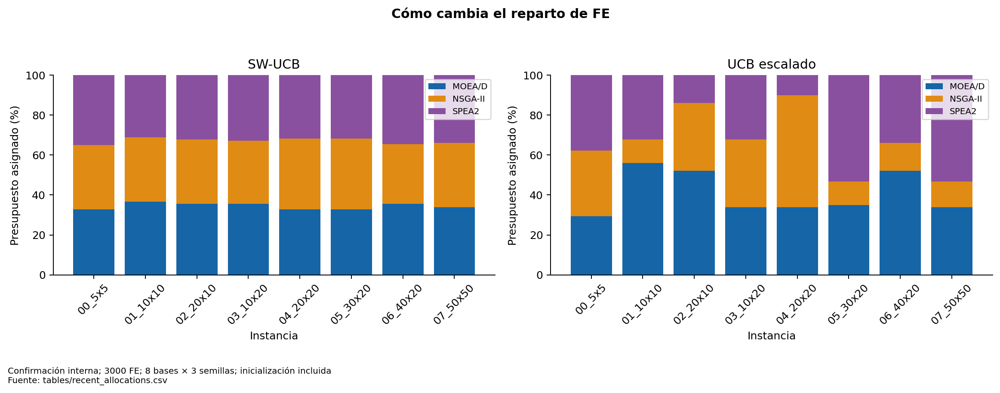
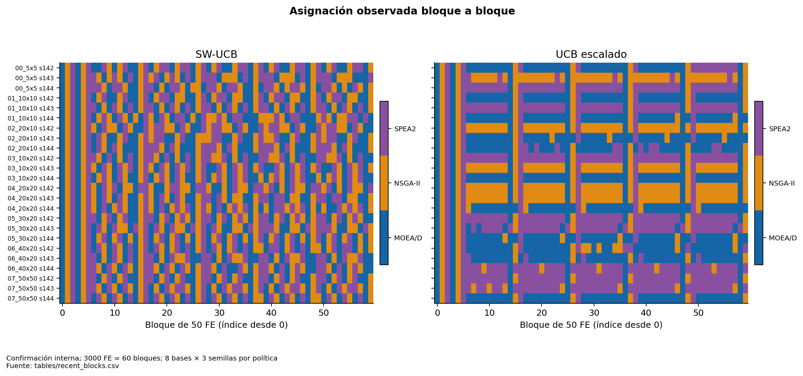

# Selección adaptativa: conducta y utilidad

El selector original ya responde matemáticamente a recompensas, pero el tamaño del bono frente a ΔHV puede volverlo casi uniforme. Escalado corrige la escala de explotación sin eliminar revisitas ni cambiar W o c. Las [fórmulas exactas](03_catalogo_algoritmos_portafolios.md) evitan confundirlo con FRRMAB o con normalizar cada brazo por separado.

## Respuestas a las seis preguntas

| Pregunta | Evidencia y alcance |
|---|---|
| ¿Reparto no uniforme? | Sí: escalado cambia las cuotas medias y los patrones por bloque |
| ¿Reacciona a recompensas? | Sí por reconstrucción de términos de ventana y reglas; el crédito es relativo al estado global |
| ¿Favorece progreso reciente? | La explotación escalada hace relevante su media reciente; no garantiza escoger al futuro mejor brazo |
| ¿Difiere entre instancias? | Sí en las trayectorias y cuotas observadas; no prueba un predictor de características |
| ¿Mejora uniforme? | ΔHV medio +.023649 en confirmación, 8/8 bases; contraste secundario/exploratorio |
| ¿Mejora SW-UCB original? | Sí en esta confirmación interna: ΔHV +.020680, Holm .015625 en familia principal |

| method | MOEA/D | NSGA-II | SPEA2 |
| --- | --- | --- | --- |
| adaptive | 0.344444 | 0.327083 | 0.328472 |
| guidance | 0.344444 | 0.327083 | 0.328472 |
| scaled | 0.408333 | 0.258333 | 0.333333 |
| uniform | 0.333333 | 0.333333 | 0.333333 |

El original asigna aproximadamente 34.44/32.71/32.85% a MOEA/D/NSGA-II/SPEA2. Escalado pasa a 40.83/25.83/33.33%. Esto concuerda globalmente con la ventaja de MOEA/D, pero aún deja la mayoría del presupuesto fuera de él. La base 5×5 y las trayectorias intermedias impiden convertir el resultado agregado en “asignar todo a MOEA/D” como política adaptativa demostrada.

La causalidad identificada por I2 es el efecto total de cambiar la regla de escala, con todo lo demás fijo en los controles. No permite afirmar que cada FE adicional a MOEA/D causó la mejora ni que toda desigualdad de cuotas sea adaptación eficaz. El estado de cada algoritmo cambia con la historia de ejecución.

La generalización a nuevas familias/test no se ha demostrado. La confirmación utiliza nuevas bases pero repite la relación tamaño–perfil y el mismo generador.

**Figura 05. Cómo cambia el reparto de FE.** Confirmación interna; 3000 FE; 8 bases × 3 semillas; inicialización incluida. Mayor desigualdad por sí sola no demuestra adaptación efectiva. Comparar con figura 02. Fuente: [tables/recent_allocations.csv](tables/recent_allocations.csv).

**Figura 15. Asignación observada bloque a bloque.** Confirmación interna; 3000 FE = 60 bloques; 8 bases × 3 semillas por política. Las revisitas se mantienen incluso con UCB escalado. La figura muestra decisiones, no ganancias causales por brazo. Fuente: [tables/recent_blocks.csv](tables/recent_blocks.csv).
