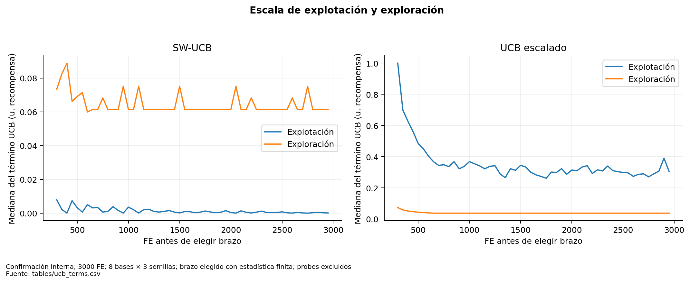

# Crédito de hipervolumen y escala del selector

La recompensa es rₜ=max(0,HVₜ−HVₜ₋₁), calculada después de actualizar el archivo global con soluciones evaluadas. Es marginal al **archivo presente**, no al archivo local ni al Pareto óptimo. Cada bloque reciente usa 50 FE; el mismo ΔHV representa diferente dificultad en diferentes momentos de búsqueda. La primera gran ganancia de arranque no se aprende en el warmup neutral.

La reconstrucción utiliza exclusivamente las observaciones anteriores a cada decisión, ventana global de diez, recuentos por brazo y escala compartida. Se excluyen warmup y probes del resumen de términos. Valores infinitos por ausencia de un brazo se representan como no aplicables a la mediana, no como cero.

| method | window_mean | exploitation | exploration |
| --- | --- | --- | --- |
| adaptive | 0.000629 | 0.000629 | 0.061326 |
| scaled | 0.000028 | 0.002561 | 0.106220 |

La [auditoría histórica Fase 2](../expanded_portfolio_phase2/final_closure/f2_6_reproducibility_manifest.json) registró explotación .00169 frente a exploración .05978, razón 35.37, y verificó 2910 decisiones. Son cifras históricas de esa cohorte; el resumen anterior se recalcula en las nuevas bases. Escalado eleva la relevancia de la explotación, sin cambiar la recompensa cruda guardada.

Una ventana enteramente nula usa escala uno y el bono mantiene exploración. El brazo ausente vuelve a ser elegible con UCB infinito. Se evita descarte irreversible, pero puede pagarse exploración cuando un brazo no recuperará progreso. En sentido opuesto, ceros globales pueden ocultar aprendizaje local o capacidad futura: suprimirlos indiscriminadamente sería metodológicamente injustificado.

## Límites de crédito

El hijo de un padre externo se acredita al receptor. El donante puede generar una mejora retardada en otro algoritmo sin recibir recompensa inmediata. HV además favorece ganancias de volumen y no toda región complementaria. No existen trazas de ascendencia completa ni un tratamiento de recompensa retardada que permita cuantificar ese sesgo causalmente. Es una hipótesis abierta, no un fallo demostrado de todo uso de HV.

Datos por decisión: [ucb_terms](tables/ucb_terms.csv); por bloque: [recent_blocks](tables/recent_blocks.csv). El diagnóstico no recalibra c ni W ni selecciona una nueva configuración.

**Figura 11. Escala de explotación y exploración.** Confirmación interna; 3000 FE; 8 bases × 3 semillas; brazo elegido con estadística finita; probes excluidos. Los términos se reconstruyen antes de decidir y se muestran para el brazo elegido; escalas de ejes independientes. Los brazos ausentes de ventana tienen UCB infinito y no entran en estas medianas. Fuente: [tables/ucb_terms.csv](tables/ucb_terms.csv).
