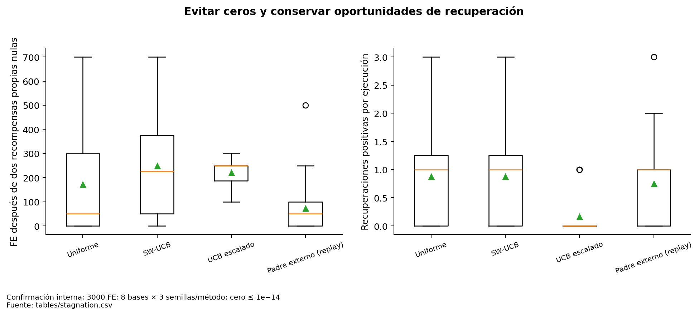

# Asignación, estancamiento y revisitas

Los tres primeros bloques de cada portafolio reciente son neutrales, seguidos por tres probes adaptativos. El presupuesto se cuenta por evaluaciones reales, incluida la inicialización. Se verificó que los 312 registros suman exactamente 3000 FE y 60 bloques. No se interpreta una generación parcial como una generación completa ni se supone que pausar pierda el estado interno.

| method | MOEA/D | NSGA-II | SPEA2 |
| --- | --- | --- | --- |
| adaptive | 0.344444 | 0.327083 | 0.328472 |
| guidance | 0.344444 | 0.327083 | 0.328472 |
| scaled | 0.408333 | 0.258333 | 0.333333 |
| uniform | 0.333333 | 0.333333 | 0.333333 |

## Estancamiento operacional

Se define una racha propia de ceros como bloques del mismo brazo con ΔHV global≤10⁻¹⁴, aunque entre ellos hayan actuado otros algoritmos. Se contabilizan FE al revisitarlo tras dos ceros, recuperaciones positivas y máximo de bloques ociosos. Son descriptores auditables de una trayectoria, no una etiqueta definitiva de inutilidad.

| method | FE_after_two_own_zero_gains | positive_recoveries | max_idle_blocks |
| --- | --- | --- | --- |
| adaptive | 250.000000 | 0.875000 | 5.041667 |
| guidance | 72.916667 | 0.750000 | 5.041667 |
| scaled | 220.833333 | 0.166667 | 10.000000 |
| uniform | 172.916667 | 0.875000 | 2.000000 |

Escalado reduce modestamente FE gastadas tras dos ceros frente al original (250 a 220.83 por corrida), pero también se observan menos recuperaciones de ese tipo y mayores pausas máximas. No demuestra “recuperación mejorada”. El padre externo, con asignación idéntica, cambia las recompensas y las rachas, lo que muestra por qué estancamiento y decisiones no se pueden interpretar aisladamente.

Las etapas de búsqueda pueden reconstruirse con FE en [recent_blocks](tables/recent_blocks.csv): temprano≤1000, medio1000–2000, tardío2000–3000, dejando warmup separado. Esos cortes son descriptivos, no nuevos presupuestos independientes. Se entrega además la secuencia de brazo seleccionado en 24 filas por política, para evitar que una media oculte comportamientos distintos entre semillas.

El coste de inicializar tres poblaciones de 30 es al menos 90 evaluaciones, frente a 30 en un individual. Los bloques neutrales asignan 150 FE en total, de las cuales una parte ya continúa la búsqueda después de inicializar. No se debe llamar a las 150 FE “pérdida por inicialización”: incluyen trabajo útil. La desventaja de profundidad se discute como hipótesis en [H1–H7](22_por_que_no_supera_moead.md).

**Figura 17. Evitar ceros y conservar oportunidades de recuperación.** Confirmación interna; 3000 FE; 8 bases × 3 semillas/método; cero ≤ 1e−14. Una recompensa nula se refiere al archivo global presente; no prueba incapacidad del algoritmo. Fuente: [tables/stagnation.csv](tables/stagnation.csv).
