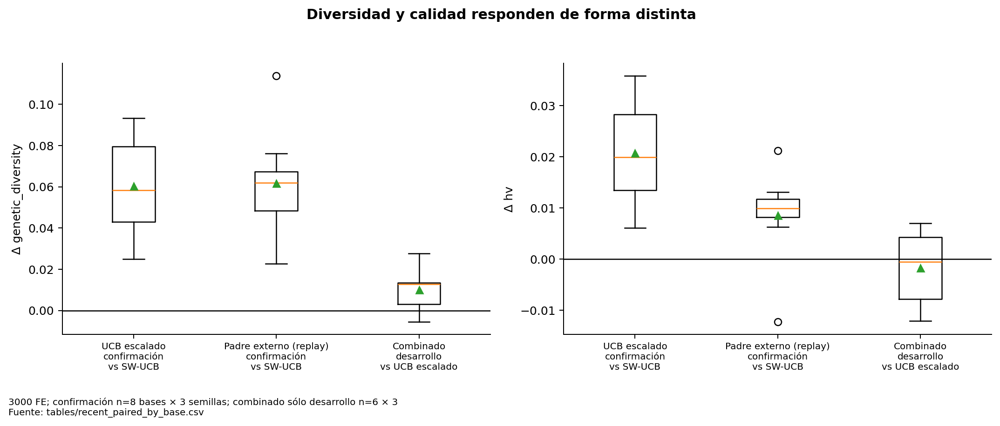

# Padre externo y cooperación activa

**Compartir genotipos mejora descriptivamente el portafolio original bajo la asignación controlada, pero no está demostrado como la mejor política autónoma ni supera a MOEA/D a igual FE de tratamiento.**

## Mecanismo observado en código

1. El selector/replay determina el receptor del siguiente bloque; el donante no determina el receptor.
2. Se toma el ND global actual. Los candidatos deben ser de la misma instancia, estar ausentes del archivo local y tener primera observación en otro brazo.
3. Se escoge el candidato que maximiza su distancia mínima euclidiana en objetivos normalizados al archivo local. Empates por ID genotípico. Un solo donante queda congelado durante el bloque.
4. Cada brazo mantiene un contador persistente de eventos de cruce exitoso. Cada diez oportunidades sustituye el segundo padre nativo por el donante disponible; no consume sorteos adicionales para elegir cadencia.
5. POX y mutación nativos generan descendencia. Toda evaluación consume FE y actualiza selección ambiental/decomposición nativas. No se copia el fitness del padre al hijo.
6. Se actualizan archivo local, global y crédito del receptor. La frecuencia efectiva depende de disponibilidad de donante y de la tasa nativa de cruce; no es exactamente una transferencia cada diez FE.

No se mezclan instancias ni máquinas, no se reemplazan poblaciones y no se cambia el problema. Los registros de eventos conservan receptor, padre sustituido, donante e índice de cruce.

## Comparación controlada y coste

El tratamiento `guidance` reproduce **exactamente la secuencia de asignación de SW-UCB del control**, incluidos presupuestos y fases, para aislar el intercambio genético. La auditoría previa verifica 42 pares con asignaciones idénticas y genotipos finales distintos. La confirmación usa ocho bases y tres semillas.

| treatment | n_bases | mean_delta | ci_low | ci_high | p_signflip | p_holm_confirmatory_hv | wins | losses | cohen_dz |
| --- | --- | --- | --- | --- | --- | --- | --- | --- | --- |
| scaled | 8 | 0.020680 | 0.014084 | 0.027370 | 0.007812 | 0.015625 | 8 | 0 | 1.994887 |
| guidance | 8 | 0.008539 | 0.001655 | 0.013961 | 0.054688 | 0.054688 | 7 | 1 | 0.898190 |

Guía obtiene ΔHV +.008539, ΔAUC +.007885, diversidad genética media +11.84% y coste temporal medio +4.59%. HV mejora en 7/8 bases y cae en 10×10. La p corregida HV .054688 impide presentarlo como resultado confirmatorio fuerte al 5%, aunque el IC bootstrap sea positivo. El efecto es condicionado al replay: ejecutar ambos desde cero cuesta 6000 FE.

## Por qué aumenta diversidad sin el mejor HV

El donante distante altera combinaciones genéticas y puede ampliar rangos sin desplazar la superficie hacia el ideal ni cubrir una región de gran volumen exclusivo. La distancia genotípica no mide convergencia; rango no equivale a cobertura. El archivo y la selección nativa pueden descartar hijos distantes de baja calidad. La información puede ser redundante en volumen aun sin coincidir sus vectores. Estos mecanismos son explicaciones plausibles, coherentes con los indicadores, pero no se midió el destino de todos los hijos para atribuir cuál domina.

**Figura 10. Diversidad y calidad responden de forma distinta.** 3000 FE; confirmación n=8 bases × 3 semillas; combinado sólo desarrollo n=6 × 3. La diversidad genotípica es una distancia en poblaciones registradas durante la campaña, no cobertura del Pareto óptimo. Fuente: [tables/recent_paired_by_base.csv](tables/recent_paired_by_base.csv).

## Línea paralela y estado externo

Existe además una línea P5/P6 de sensibilidad de c e inyección directa de incumbentes, distinta del padre externo. P7 seguía produciendo resultados durante la auditoría. Se documenta en [apéndice 32](32_linea_paralela_P5_P6_P7.md), con un corte parcial fijo, sin mezclar presupuestos ni incorporarlo como confirmación. El conteo de instancias corresponde al inicio: desapareció externamente `mojssp-dmab - copia`, mientras el repositorio original `mojssp-dmab` y este checkout conservaron su estado. Véase [preservación](00_preservacion_trazabilidad.md).
