# Catálogo de las 23 figuras y sus fuentes

**Diez para la reunión:** [01](figures/01_hv_confirmacion.png), [02](figures/02_diferencias_pareadas.png), [03](figures/03_hv_fe.png), [05](figures/05_asignacion.png), [06](figures/06_contribuciones.png), [07](figures/07_frentes_proyecciones.png), [09](figures/09_hv_tamano.png), [10](figures/10_cooperacion_diversidad.png), [11](figures/11_escala_ucb.png), [12](figures/12_page_hinkley.png).

## 01_hv_confirmacion

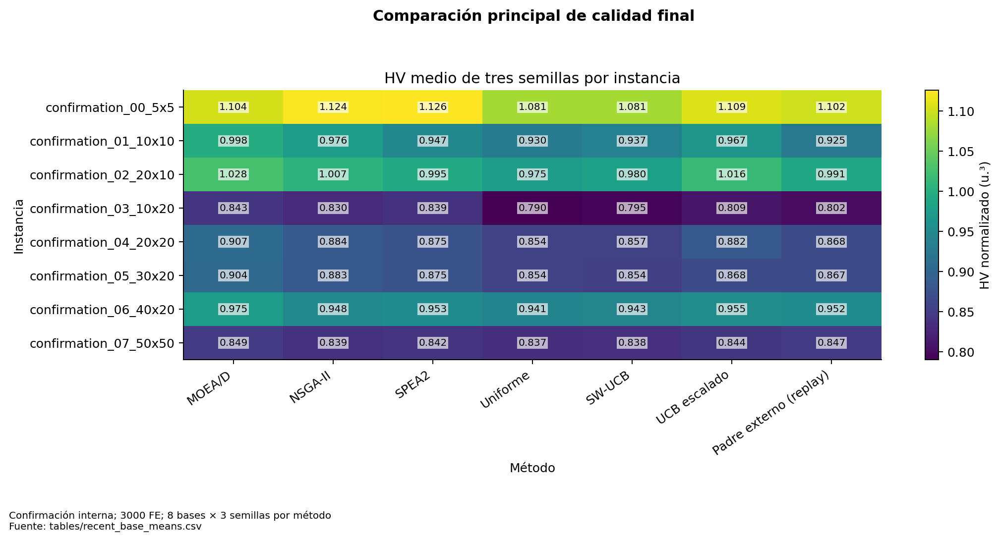

**Figura 01. Comparación principal de calidad final.** Confirmación interna; 3000 FE; 8 bases × 3 semillas por método. Las filas muestran heterogeneidad entre bases. El HV absoluto no mide dificultad universal. Fuente: [tables/recent_base_means.csv](tables/recent_base_means.csv).

[Versión vectorial SVG](figures/01_hv_confirmacion.svg).

## 02_diferencias_pareadas

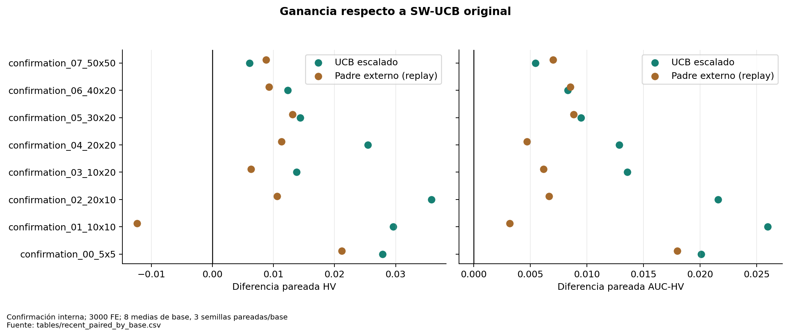

**Figura 02. Ganancia respecto a SW-UCB original.** Confirmación interna; 3000 FE; 8 medias de base, 3 semillas pareadas/base. Escalado mejora HV y AUC en las ocho bases; padre externo pierde HV en una. Fuente: [tables/recent_paired_by_base.csv](tables/recent_paired_by_base.csv).

[Versión vectorial SVG](figures/02_diferencias_pareadas.svg).

## 03_hv_fe

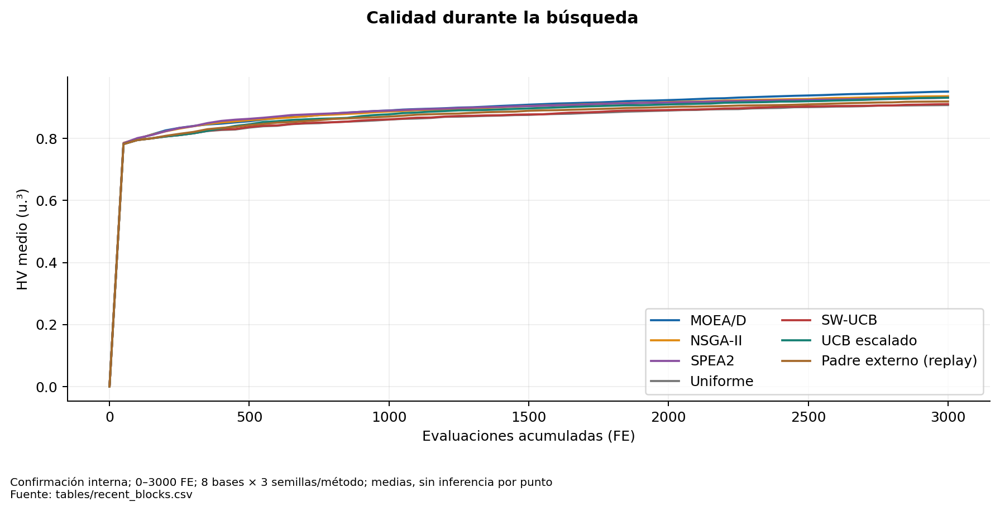

**Figura 03. Calidad durante la búsqueda.** Confirmación interna; 0–3000 FE; 8 bases × 3 semillas/método; medias, sin inferencia por punto. Las trayectorias proceden de registros cada 50 FE; el origen (0,0) forma parte de AUC. Fuente: [tables/recent_blocks.csv](tables/recent_blocks.csv).

[Versión vectorial SVG](figures/03_hv_fe.svg).

## 04_calidad_tiempo

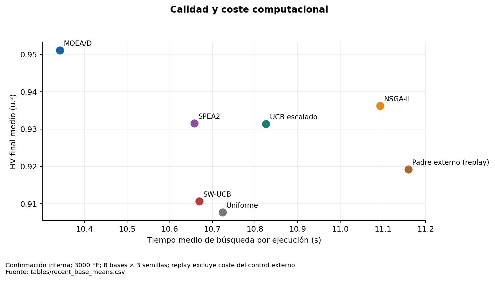

**Figura 04. Calidad y coste computacional.** Confirmación interna; 3000 FE; 8 bases × 3 semillas; replay excluye coste del control externo. El tiempo incluye algoritmos y gestión online; no permite aislar el coste del selector. Fuente: [tables/recent_base_means.csv](tables/recent_base_means.csv).

[Versión vectorial SVG](figures/04_calidad_tiempo.svg).

## 05_asignacion

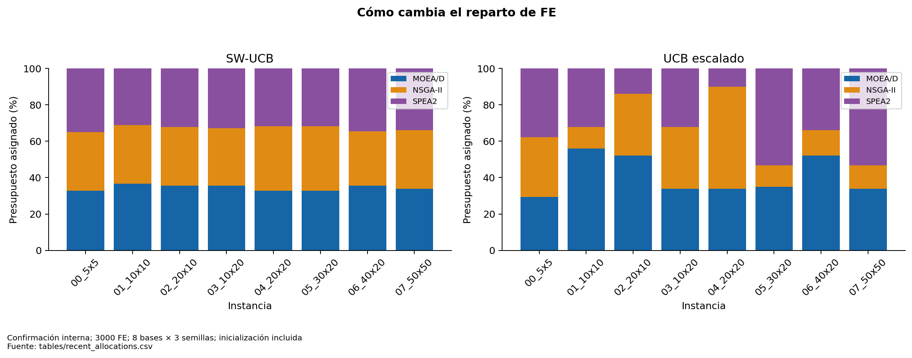

**Figura 05. Cómo cambia el reparto de FE.** Confirmación interna; 3000 FE; 8 bases × 3 semillas; inicialización incluida. Mayor desigualdad por sí sola no demuestra adaptación efectiva. Comparar con figura 02. Fuente: [tables/recent_allocations.csv](tables/recent_allocations.csv).

[Versión vectorial SVG](figures/05_asignacion.svg).

## 06_contribuciones

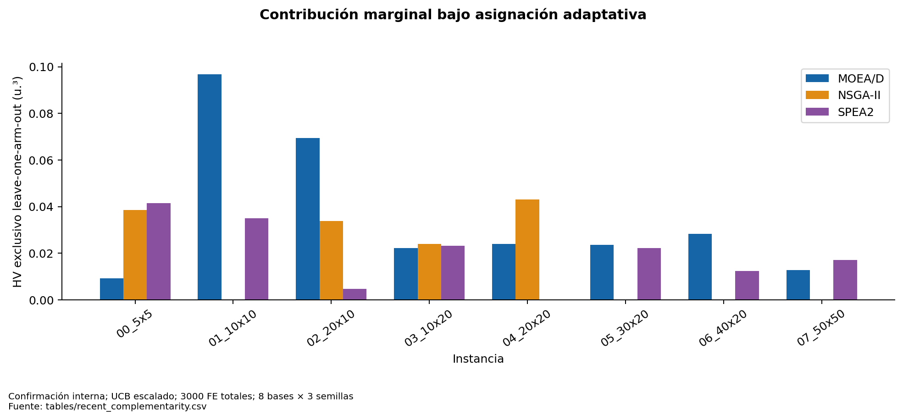

**Figura 06. Contribución marginal bajo asignación adaptativa.** Confirmación interna; UCB escalado; 3000 FE totales; 8 bases × 3 semillas. No sumar estas contribuciones como HV total. Son archivos locales observados, no un experimento de eliminar brazos. Fuente: [tables/recent_complementarity.csv](tables/recent_complementarity.csv).

[Versión vectorial SVG](figures/06_contribuciones.svg).

## 07_frentes_proyecciones

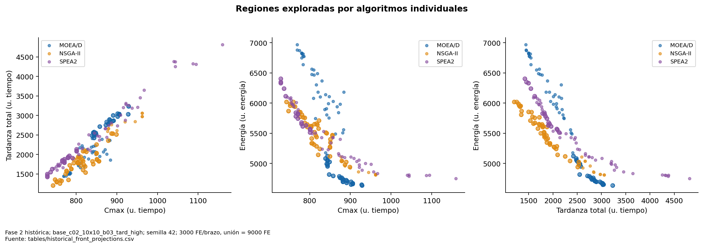

**Figura 07. Regiones exploradas por algoritmos individuales.** Fase 2 histórica; base_c02_10x10_b03_tard_high; semilla 42; 3000 FE/brazo, unión = 9000 FE. Círculos huecos: soluciones que sobreviven en la unión. Ejemplo ilustrativo, no generalización. Fuente: [tables/historical_front_projections.csv](tables/historical_front_projections.csv).

[Versión vectorial SVG](figures/07_frentes_proyecciones.svg).

## 08_caracterizacion

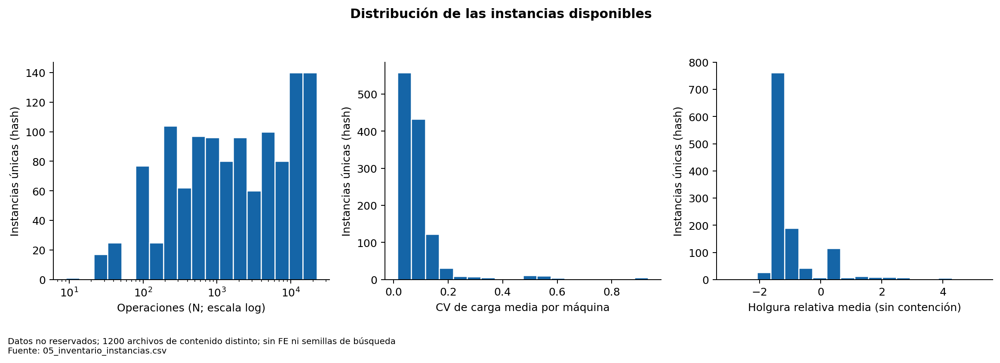

**Figura 08. Distribución de las instancias disponibles.** Datos no reservados; 1200 archivos de contenido distinto; sin FE ni semillas de búsqueda. Los perfiles derivados están correlacionados; este histograma describe el inventario, no una muestra independiente. Fuente: [05_inventario_instancias.csv](05_inventario_instancias.csv).

[Versión vectorial SVG](figures/08_caracterizacion.svg).

## 09_hv_tamano

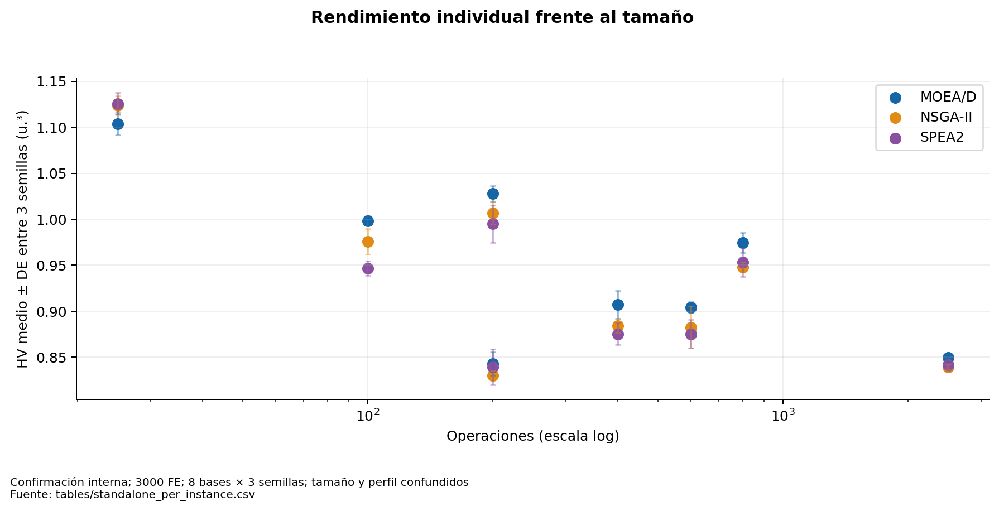

**Figura 09. Rendimiento individual frente al tamaño.** Confirmación interna; 3000 FE; 8 bases × 3 semillas; tamaño y perfil confundidos. Hay dos geometrías con 200 operaciones. No se ajusta una regla de especialización a ocho observaciones. Fuente: [tables/standalone_per_instance.csv](tables/standalone_per_instance.csv).

[Versión vectorial SVG](figures/09_hv_tamano.svg).

## 10_cooperacion_diversidad

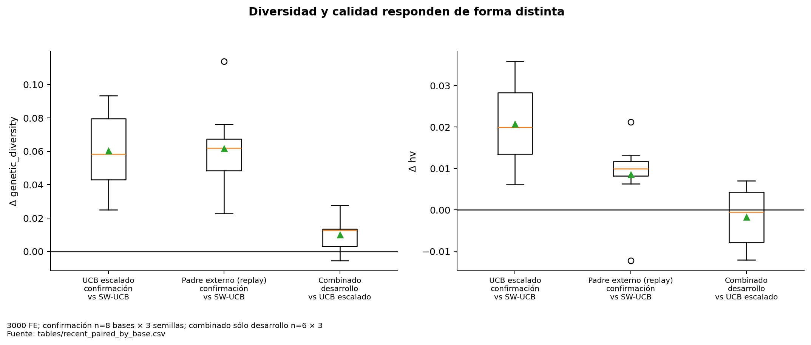

**Figura 10. Diversidad y calidad responden de forma distinta.** 3000 FE; confirmación n=8 bases × 3 semillas; combinado sólo desarrollo n=6 × 3. La diversidad genotípica es una distancia en poblaciones registradas durante la campaña, no cobertura del Pareto óptimo. Fuente: [tables/recent_paired_by_base.csv](tables/recent_paired_by_base.csv).

[Versión vectorial SVG](figures/10_cooperacion_diversidad.svg).

## 11_escala_ucb

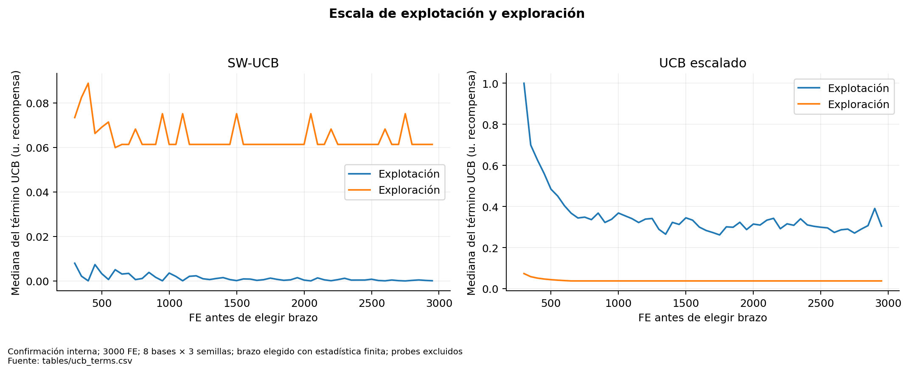

**Figura 11. Escala de explotación y exploración.** Confirmación interna; 3000 FE; 8 bases × 3 semillas; brazo elegido con estadística finita; probes excluidos. Los términos se reconstruyen antes de decidir y se muestran para el brazo elegido; escalas de ejes independientes. Los brazos ausentes de ventana tienen UCB infinito y no entran en estas medianas. Fuente: [tables/ucb_terms.csv](tables/ucb_terms.csv).

[Versión vectorial SVG](figures/11_escala_ucb.svg).

## 12_page_hinkley

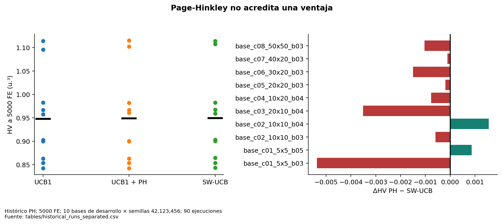

**Figura 12. Page-Hinkley no acredita una ventaja.** Histórico PH; 5000 FE; 10 bases de desarrollo × semillas 42,123,456; 90 ejecuciones. Contraste histórico Holm PH vs SW-UCB p=0.320312. La calibración y comparación usan las mismas bases. Fuente: [tables/historical_runs_separated.csv](tables/historical_runs_separated.csv).

[Versión vectorial SVG](figures/12_page_hinkley.svg).

## 13_presupuestos_historicos

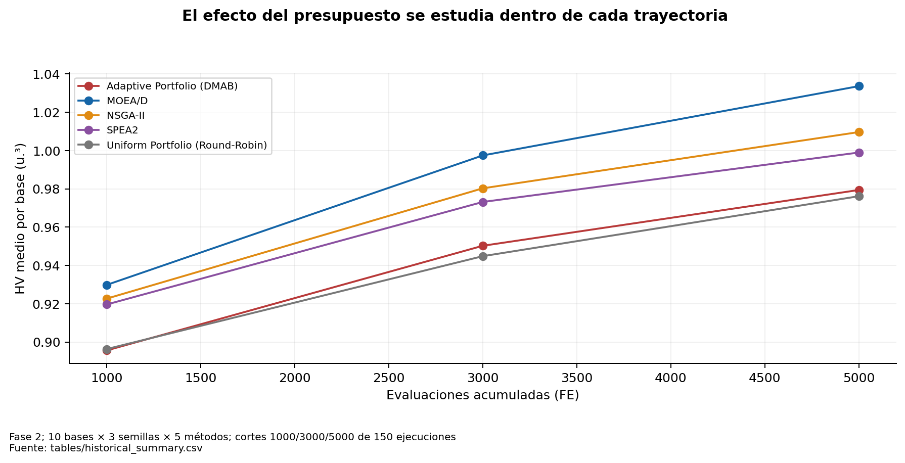

**Figura 13. El efecto del presupuesto se estudia dentro de cada trayectoria.** Fase 2; 10 bases × 3 semillas × 5 métodos; cortes 1000/3000/5000 de 150 ejecuciones. No tratar 450 cortes como ejecuciones independientes. El piloto de 1000 FE tampoco es una réplica nueva de calidad. Fuente: [tables/historical_summary.csv](tables/historical_summary.csv).

[Versión vectorial SVG](figures/13_presupuestos_historicos.svg).

## 14_correlaciones

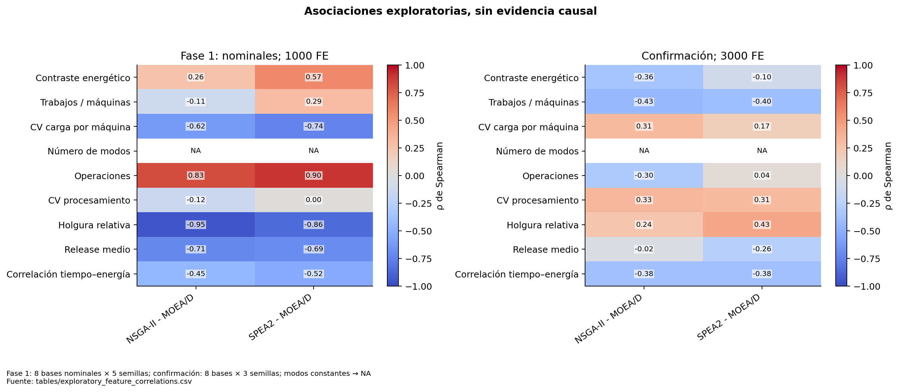

**Figura 14. Asociaciones exploratorias, sin evidencia causal.** Fase 1: 8 bases nominales × 5 semillas; confirmación: 8 bases × 3 semillas; modos constantes → NA. Las diferencias entre campañas y perfiles impiden usar estas correlaciones como un selector entrenado. Fuente: [tables/exploratory_feature_correlations.csv](tables/exploratory_feature_correlations.csv).

[Versión vectorial SVG](figures/14_correlaciones.svg).

## 15_trayectorias_asignacion

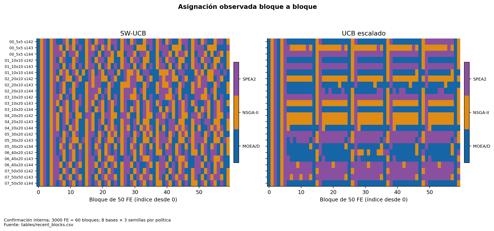

**Figura 15. Asignación observada bloque a bloque.** Confirmación interna; 3000 FE = 60 bloques; 8 bases × 3 semillas por política. Las revisitas se mantienen incluso con UCB escalado. La figura muestra decisiones, no ganancias causales por brazo. Fuente: [tables/recent_blocks.csv](tables/recent_blocks.csv).

[Versión vectorial SVG](figures/15_trayectorias_asignacion.svg).

## 16_solapamiento

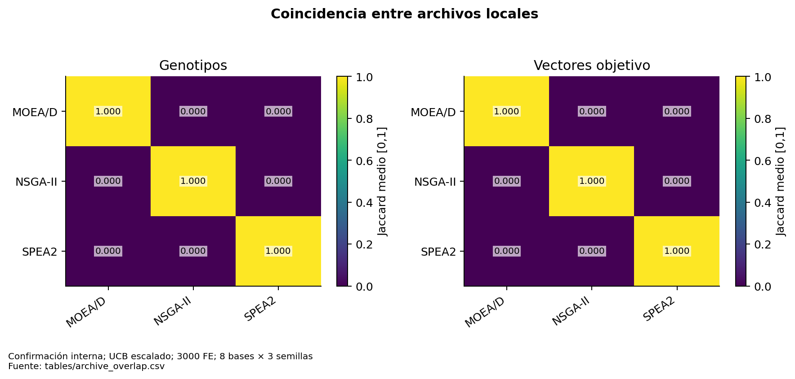

**Figura 16. Coincidencia entre archivos locales.** Confirmación interna; UCB escalado; 3000 FE; 8 bases × 3 semillas. Jaccard exacto bajo no implica cobertura volumétrica distinta: puntos diferentes pueden dominar regiones parecidas. Fuente: [tables/archive_overlap.csv](tables/archive_overlap.csv).

[Versión vectorial SVG](figures/16_solapamiento.svg).

## 17_estancamiento

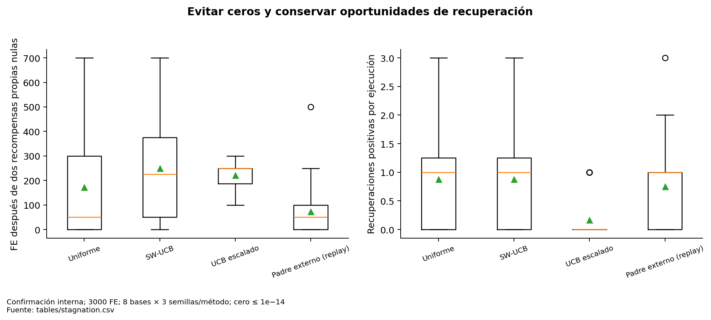

**Figura 17. Evitar ceros y conservar oportunidades de recuperación.** Confirmación interna; 3000 FE; 8 bases × 3 semillas/método; cero ≤ 1e−14. Una recompensa nula se refiere al archivo global presente; no prueba incapacidad del algoritmo. Fuente: [tables/stagnation.csv](tables/stagnation.csv).

[Versión vectorial SVG](figures/17_estancamiento.svg).

## 18_caracteristicas_rendimiento

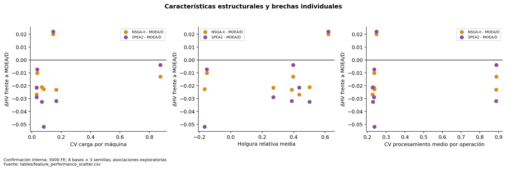

**Figura 18. Características estructurales y brechas individuales.** Confirmación interna; 3000 FE; 8 bases × 3 semillas; asociaciones exploratorias. Tamaño, perfil y configuración del generador no están cruzados factorialmente en esta campaña. Fuente: [tables/feature_performance_scatter.csv](tables/feature_performance_scatter.csv).

[Versión vectorial SVG](figures/18_caracteristicas_rendimiento.svg).

## 19_frente_3d

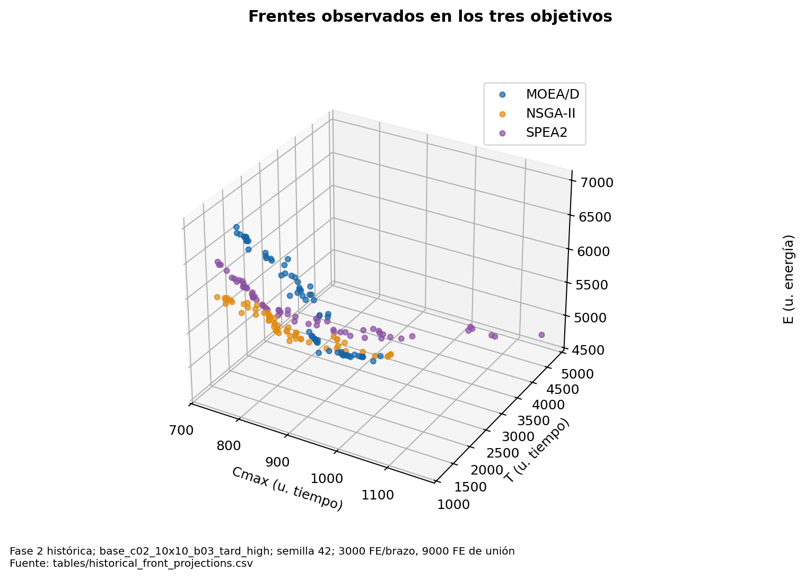

**Figura 19. Frentes observados en los tres objetivos.** Fase 2 histórica; base_c02_10x10_b03_tard_high; semilla 42; 3000 FE/brazo, 9000 FE de unión. No se conoce el frente Pareto óptimo. Esta visualización compara aproximaciones evaluadas. Fuente: [tables/historical_front_projections.csv](tables/historical_front_projections.csv).

[Versión vectorial SVG](figures/19_frente_3d.svg).

## 20_complementariedad_fe

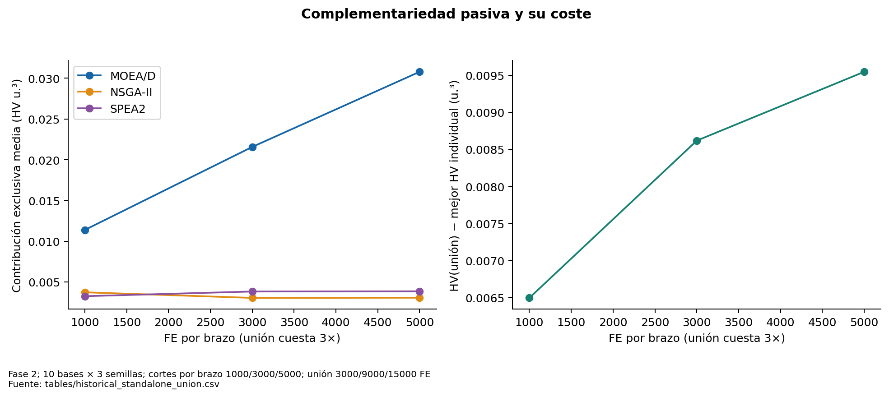

**Figura 20. Complementariedad pasiva y su coste.** Fase 2; 10 bases × 3 semillas; cortes por brazo 1000/3000/5000; unión 3000/9000/15000 FE. Ganancia de unión positiva no demuestra que un portafolio gane al mejor individual a igual FE total. Fuente: [tables/historical_standalone_union.csv](tables/historical_standalone_union.csv).

[Versión vectorial SVG](figures/20_complementariedad_fe.svg).

## 21_perfiles_instancias

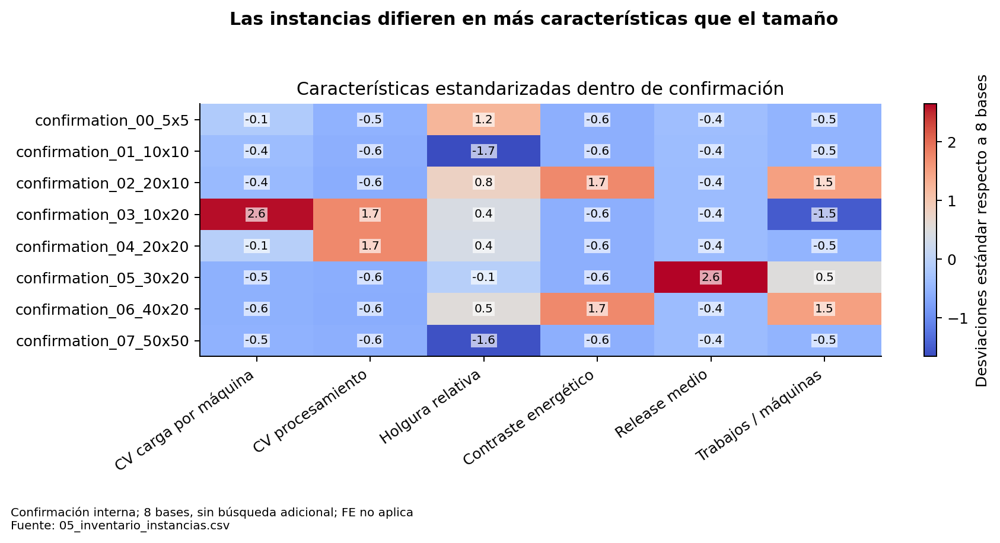

**Figura 21. Las instancias difieren en más características que el tamaño.** Confirmación interna; 8 bases, sin búsqueda adicional; FE no aplica. La estandarización sirve para comparar columnas con unidades distintas; no es un índice de dificultad. Fuente: [05_inventario_instancias.csv](05_inventario_instancias.csv).

[Versión vectorial SVG](figures/21_perfiles_instancias.svg).

## 22_modos_energia

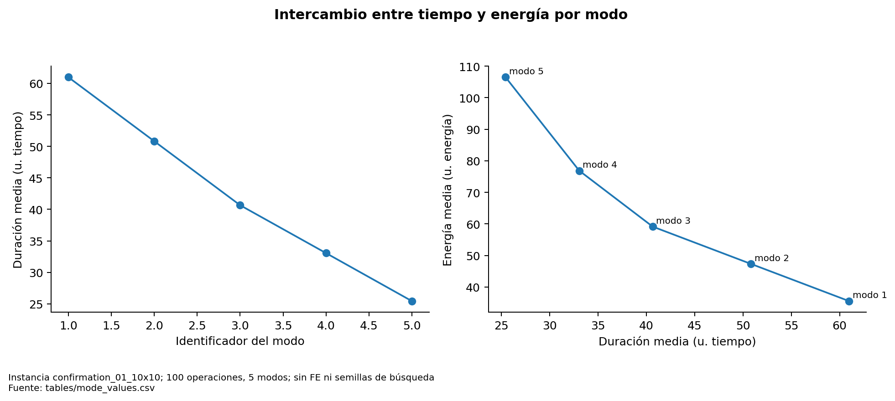

**Figura 22. Intercambio entre tiempo y energía por modo.** Instancia confirmation_01_10x10; 100 operaciones, 5 modos; sin FE ni semillas de búsqueda. El ejemplo describe modos existentes. El número de modos no varía entre las bases comparadas. Fuente: [tables/mode_values.csv](tables/mode_values.csv).

[Versión vectorial SVG](figures/22_modos_energia.svg).

## 23_hv_tiempo

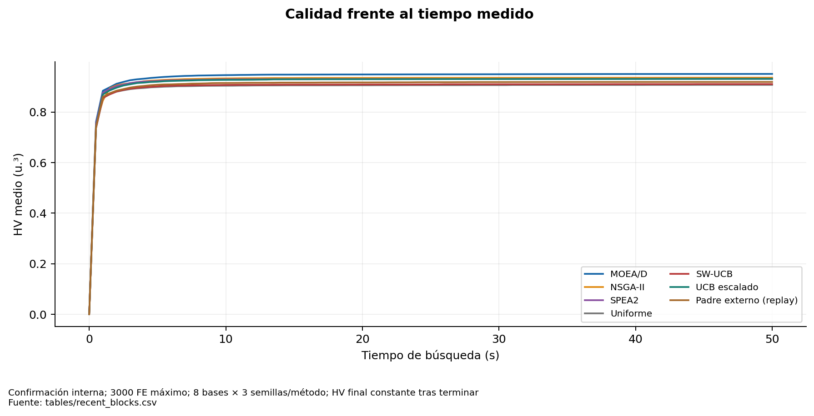

**Figura 23. Calidad frente al tiempo medido.** Confirmación interna; 3000 FE máximo; 8 bases × 3 semillas/método; HV final constante tras terminar. Se conserva el último HV al concluir cada corrida: no se extrapolan mejoras ni se promedian sólo las ejecuciones lentas. Fuente: [tables/recent_blocks.csv](tables/recent_blocks.csv).

[Versión vectorial SVG](figures/23_hv_tiempo.svg).