# Informe integral MO-JSSP para seguimiento con directores

Reunión: 16 de octubre de 2026. Corte de evidencia: auditoría del 15 de octubre. Trabajo exclusivamente de análisis y documentación, sin nuevas optimizaciones.

## Resumen

El resultado central es una mejora reproducible del portafolio mediante escalado del crédito UCB, con ΔHV +.020680 y AUC +.014673 frente al original en ocho bases de confirmación interna. El portafolio no supera al mejor individual en promedio. La guía genética produce una señal condicional positiva y mayor diversidad; su coste de replay y la multiplicidad limitan la afirmación. Combinar ambos mecanismos no añade ventaja demostrada. La caracterización amplia del archivo no subsana las pocas bases independientes de rendimiento ni la confusión tamaño/perfil.

## Contexto y objetivos

Se estudia cómo integrar MOEA/D, NSGA-II y SPEA2 para obtener aproximaciones no dominadas de Cmax, tardanza y energía bajo presupuesto FE. Eficiencia y adaptabilidad se evalúan con calidad, trayectoria, tiempo, contribuciones y asignación. La investigación prioriza evidencia reproducible y resultados negativos informativos. No tiene como condición fabricar una victoria del portafolio.

## Diez hallazgos principales

1. UCB escalado mejora SW-UCB original en HV final y AUC en las ocho bases de confirmación interna a 3000 FE; ΔHV +0.020680, Holm .015625.
2. El portafolio escalado aún tiene menor HV medio que MOEA/D: .931368 frente a .951055, y pierde en siete de ocho bases.
3. SPEA2 gana la base 5×5 de confirmación; NSGA-II también supera allí a MOEA/D. No existe superioridad individual uniforme.
4. Padre externo con replay mejora HV medio +.008539 y diversidad genética +11.84%, pero HV corregido p=.054688 y requiere una asignación externa.
5. La combinación escalado + guía no añadió una mejora reproducible: ΔHV −.001742 frente a escalado en desarrollo; no se confirmó.
6. La complementariedad geométrica es positiva y asimétrica; a 5000 FE/brazo MOEA/D aporta MC .030796 frente a .003065/.003849. La unión cuesta 15000 FE.
7. Page-Hinkley C5 gasta 165 FE medias en resondeo y no acredita ventaja corregida frente a SW-UCB. Su comparación reutiliza los resultados de calibración C5.
8. El inventario contiene 1336 instancias por contenido y 2746 copias; sólo una pequeña parte tiene comparaciones actuales. Holdout: 80 variantes de 16 bases, sin abrir para rendimiento.
9. No puede afirmarse una regla general algoritmo–tamaño. La confirmación tiene 4 bases pequeñas, 1 mediana y 3 grandes; tamaño y perfil están confundidos.
10. El ensayo histórico de cuello de botella favorece la ventaja relativa de NSGA-II en 8/8 bases, pero tras ocho contrastes Holm queda en .0625: es una hipótesis dirigida para confirmar.

## Tabla de versiones

| Versión | Selección / asignación | Información compartida | Evidencia | Estado |
| --- | --- | --- | --- | --- |
| Histórico NSGA-II/MOPSO/NSGA-II+LS | SW-UCB y uniforme; brazos anteriores | Unión pasiva; búsqueda local sólo dentro de su brazo | 500/1000 FE; campañas F8 | Antecedente; no mezclar con los tres brazos actuales |
| MOEA/D, NSGA-II, SPEA2 individuales | Un brazo usa todo B | Sin intercambio | 1000, 3000, 5000; reciente 3000 | Controles vigentes |
| Uniforme RR | Bloques cíclicos de 50 FE | Archivo global como salida | Fase 2 y reciente | Control de fragmentación y agregación |
| SW-UCB original | Media ΔHV + bono; W=10,c=.07 | Archivo global mide recompensa; sin padre externo | Fase 2, PH y reciente | Línea base conservada |
| UCB1 acumulativo | Media de todas las recompensas + bono | Sin transferencia genética | PH: 5000 FE, 10 bases × 3 semillas | Control de olvido |
| UCB1 + Page-Hinkley C5 | Alarma reinicia crédito; δ=.0005, λ=.020 | Poblaciones y archivo se conservan | 270 calibración + 90 comparación, 5000 FE | No adoptado; sin ventaja corregida |
| UCB escalado | Media ΔHV / máximo reciente + mismo bono | Sin cooperación genética | 6 desarrollo y 8 confirmación, 3000 FE | Mejora reproducible frente a SW-UCB |
| Padre externo con replay | Copia exactamente la asignación del control SW-UCB | Un padre extranjero cada 10 cruces elegibles | 6 desarrollo y 8 confirmación, 3000 FE tratamiento | Evidencia condicional; coste del control adicional |
| Escalado + padre externo | Decisiones online con crédito escalado | Mismo mecanismo de padre externo | Sólo 6 desarrollo × 3 semillas, 3000 FE | No adoptado; sin ganancia adicional clara |
| SW-UCB c=.01/.03 (P5 paralelo) | Reducir el bono sin escalar crédito | Unión pasiva | 2 bases × una semilla; 1000 FE | Sensibilidad exploratoria; ver apéndice 32 |
| Inyección acotada P6/P7 paralela | SW-UCB c=.01 y secuencia fija | Hasta 2 incumbentes evaluados por bloque desde índice 6 | P6: 2 bases × una semilla; P7 parcial 1000 FE | Distinta de padre externo; corte externo separado |

## Tabla de algoritmos por tamaño

| size | n_base_clusters | MOEA/D | NSGA-II | SPEA2 | Mayor media |
| --- | --- | --- | --- | --- | --- |
| grande | 3 | 0.909396 | 0.889883 | 0.890158 | MOEA/D |
| mediana | 1 | 0.907217 | 0.884035 | 0.875291 | MOEA/D |
| pequena | 4 | 0.993259 | 0.984074 | 0.976691 | MOEA/D |

Las categorías son terciles del diseño de ocho geometrías. Una base mediana no permite generalizar. [Tabla por instancia](tables/best_algorithm_by_instance.csv).

## Arquitectura y definiciones del problema

Capítulo específico: [02_arquitectura_portafolio.md](02_arquitectura_portafolio.md).

#### Modelo y representación

Cada operación tiene máquina fija, precedencia dentro del trabajo, release y varios modos (duración, energía). El genotipo incluye una secuencia de trabajos con repeticiones y un vector de modos por operación canónica. POX conserva las multiplicidades. El decodificador serial usa:

\[
S_{jk}=\max(C_{j,k-1},a_{M_{jk}},r_{jk}),\qquad C_{jk}=S_{jk}+p_{jkv}.
\]

Esto conserva precedencias, disponibilidad de máquina, releases y ejecución no interrumpida. No hay asignación flexible de máquina en estos datos JSP2. Se minimizan \(C_{max}=\max_j C_j\), \(T=\sum_j\max(0,C_j-d_j)\) y \(E=\sum_o e_{o,v_o}\). El due date del trabajo procede de la última operación en orden tecnológico, no del máximo due date de la fila. La energía implementada suma energías de procesamiento por modo; no se añade un modelo nuevo de energía ociosa. Los archivos no declaran unidades físicas homogéneas: se usan unidades de tiempo y energía de la instancia, sin afirmar kWh.

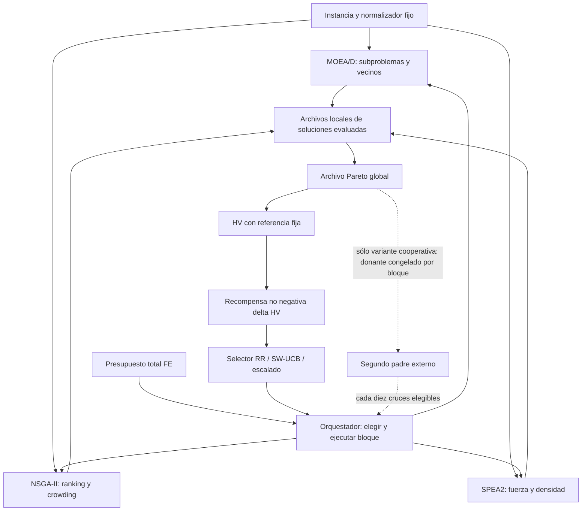

#### Flujo de un bloque y control de FE

Las poblaciones no se reinicializan al cambiar de brazo. La inicialización consume FE. En la campaña reciente hay tres bloques neutrales de 50 FE y después una prueba adaptativa de un bloque por brazo; warmup no aprende recompensas en el selector. El archivo global informa la selección mediante HV incluso sin transferencia genética. Esa comunicación de crédito no implica que los algoritmos lean sus genotipos.

#### Cinco mecanismos diferentes

| Mecanismo | Qué recibe cada algoritmo | Qué cambia |
|---|---|---|
| Unión pasiva | Nada del otro brazo | Sólo salida Pareto global |
| Archivo compartido como indicador | El selector observa HV global | Crédito y asignación |
| Selección adaptativa | Más o menos bloques de ejecución | Profundidad de búsqueda |
| Padre externo | Un genotipo del archivo global | Variación genética |
| PH | Ningún genotipo nuevo | Memoria del selector tras alarma |

Un archivo común no prueba cooperación genética. La unión de individuales usa 3B FE; un portafolio real reparte B FE. Una solución producida tras cruce externo se acredita al receptor que la evalúa. La primera observación no identifica todos sus ancestros.

Fuentes de implementación: `src/mojssp/io.py`, `decoder.py`, `evaluator.py`, `portfolio.py`, `orchestrator.py`, `cooperation.py`; copias y hashes en [evidencia](evidence/preservation_before.json).

## Catálogo de algoritmos y políticas

Capítulo específico: [03_catalogo_algoritmos_portafolios.md](03_catalogo_algoritmos_portafolios.md).

| Versión | Selección / asignación | Información compartida | Evidencia | Estado |
| --- | --- | --- | --- | --- |
| Histórico NSGA-II/MOPSO/NSGA-II+LS | SW-UCB y uniforme; brazos anteriores | Unión pasiva; búsqueda local sólo dentro de su brazo | 500/1000 FE; campañas F8 | Antecedente; no mezclar con los tres brazos actuales |
| MOEA/D, NSGA-II, SPEA2 individuales | Un brazo usa todo B | Sin intercambio | 1000, 3000, 5000; reciente 3000 | Controles vigentes |
| Uniforme RR | Bloques cíclicos de 50 FE | Archivo global como salida | Fase 2 y reciente | Control de fragmentación y agregación |
| SW-UCB original | Media ΔHV + bono; W=10,c=.07 | Archivo global mide recompensa; sin padre externo | Fase 2, PH y reciente | Línea base conservada |
| UCB1 acumulativo | Media de todas las recompensas + bono | Sin transferencia genética | PH: 5000 FE, 10 bases × 3 semillas | Control de olvido |
| UCB1 + Page-Hinkley C5 | Alarma reinicia crédito; δ=.0005, λ=.020 | Poblaciones y archivo se conservan | 270 calibración + 90 comparación, 5000 FE | No adoptado; sin ventaja corregida |
| UCB escalado | Media ΔHV / máximo reciente + mismo bono | Sin cooperación genética | 6 desarrollo y 8 confirmación, 3000 FE | Mejora reproducible frente a SW-UCB |
| Padre externo con replay | Copia exactamente la asignación del control SW-UCB | Un padre extranjero cada 10 cruces elegibles | 6 desarrollo y 8 confirmación, 3000 FE tratamiento | Evidencia condicional; coste del control adicional |
| Escalado + padre externo | Decisiones online con crédito escalado | Mismo mecanismo de padre externo | Sólo 6 desarrollo × 3 semillas, 3000 FE | No adoptado; sin ganancia adicional clara |
| SW-UCB c=.01/.03 (P5 paralelo) | Reducir el bono sin escalar crédito | Unión pasiva | 2 bases × una semilla; 1000 FE | Sensibilidad exploratoria; ver apéndice 32 |
| Inyección acotada P6/P7 paralela | SW-UCB c=.01 y secuencia fija | Hasta 2 incumbentes evaluados por bloque desde índice 6 | P6: 2 bases × una semilla; P7 parcial 1000 FE | Distinta de padre externo; corte externo separado |

#### Componentes individuales

**MOEA/D** descompone objetivos mediante Tchebycheff sobre valores normalizados, \(g(x|w,z^*)=\max_k w_k|z_k(x)-z_k^*|\), con el tratamiento de pesos nulos definido en código. Mantiene subproblemas, ideal y vecinos. En la campaña reciente: población 30, vecinos 6, probabilidad de selección local .9, máximo dos reemplazos y cruce 1.0.

**NSGA-II** aplica ordenamiento no dominado, crowding y selección ambiental elitista; conserva descendencia parcial al pausar un bloque. La población experimental es 30, aunque el constructor tiene otro valor predeterminado. Cruce .9. **SPEA2** utiliza fuerza S(i), fitness crudo R(i)=ΣS(j) de quienes dominan i y densidad 1/(σᵏ+2), k=floor(√n), con truncación de vecinos en objetivos normalizados. Población y archivo ambiental experimentales 30; cruce .9.

Los tres usan POX, intercambio de secuencia con probabilidad .2 y mutación de modo por gen 1/N en el código auditado. Un documento histórico menciona mutación .1, pero no es una especificación suficiente: el runner histórico invoca los constructores y la instantánea reciente establece el parámetro efectivo. No se homogenizaron operadores para esta auditoría.

Las diferencias de selección hacen razonable estudiar complementariedad; no garantizan regiones exclusivas ni superioridad del conjunto. Referencias originales: [MOEA/D](https://doi.org/10.1109/TEVC.2007.892759), [NSGA-II](https://doi.org/10.1109/4235.996017), [SPEA2, TIK 103](https://sop.tik.ee.ethz.ch/publicationlistfiles/zlt2001a.pdf). Son fundamento conceptual, no evidencia del comportamiento de esta implementación.

#### Fórmulas auditadas

Se normaliza cada objetivo con cotas analíticas de **esa instancia**, fijas durante una corrida:
\[
z_k=(f_k-L_k)/(U_k-L_k),\quad R=(1.1,1.1,1.1).
\]
Si la cota coincide se asigna cero, comprobando primero la pertenencia al intervalo. No se permite recortar violaciones reales para mejorar el indicador. La cota inferior de Cmax es \(\max_{j,k}(r_{jk}+\sum_{h\ge k}\min_v p_{jhv})\); la superior es \(\max r+\sum_o\max_v p_{ov}\). Energía usa suma de mínimos/máximos; tardanza inferior cero y superior \(\sum_j\max(0,U_C-d_j)\). Las cotas pueden ser muy conservadoras. El HV máximo teórico de la caja normalizada y referencia es 1.331: **HV > 1 es válido**.

\[
HV(A)=\operatorname{vol}\left(\bigcup_{z\in ND(A)}[z_1,R_1]\times[z_2,R_2]\times[z_3,R_3]\right),\quad
r_t=\max(0,HV(A_t)-HV(A_{t-1})).
\]

La recompensa usada por UCB es ΔHV por bloque, no ΔHV/FE. El diagnóstico puede dividir por 50 FE, pero no cambia la señal registrada. Para SW-UCB original:
\[
U_i(t)=\bar r_{i,W}+c\sqrt{\log(\min(t,W))/n_{i,W}},\quad W=10,\ c=0.07.
\]
La ventana contiene las últimas W observaciones **globales**, no W observaciones por brazo. Un brazo ausente tiene UCB infinito; empates usan RNG sembrado. Tras warmup se garantiza un probe por brazo. UCB1 usa media y recuento acumulativos, con log(t) en lugar de la ventana. Uniforme RR ignora recompensas y rota determinísticamente.

En escalado se conservan recompensas crudas y se calcula al decidir:
\[
s_t=\max_{(i,r)\in W}|r|\quad(1\text{ si todos son cero}),\qquad
U_i^{esc}=\bar r_{i,W}/s_t+c\sqrt{\log(\min(t,W))/n_{i,W}}.
\]
Es un denominador común de la ventana actual, también para recompensas antiguas aún vigentes. No es normalización independiente por brazo ni una implementación de FRRMAB.

PH de descenso usa la media acumulada actualizada \(\bar r_t\), \(m_t=m_{t-1}+\bar r_t-r_t-\delta\), \(M_t=\min(M_{t-1},m_t)\), alarma si \(m_t-M_t>\lambda\) tras mínimo de observaciones. C5: δ=.0005, λ=.020, UCB1 c=.07. Reinicia crédito, no poblaciones ni archivo; el resondeo consume 150 FE del presupuesto regular. No es SW-UCB más PH.

La AUC reciente es el promedio trapezoidal del HV a lo largo de B FE:
\[
AUC_B=\frac1B\sum_t(FE_t-FE_{t-1})\frac{HV_t+HV_{t-1}}2,\quad (FE_0,HV_0)=(0,0).
\]
No es un área normalizada por el mejor algoritmo ni un AUC temporal. Mantener B y muestreo de 50 FE al comparar. El origen elegido penaliza el arranque; comparar campañas con otra definición requiere recalcularla.

## Evolución técnica y experimental

Capítulo específico: [01_evolucion_investigacion.md](01_evolucion_investigacion.md).

La investigación pasó de un portafolio con NSGA-II, MOPSO y NSGA-II con búsqueda local a un portafolio de MOEA/D, NSGA-II y SPEA2. Esa transición cambia los brazos y limita cualquier comparación directa de campañas F8 con las actuales. La [historia Git](evidence/git_history.txt) distingue implementación, resultados y cierre: MOEA/D `4e596e8`, SPEA2 `7d97f02`, integración de tres brazos `473908a`, scripts de Fase 2 `335b98e`, cierre `ea044c0` y observabilidad `1d695f3`.

#### Secuencia reconstruida

1. **Antecedentes F8:** experimentos de parámetros, MOPSO y búsqueda local. Sus resultados diagnostican otra composición del portafolio; no prueban la eficacia de los tres brazos actuales.
2. **Benchmark técnico:** 8 bases, una semilla, cinco individuales, 1000 FE. Sirve para comprobación técnica y costes, con incertidumbre estocástica insuficiente.
3. **Complementariedad Fase 1:** 40 variantes de desarrollo = 8 bases × 5 perfiles; 5 semillas; 600 corridas de 1000 FE. Compara algoritmos completos y uniones cuyo coste es 3B. Las variantes no elevan la muestra independiente a 40.
4. **Fase 2:** piloto de 1000 FE y 150 trayectorias de 5000 FE con cortes de 1000/3000/5000. El piloto y el primer corte tienen idénticos 150 valores de HV: no son dos validaciones independientes de calidad.
5. **Page-Hinkley:** 9 configuraciones, 270 corridas; comparación de UCB1, PH C5 y SW-UCB, 90 corridas. Las 30 filas PH C5 coinciden con calibración. No hubo confirmación en nuevas bases. Conservar SW-UCB por parsimonia no equivale a probar su superioridad estadística.
6. **Auditoría Pareto y procedencia:** se detectó sobreestimación de la contribución leave-one-out histórica; se conserva el resultado heredado y se publica el canónico. Se añadió observabilidad no invasiva. La procedencia no es ascendencia genética.
7. **Campaña del 15 de octubre:** 312 corridas nuevas de 3000 FE; tres iteraciones aisladas: padre externo, escalado del crédito y combinación. Desarrollo: 6 bases × 3 semillas × 8 métodos. Confirmación interna: 8 bases × 3 semillas × 7 métodos. Sólo escalado y padre externo avanzaron a confirmación.

#### Todas las versiones

| Versión | Selección / asignación | Información compartida | Evidencia | Estado |
| --- | --- | --- | --- | --- |
| Histórico NSGA-II/MOPSO/NSGA-II+LS | SW-UCB y uniforme; brazos anteriores | Unión pasiva; búsqueda local sólo dentro de su brazo | 500/1000 FE; campañas F8 | Antecedente; no mezclar con los tres brazos actuales |
| MOEA/D, NSGA-II, SPEA2 individuales | Un brazo usa todo B | Sin intercambio | 1000, 3000, 5000; reciente 3000 | Controles vigentes |
| Uniforme RR | Bloques cíclicos de 50 FE | Archivo global como salida | Fase 2 y reciente | Control de fragmentación y agregación |
| SW-UCB original | Media ΔHV + bono; W=10,c=.07 | Archivo global mide recompensa; sin padre externo | Fase 2, PH y reciente | Línea base conservada |
| UCB1 acumulativo | Media de todas las recompensas + bono | Sin transferencia genética | PH: 5000 FE, 10 bases × 3 semillas | Control de olvido |
| UCB1 + Page-Hinkley C5 | Alarma reinicia crédito; δ=.0005, λ=.020 | Poblaciones y archivo se conservan | 270 calibración + 90 comparación, 5000 FE | No adoptado; sin ventaja corregida |
| UCB escalado | Media ΔHV / máximo reciente + mismo bono | Sin cooperación genética | 6 desarrollo y 8 confirmación, 3000 FE | Mejora reproducible frente a SW-UCB |
| Padre externo con replay | Copia exactamente la asignación del control SW-UCB | Un padre extranjero cada 10 cruces elegibles | 6 desarrollo y 8 confirmación, 3000 FE tratamiento | Evidencia condicional; coste del control adicional |
| Escalado + padre externo | Decisiones online con crédito escalado | Mismo mecanismo de padre externo | Sólo 6 desarrollo × 3 semillas, 3000 FE | No adoptado; sin ganancia adicional clara |
| SW-UCB c=.01/.03 (P5 paralelo) | Reducir el bono sin escalar crédito | Unión pasiva | 2 bases × una semilla; 1000 FE | Sensibilidad exploratoria; ver apéndice 32 |
| Inyección acotada P6/P7 paralela | SW-UCB c=.01 y secuencia fija | Hasta 2 incumbentes evaluados por bloque desde índice 6 | P6: 2 bases × una semilla; P7 parcial 1000 FE | Distinta de padre externo; corte externo separado |

#### Qué cambió en la interpretación

El escalado mejora SW-UCB original en las ocho bases de confirmación, pero sigue debajo de MOEA/D en promedio. La cooperación tiene una señal favorable bajo asignación controlada; no constituye aún una política autónoma que incluya el coste de obtener esa asignación. Combinarla con escalado no produjo una ganancia adicional reproducible en desarrollo. El cierre actual es una mejora de un portafolio limitado, sin victoria general sobre sus componentes.

Fuentes: [campaign_inventory](tables/campaign_inventory.csv), [historical_summary](tables/historical_summary.csv), [recent_paired_statistics](tables/recent_paired_statistics.csv), [auditoría de dependencias](evidence/cross_campaign_audit.json). Los enlaces a tablas remiten a transformaciones reproducibles. Cada fila conserva campaña y fuente cuando corresponde. La relación completa de rutas, tamaños y SHA-256 originales está en [preservation_before.json](evidence/preservation_before.json). No se han ejecutado nuevas optimizaciones. Las inferencias son internas al generador y a las bases observadas; el test final permanece reservado.

## Inventario completo y características estructurales

Capítulo específico: [06_caracterizacion_instancias.md](06_caracterizacion_instancias.md).

Se localizaron **2746 copias .dzn y 1336 contenidos distintos por SHA-256** en datos y directorios de instancias de los cuatro checkouts relacionados. El inventario incluye archivos históricos archivados de hasta **150×150 = 22500 operaciones**, además del conjunto expandido, perfiles f86, variantes pareadas, validación y las 14 bases recientes. Tener un archivo no implica disponer de un resultado experimental para él.

| split | feature_status | n_unique | n_copies |
| --- | --- | --- | --- |
| confirmation | parsed | 8 | 8 |
| development | parsed | 126 | 250 |
| historical_or_unassigned | parsed | 1066 | 2216 |
| holdout_test | reserved_metadata_only | 80 | 160 |
| validation | parse_error | 50 | 100 |
| validation | parsed | 6 | 12 |

El conjunto expandido declara **200 variantes, 40 bases: desarrollo 120 variantes de 24 bases y holdout 80 variantes de 16 bases**. Se inventarían las reservadas con metadatos, sin abrir su contenido para calcular características ni resultados. La campaña reciente añade 6 bases de desarrollo y 8 de confirmación interna. Esas ocho no son el test final. Los archivos sin split explícito se etiquetan `historical_or_unassigned`; no se convierten en confirmación a posteriori.

Hay 50 contenidos con errores de lectura bajo `data/invalid`, preservados sin corregir. No se presume que esos errores fueran generados intencionalmente para pruebas. `parsed` significa que se pudo caracterizar bajo el formato JSP2; no certifica factibilidad de cualquier calendario ni resuelve la instancia. Las copias idénticas comparten una fila y conservan todas las rutas en `copies`. [Detalle por archivo](tables/instance_file_copies.csv), [inventario por contenido](05_inventario_instancias.csv).

#### Definiciones calculadas

| Familia | Definición operacional |
|---|---|
| Dimensión | J, M, N=J×M del formato, modos mínimo/máximo, J/M, operaciones por trabajo y máquina |
| Procesamiento | Por operación se promedia duración entre sus modos; media, DE poblacional y CV entre operaciones. Se guardan también media/min/max de todos los modos |
| Cargas | Lₘ=Σₒ∈ₘ promedio de duración por modos; CV(L), max(L)/media(L), vector completo por máquina |
| Concentración | HHI de cantidades de operaciones por máquina, Σ(nₘ/N)²; aquí las rutas completas la fijan en 1/M. El desequilibrio temporal puede variar aunque el conteo sea uniforme |
| Fechas | Estadísticos de releases por operación y due date de última operación tecnológica; finalización aislada más rápida qⱼ por recurrencia max(release,fin previo)+mínimo tiempo |
| Holgura | sⱼ=(dⱼ−qⱼ)/Σmínimo tiempo del trabajo; proporción ajustada sⱼ≤0. Es un criterio explícito y conservador: no incluye contención entre trabajos |
| Energía | Media/CV entre energías medias por operación; razón max/min entre modos; energía del modo más rápido menos la del más lento |
| Conflicto | Correlación de Pearson tiempo–energía **dentro de cada operación**, luego promedio. Evita confundir operaciones grandes con modos rápidos |
| Estructura | Cadena máxima, cargas, holgura, cota inferior/superior de Cmax y energía; descriptores, no demostración de dificultad real |

Cada operación requiere una máquina fija y cada trabajo visita M máquinas en estos datos. La longitud de precedencias es M. El número de modos se documenta, pero es constante (5) en las bases de comparación principales: no puede estimarse su efecto algorítmico con esas corridas.

#### Confirmación interna: características reales

| instance | jobs | machines | operations | modes_max | jobs_machines_ratio | processing_cv | machine_load_cv | relative_slack_mean | energy_mode_contrast_mean |
| --- | --- | --- | --- | --- | --- | --- | --- | --- | --- |
| confirmation_00_5x5 | 5.0000 | 5.0000 | 25.0000 | 5.0000 | 1.0000 | 0.2477 | 0.1453 | 0.6204 | 2.9986 |
| confirmation_01_10x10 | 10.0000 | 10.0000 | 100.0000 | 5.0000 | 1.0000 | 0.2370 | 0.0816 | -0.1664 | 2.9960 |
| confirmation_02_20x10 | 20.0000 | 10.0000 | 200.0000 | 5.0000 | 2.0000 | 0.2297 | 0.0681 | 0.5008 | 37.4627 |
| confirmation_03_10x20 | 10.0000 | 20.0000 | 200.0000 | 5.0000 | 0.5000 | 0.8884 | 0.8746 | 0.3972 | 2.9988 |
| confirmation_04_20x20 | 20.0000 | 20.0000 | 400.0000 | 5.0000 | 1.0000 | 0.8876 | 0.1662 | 0.3876 | 2.9995 |
| confirmation_05_30x20 | 30.0000 | 20.0000 | 600.0000 | 5.0000 | 1.5000 | 0.2343 | 0.0336 | 0.2707 | 3.0013 |
| confirmation_06_40x20 | 40.0000 | 20.0000 | 800.0000 | 5.0000 | 2.0000 | 0.2272 | 0.0330 | 0.4352 | 37.5394 |
| confirmation_07_50x50 | 50.0000 | 50.0000 | 2500.0000 | 5.0000 | 1.0000 | 0.2362 | 0.0375 | -0.1525 | 2.9999 |

El lector vectorizado permite caracterizar el archivo histórico grande sin optimizar. Se contrastó con el lector de dominio y sus cotas en bases recientes, históricas y dos de las mayores instancias; los errores numéricos máximos fueron 1.42×10⁻¹⁴. Véase [independent_feature_checks](tables/independent_feature_checks.csv). No se infiere que una mayor carga o un mayor N cause necesariamente menor calidad normalizada.

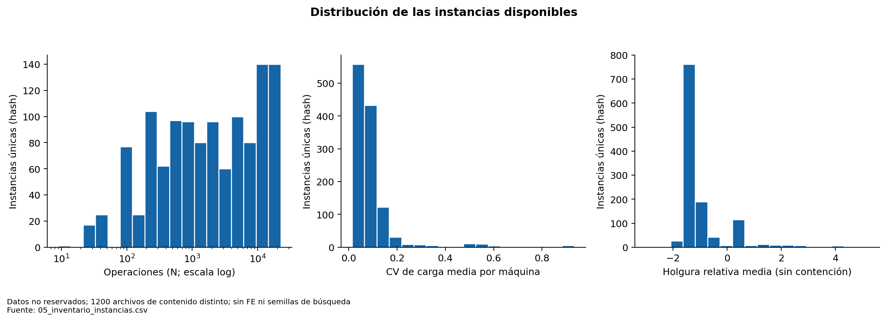

**Figura 08. Distribución de las instancias disponibles.** Datos no reservados; 1200 archivos de contenido distinto; sin FE ni semillas de búsqueda. Los perfiles derivados están correlacionados; este histograma describe el inventario, no una muestra independiente. Fuente: [05_inventario_instancias.csv](05_inventario_instancias.csv).

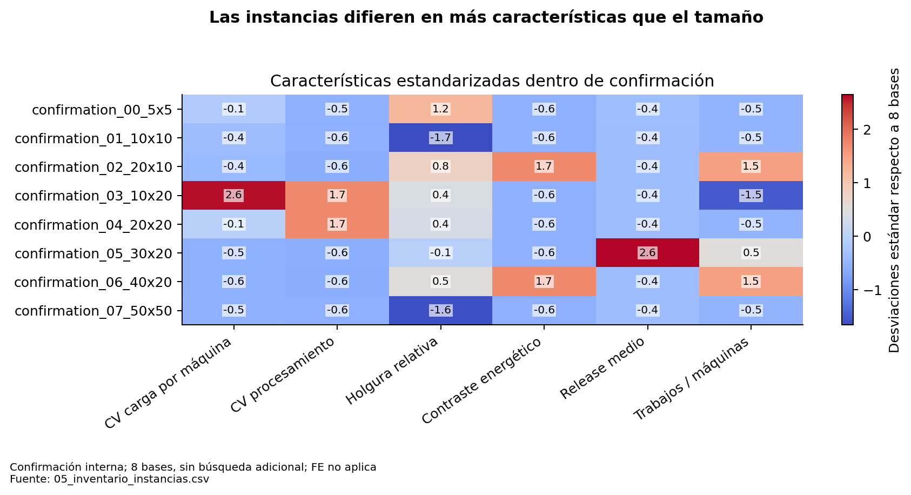

**Figura 21. Las instancias difieren en más características que el tamaño.** Confirmación interna; 8 bases, sin búsqueda adicional; FE no aplica. La estandarización sirve para comparar columnas con unidades distintas; no es un índice de dificultad. Fuente: [05_inventario_instancias.csv](05_inventario_instancias.csv).

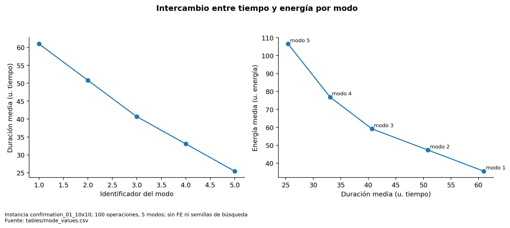

**Figura 22. Intercambio entre tiempo y energía por modo.** Instancia confirmation_01_10x10; 100 operaciones, 5 modos; sin FE ni semillas de búsqueda. El ejemplo describe modos existentes. El número de modos no varía entre las bases comparadas. Fuente: [tables/mode_values.csv](tables/mode_values.csv).

## Clasificación reproducible del tamaño

Capítulo específico: [07_clasificacion_tamanos.md](07_clasificacion_tamanos.md).

Se usan categorías **descriptivas del diseño experimental de ocho geometrías**, no una taxonomía universal del JSSP. Las geometrías de referencia son 5×5, 10×10, 20×10, 10×20, 20×20, 30×20, 40×20 y 50×50, con N=[25,100,200,200,400,600,800,2500]. Se calculan los terciles empíricos con interpolación lineal (NumPy/Pandas): Q₁/₃=200 y Q₂/₃=533.333.

| Categoría de este informe | Regla | Geometrías observadas de referencia | Bases de confirmación |
|---|---|---|---|
| Pequeña | N≤200 | 5×5, 10×10, 20×10, 10×20 | 4 |
| Mediana | 200<N≤533.333 | 20×20 | 1 |
| Grande | N>533.333 | 30×20, 40×20, 50×50 | 3 |

Se conservan juntos los dos diseños de 200 operaciones. Eso produce grupos desbalanceados; no se fuerzan cortes para obtener un ganador determinado. Los archivos archivados mayores también se etiquetan por esta regla, pero “grande” cubre desde 600 hasta 22500 operaciones: para describirlos se deben mirar N y geometría exactos. La columna del CSV es `geometry_category`.

La relación J/M y las dos dimensiones se conservan separadas: 20×10 y 10×20 tienen N=200 pero distinta contención y longitud de cadena. No se reduce toda la estructura a un único número. Las instancias de validación de 2×2, 3×2 y 3×3 no definen los cortes ni entran en inferencia de rendimiento.

La literatura usa familias de benchmarks y dimensiones concretas, sin un umbral único que pueda trasladarse automáticamente a este MO-JSSP con tres objetivos, releases y velocidades. Por eso este informe no etiqueta estos terciles como categorías generales de la literatura. Una comparación con un benchmark externo debe publicar sus propias dimensiones, objetivos, generador y presupuesto.

La categoría mediana tiene una sola base en confirmación. Un intervalo bootstrap idéntico a su valor observado no es precisión perfecta: no hay información para estimar variación entre bases en esa categoría. Se informa como **incertidumbre entre bases no estimable**.

Ver [resultados por tamaño](08_rendimiento_por_tamano.md), [algorithm_by_size](tables/algorithm_by_size.csv) y [registro del criterio](evidence/analysis_audit.json).

## Comparación integral por condiciones compatibles

Capítulo específico: [11_comparacion_standalones_portafolios.md](11_comparacion_standalones_portafolios.md).

#### Comparación principal: confirmación reciente

3000 FE por ejecución, población 30, bloques 50, ocho bases nuevas y tres semillas por base. Media con peso igual por base. El padre externo usa una asignación obtenida de otra ejecución: la tabla muestra el coste del tratamiento, no el del par control+tratamiento.

| Método | HV | AUC-HV | Tiempo (s) | Vectores únicos | Diversidad genética |
| --- | --- | --- | --- | --- | --- |
| SW-UCB original | 0.910688 | 0.863775 | 10.669425 | 33.416667 | 0.522403 |
| Padre externo con replay | 0.919227 | 0.871660 | 11.159364 | 36.333333 | 0.584256 |
| MOEA/D | 0.951055 | 0.892458 | 10.342937 | 42.000000 | 0.410422 |
| NSGA-II | 0.936247 | 0.887201 | 11.093345 | 39.208333 | 0.510718 |
| UCB escalado | 0.931368 | 0.878448 | 10.825721 | 40.000000 | 0.582817 |
| SPEA2 | 0.931566 | 0.887347 | 10.658174 | 40.041667 | 0.498004 |
| Uniforme | 0.907719 | 0.862234 | 10.723841 | 34.625000 | 0.522602 |

MOEA/D lidera HV y AUC medios. Escalado mejora el portafolio original y uniforme, pero no supera en promedio a los tres individuales. NSGA-II y SPEA2 también tienen AUC media mayor que escalado. La diversidad genética más alta del portafolio no compensa automáticamente esa brecha de calidad.

#### Diagnóstico histórico, sin mezclar presupuestos

| budget | method | n_base_clusters | mean_hv | sd_hv | mean_seconds |
| --- | --- | --- | --- | --- | --- |
| 1000 | Adaptive Portfolio (DMAB) | 10 | 0.895674 | 0.080687 | 2.847333 |
| 1000 | MOEA/D | 10 | 0.929894 | 0.095252 | 2.554326 |
| 1000 | NSGA-II | 10 | 0.922717 | 0.088311 | 2.746716 |
| 1000 | SPEA2 | 10 | 0.919666 | 0.086333 | 2.822224 |
| 1000 | Uniform Portfolio (Round-Robin) | 10 | 0.896374 | 0.082811 | 2.842687 |
| 3000 | Adaptive Portfolio (DMAB) | 10 | 0.950298 | 0.101235 | 8.966583 |
| 3000 | MOEA/D | 10 | 0.997476 | 0.104116 | 8.086690 |
| 3000 | NSGA-II | 10 | 0.980304 | 0.112566 | 8.603693 |
| 3000 | SPEA2 | 10 | 0.973181 | 0.106626 | 8.957935 |
| 3000 | Uniform Portfolio (Round-Robin) | 10 | 0.944871 | 0.099915 | 8.988331 |
| 5000 | Adaptive Portfolio (DMAB) | 10 | 0.979420 | 0.105080 | 15.348296 |
| 5000 | MOEA/D | 10 | 1.033652 | 0.098234 | 13.911648 |
| 5000 | NSGA-II | 10 | 1.009661 | 0.115866 | 14.685187 |
| 5000 | SPEA2 | 10 | 0.998988 | 0.111839 | 15.332571 |
| 5000 | Uniform Portfolio (Round-Robin) | 10 | 0.976170 | 0.104618 | 15.389468 |

La ventaja de MOEA/D histórico respecto al portafolio original no desaparece al pasar de 1000 a 5000 FE. Eso contradice una explicación basada exclusivamente en arranque: puede influir profundidad, asignación o complementariedad insuficiente. No identifica por sí solo sus causas.

Las otras cohortes (benchmark técnico, Fase 1, PH y versiones F8) se publican en [historical_summary](tables/historical_summary.csv), con su presupuesto y composición. Los métodos de PH no comparten las variantes de perfil ni todas las semillas con Fase 2. No se integran como si sus HV medios midieran un mismo ensayo. Tampoco hay una campaña reciente de 10000 FE que permita concluir superioridad a ese presupuesto.

#### Métricas disponibles y límites

HV, FE, archivo y tiempo existen en cohortes principales. AUC reciente se recalculó con los 60 bloques. Los rangos y distancias en objetivos, y las distancias genéticas finales, son diagnósticos diferentes. Los archivos históricos guardan vectores pero no todos los genotipos ni poblaciones. No se completa con números inventados la diversidad genotípica histórica.

Las tablas de medias, medianas, DE, IC y contrastes están en [recent_summary](tables/recent_summary.csv), [recent_paired_statistics](tables/recent_paired_statistics.csv) y [exploratory_all_pairwise](tables/exploratory_all_pairwise.csv). El conjunto principal es confirmación interna; resultados de desarrollo y perfiles son exploratorios.

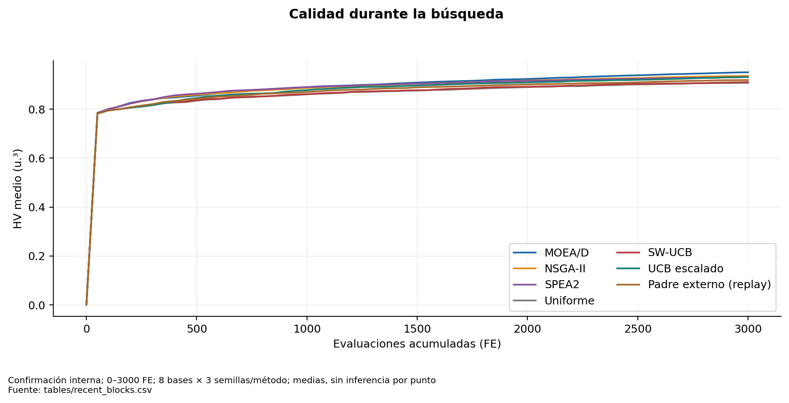

**Figura 03. Calidad durante la búsqueda.** Confirmación interna; 0–3000 FE; 8 bases × 3 semillas/método; medias, sin inferencia por punto. Las trayectorias proceden de registros cada 50 FE; el origen (0,0) forma parte de AUC. Fuente: [tables/recent_blocks.csv](tables/recent_blocks.csv).

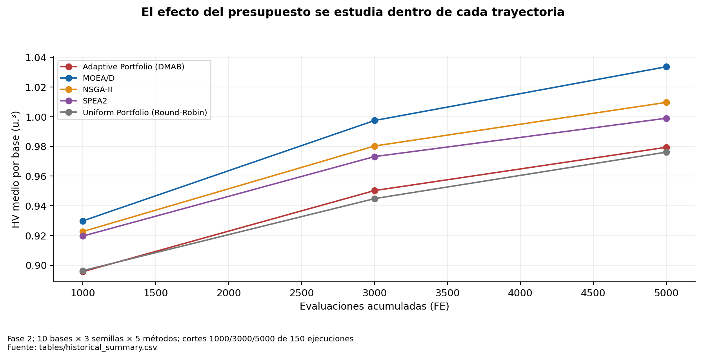

**Figura 13. El efecto del presupuesto se estudia dentro de cada trayectoria.** Fase 2; 10 bases × 3 semillas × 5 métodos; cortes 1000/3000/5000 de 150 ejecuciones. No tratar 450 cortes como ejecuciones independientes. El piloto de 1000 FE tampoco es una réplica nueva de calidad. Fuente: [tables/historical_summary.csv](tables/historical_summary.csv).

## Estadística, incertidumbre y unidad de análisis

Capítulo específico: [12_analisis_estadistico.md](12_analisis_estadistico.md).

La unidad independiente es la **base de instancia**. Se promedian semillas dentro de base; en Fase 1 también perfiles al comparar rendimiento global. Sus 600 corridas equivalen a ocho clústeres independientes, no 600 bases. En confirmación reciente n=8 con 24 corridas por método; en desarrollo n=6. Fase 2 tiene n=10, 150 trayectorias, 450 cortes dependientes.

#### Familia principal predefinida

Dos candidatos frente a SW-UCB en HV final de confirmación, Holm de dos pruebas. Se recalculan diferencias pareadas, bootstrap de bases (20000 remuestreos, semilla analítica 20261016), prueba exacta de inversión de signos de la media (2⁸), victorias/empates/derrotas y dᶻ.

| treatment | n_bases | mean_delta | ci_low | ci_high | p_signflip | p_holm_confirmatory_hv | wins | losses | cohen_dz |
| --- | --- | --- | --- | --- | --- | --- | --- | --- | --- |
| scaled | 8 | 0.020680 | 0.014084 | 0.027370 | 0.007812 | 0.015625 | 8 | 0 | 1.994887 |
| guidance | 8 | 0.008539 | 0.001655 | 0.013961 | 0.054688 | 0.054688 | 7 | 1 | 0.898190 |

El escalado presenta ΔHV=+0.020680 e IC positivo, con p ajustado .015625. El padre externo tiene ΔHV=+0.008539 e IC bootstrap positivo, pero p ajustado .054688. No se elige la prueba que produzca “significativo”: sus distintos resultados se muestran juntos. La prueba de signos sin magnitudes para guía da .070312, frente a .054688 de inversión de signos de la media.

La prueba de inversión de signos exige intercambiabilidad/simetría bajo la hipótesis nula; no es idéntica al test binomial de signos ni prueba causal por sí sola. dᶻ divide por la DE de diferencias entre bases y puede ser inestable con n pequeño. Los IC bootstrap son aproximados, condicionados a la colección de bases y no simultáneos. Los IC descriptivos de HV absoluto mezclan estructura y escala de normalización; para cambios convienen IC de diferencias pareadas.

#### Análisis secundarios y exploratorios

AUC, tiempo, archivo y diversidad se reportan como secundarios con sus IC; no se declararon todos confirmatorios al 5%. Se incluyen Friedman exploratorio y comparaciones por pares con Holm **por cohorte y presupuesto** en [omnibus_tests](tables/omnibus_tests.csv) y [exploratory_all_pairwise](tables/exploratory_all_pairwise.csv). Un omnibus significativo no demuestra que cada método sea mejor que todos los demás. Los contrastes de ocho perfiles relativos tienen su propia familia de ocho pruebas en [profile_relative_effects](tables/profile_relative_effects.csv).

Las p de Wilcoxon calculadas con SciPy pueden usar métodos distintos en presencia de ceros/empates; la tabla conserva además el contraste exacto de inversión de signos. Las p históricas de PH documentadas (.146484, .320312, .578125 tras Holm) se citan como análisis histórico, no como una nueva confirmación. No confundir ausencia de significación con equivalencia.

No se realizó metaanálisis de campañas, selección de variables ni ajuste del portafolio. La nueva semilla de bootstrap puede cambiar ligeramente los límites frente al informe del día 15 sin cambiar los resultados crudos. Los intervalos de una categoría con una sola base son degenerados y **no estiman** incertidumbre entre bases.

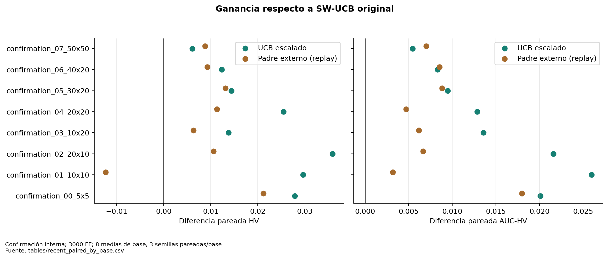

**Figura 02. Ganancia respecto a SW-UCB original.** Confirmación interna; 3000 FE; 8 medias de base, 3 semillas pareadas/base. Escalado mejora HV y AUC en las ocho bases; padre externo pierde HV en una. Fuente: [tables/recent_paired_by_base.csv](tables/recent_paired_by_base.csv).

## Rendimiento y características de instancia

Capítulo específico: [09_rendimiento_por_caracteristicas.md](09_rendimiento_por_caracteristicas.md).

Se estudió la diferencia HV(NSGA-II o SPEA2) − HV(MOEA/D), no sólo el HV absoluto. Las correlaciones de Spearman usan medias de semillas por base; Fase 1 restringe este análisis a los ocho perfiles nominales para no presentar 40 variantes correlacionadas como independientes. Se conservan separadas las campañas y los presupuestos. No se ajusta un modelo de nueve predictores con ocho observaciones.

Los descriptores incluyen operaciones, J/M, CV de carga por máquina, holgura, CV de procesamiento, contraste energético, releases y correlación tiempo–energía. El número de modos es constante y se marca no estimable. Las correlaciones son exploratorias sin pruebas de selección de variables ni reivindicación causal.

#### Contrastes emparejados de perfiles históricos

Fase 1 permite comparar cada tratamiento con su propia base nominal. Para separar el cambio de rendimiento relativo se calcula:

Δrel=(HV_alg−HV_MOEAD)_perfil−(HV_alg−HV_MOEAD)_base.

Se promedian cinco semillas antes de calcular diferencias entre las ocho bases. Se corrigen conjuntamente ocho contrastes (4 perfiles × 2 algoritmos). Esto controla dependencia de variantes, pero no convierte los cambios de HV entre instancias normalizadas de forma distinta en pérdida física de tiempo o energía.

| profile | contrast | n_base_clusters | mean_delta | ci_low | ci_high | wins | losses | p_signflip | p_holm |
| --- | --- | --- | --- | --- | --- | --- | --- | --- | --- |
| tard_med | NSGA-II - MOEA/D | 8 | -0.000422 | -0.003165 | 0.002698 | 3 | 5 | 0.781250 | 1.000000 |
| tard_med | SPEA2 - MOEA/D | 8 | 0.001398 | -0.002293 | 0.004927 | 4 | 4 | 0.500000 | 1.000000 |
| tard_high | NSGA-II - MOEA/D | 8 | 0.002615 | -0.000813 | 0.006336 | 5 | 3 | 0.234375 | 1.000000 |
| tard_high | SPEA2 - MOEA/D | 8 | 0.004573 | -0.001809 | 0.011028 | 5 | 3 | 0.203125 | 1.000000 |
| nrg_strong | NSGA-II - MOEA/D | 8 | 0.011700 | 0.003337 | 0.023105 | 6 | 2 | 0.031250 | 0.187500 |
| nrg_strong | SPEA2 - MOEA/D | 8 | 0.008058 | -0.002689 | 0.023600 | 5 | 3 | 0.351562 | 1.000000 |
| btnk_high | NSGA-II - MOEA/D | 8 | 0.014506 | 0.008054 | 0.021239 | 8 | 0 | 0.007812 | 0.062500 |
| btnk_high | SPEA2 - MOEA/D | 8 | 0.013489 | 0.006127 | 0.020936 | 7 | 1 | 0.015625 | 0.109375 |

El cuello de botella aumenta la ventaja relativa de NSGA-II frente a MOEA/D en las ocho bases (+0.014506 HV medio), señal consistente. Tras Holm sobre ocho contrastes, p=.0625: merece contraste dirigido, no una regla confirmada de especialización. El perfil energético fuerte también muestra una señal nominal para NSGA-II, debilitada al corregir multiplicidad. Los cambios de fechas tienen incertidumbre que incluye cero en estos contrastes relativos.

En la campaña reciente tamaño y perfil se asignan juntos: 20×10 con energía fuerte, 10×20 con cuello de botella, 20×20 con duración variable y 30×20 con releases altos. Una correlación no identifica cuál de ellos explica la diferencia. Además, las cotas analíticas modifican la escala entre perfiles. Los mismos métodos sí comparten normalización dentro de cada instancia.

Fuentes: [profile_relative_effects_by_base](tables/profile_relative_effects_by_base.csv), [exploratory_feature_correlations](tables/exploratory_feature_correlations.csv), [feature_performance_scatter](tables/feature_performance_scatter.csv).

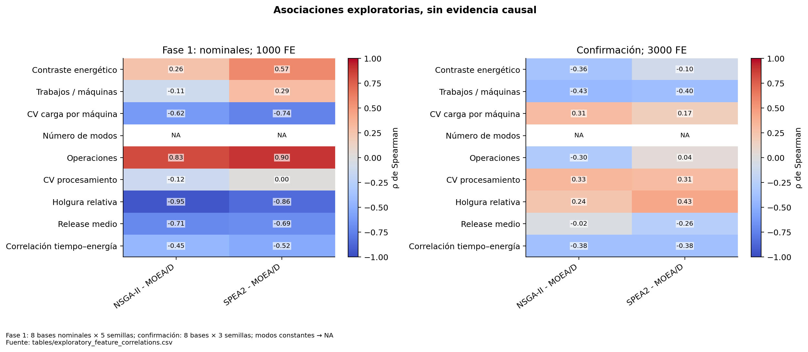

**Figura 14. Asociaciones exploratorias, sin evidencia causal.** Fase 1: 8 bases nominales × 5 semillas; confirmación: 8 bases × 3 semillas; modos constantes → NA. Las diferencias entre campañas y perfiles impiden usar estas correlaciones como un selector entrenado. Fuente: [tables/exploratory_feature_correlations.csv](tables/exploratory_feature_correlations.csv).

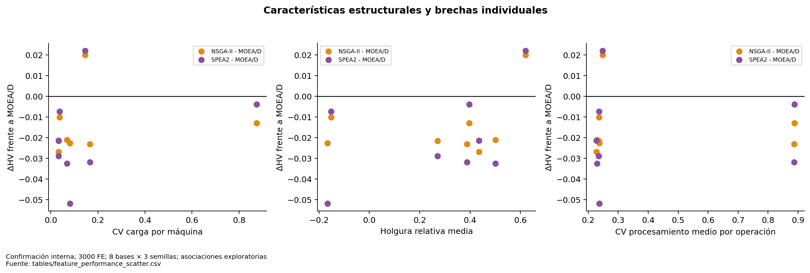

**Figura 18. Características estructurales y brechas individuales.** Confirmación interna; 3000 FE; 8 bases × 3 semillas; asociaciones exploratorias. Tamaño, perfil y configuración del generador no están cruzados factorialmente en esta campaña. Fuente: [tables/feature_performance_scatter.csv](tables/feature_performance_scatter.csv).

## Complementariedad observada y beneficio real

Capítulo específico: [14_complementariedad.md](14_complementariedad.md).

**Sí existe complementariedad geométrica observada. No se ha demostrado que baste para compensar el presupuesto dividido.** Los archivos de los tres algoritmos contienen soluciones diferentes; la unión mejora el HV del mejor archivo aislado en muchos casos. Sin embargo, esa unión compara tres búsquedas completas y cuesta tres veces el presupuesto de cada una.

#### Medida canónica

Sea Aᵢ el archivo completo guardado de cada brazo y U=ND(∪Aᵢ). La contribución exclusiva es

MCᵢ = HV(U) − HV(ND(∪ⱼ≠ᵢ Aⱼ)).

Al retirar i, se recuperan las soluciones de otros archivos que estaban dominadas por él. Restar sus puntos del frente U ya filtrado pierde esos sustitutos y sobreestima MCᵢ. Se detectó ese defecto en el cierre histórico; los resultados originales no se modificaron aquí. El recálculo actual coincide con la tabla histórica canónica.

| FE_per_arm | arm | contribucion_exclusiva | ganancia_union |
| --- | --- | --- | --- |
| 1000 | MOEA/D | 0.011384 | 0.006493 |
| 1000 | NSGA-II | 0.003728 | 0.006493 |
| 1000 | SPEA2 | 0.003252 | 0.006493 |
| 3000 | MOEA/D | 0.021573 | 0.008617 |
| 3000 | NSGA-II | 0.003043 | 0.008617 |
| 3000 | SPEA2 | 0.003826 | 0.008617 |
| 5000 | MOEA/D | 0.030796 | 0.009547 |
| 5000 | NSGA-II | 0.003065 | 0.009547 |
| 5000 | SPEA2 | 0.003849 | 0.009547 |

A 5000 FE por individual (15000 para la unión), los aportes exclusivos medios son aproximadamente .030796, .003065 y .003849 para MOEA/D, NSGA-II y SPEA2. La ganancia de unión sobre el mejor individual a ese B es .009547. Estos números no son un beneficio gratuito de un portafolio de 5000 FE. Tampoco se suman los MC como HV total: el volumen cubierto en común permanece sin asignación exclusiva.

En el portafolio reciente se calcula la misma eliminación sobre los archivos locales **realmente obtenidos bajo su asignación**. El valor no predice qué pasaría si se retirara un algoritmo y se reasignaran sus FE: es un contrafactual geométrico, no una ablación de búsqueda. La complementariedad puede variar al cambiar cuánto ejecuta cada brazo.

#### Cuatro afirmaciones distintas

| Concepto | Evidencia actual |
|---|---|
| Complementariedad observada | Archivos y HV exclusivos positivos, heterogéneos por base |
| Especialización regional | Ejemplos y descriptores de regiones; falta persistencia por semillas y bases |
| Especialización por tipo | Señales de perfiles; insuficiente validación independiente |
| Beneficio del portafolio | Escalado mejora su control, pero los individuales siguen siendo referencias más fuertes |

En los 42 pares recientes, el uniforme a 3000 FE equivale a la unión de los tres flujos individuales a 1000 FE con semillas alineadas, según la auditoría conservada. Es una demostración de agregación pasiva, no de cooperación activa.

Fuentes: [historical_standalone_union](tables/historical_standalone_union.csv), [recent_complementarity](tables/recent_complementarity.csv), [corrección histórica](../pareto_cooperation_research/metrics_correction_report.md).

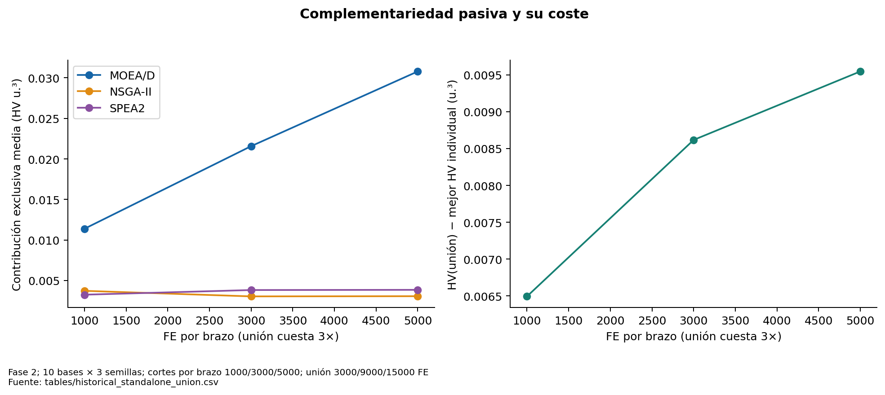

**Figura 20. Complementariedad pasiva y su coste.** Fase 2; 10 bases × 3 semillas; cortes por brazo 1000/3000/5000; unión 3000/9000/15000 FE. Ganancia de unión positiva no demuestra que un portafolio gane al mejor individual a igual FE total. Fuente: [tables/historical_standalone_union.csv](tables/historical_standalone_union.csv).

## Aporte exclusivo, procedencia y solapamiento

Capítulo específico: [16_contribuciones_por_brazo.md](16_contribuciones_por_brazo.md).

Las siguientes medias usan ocho bases y tres semillas de confirmación a 3000 FE totales. Los archivos locales contienen los resultados de cada receptor bajo la asignación ejecutada. Un genotipo presente en dos archivos cuenta como compartido y la eliminación de un brazo conserva la copia del otro.

| method | arm | MC | genotipos_exclusivos_ND | compartidos |
| --- | --- | --- | --- | --- |
| adaptive | MOEA/D | 0.010419 | 14.083333 | 0.000000 |
| adaptive | NSGA-II | 0.005540 | 9.041667 | 0.000000 |
| adaptive | SPEA2 | 0.006183 | 11.250000 | 0.000000 |
| guidance | MOEA/D | 0.003979 | 17.208333 | 0.000000 |
| guidance | NSGA-II | 0.003482 | 8.791667 | 0.000000 |
| guidance | SPEA2 | 0.002996 | 11.250000 | 0.000000 |
| scaled | MOEA/D | 0.035772 | 18.250000 | 0.000000 |
| scaled | NSGA-II | 0.017451 | 10.083333 | 0.000000 |
| scaled | SPEA2 | 0.019510 | 13.708333 | 0.000000 |

No se equipara el brazo receptor con origen genético completo. `first_observed_final` es el primer brazo en cuyo archivo se observó el genotipo durante el registro por bloques; no captura todos los hijos descartados ni su genealogía. `guidance_events` identifica receptor, donante y padre nativo sustituido. Un hijo del donante puede tener crédito de generación del receptor y ascendencia de otro brazo. Son datos distintos.

El recálculo offline de todos los MC recientes discrepa de los valores guardados como máximo 4.44×10⁻¹⁶. El Jaccard exacto por genotipos y vectores se publica por par de brazos en [archive_overlap](tables/archive_overlap.csv). Cero coincidencias no prueba ausencia de solapamiento volumétrico ni regiones completamente separadas.

Hay tres escalas temporales disponibles: recompensas por bloque (ganancia secuencial dependiente del orden), MC de archivos recientes finales y MC de uniones individuales históricas a 1000/3000/5000 FE. **No hay archivos locales completos por cada bloque reciente** para calcular un MC temporal canónico continuo. Asignar a un brazo la suma de ΔHV de sus bloques no sustituye ese análisis: una ganancia temprana puede volverse redundante después.

Las contribuciones por instancia, semilla y presupuesto están en [recent_complementarity](tables/recent_complementarity.csv) y [historical_standalone_union](tables/historical_standalone_union.csv). Para estudiar si una región cambia con las características se necesita cruzar perfiles con bases independientes y guardar archivos locales/procedencia por checkpoint. Esa optimización queda como trabajo posterior.

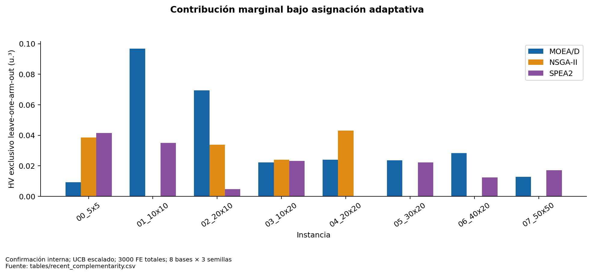

**Figura 06. Contribución marginal bajo asignación adaptativa.** Confirmación interna; UCB escalado; 3000 FE totales; 8 bases × 3 semillas. No sumar estas contribuciones como HV total. Son archivos locales observados, no un experimento de eliminar brazos. Fuente: [tables/recent_complementarity.csv](tables/recent_complementarity.csv).

## Selección adaptativa: conducta y utilidad

Capítulo específico: [17_analisis_adaptabilidad.md](17_analisis_adaptabilidad.md).

El selector original ya responde matemáticamente a recompensas, pero el tamaño del bono frente a ΔHV puede volverlo casi uniforme. Escalado corrige la escala de explotación sin eliminar revisitas ni cambiar W o c. Las [fórmulas exactas](03_catalogo_algoritmos_portafolios.md) evitan confundirlo con FRRMAB o con normalizar cada brazo por separado.

#### Respuestas a las seis preguntas

| Pregunta | Evidencia y alcance |
|---|---|
| ¿Reparto no uniforme? | Sí: escalado cambia las cuotas medias y los patrones por bloque |
| ¿Reacciona a recompensas? | Sí por reconstrucción de términos de ventana y reglas; el crédito es relativo al estado global |
| ¿Favorece progreso reciente? | La explotación escalada hace relevante su media reciente; no garantiza escoger al futuro mejor brazo |
| ¿Difiere entre instancias? | Sí en las trayectorias y cuotas observadas; no prueba un predictor de características |
| ¿Mejora uniforme? | ΔHV medio +.023649 en confirmación, 8/8 bases; contraste secundario/exploratorio |
| ¿Mejora SW-UCB original? | Sí en esta confirmación interna: ΔHV +.020680, Holm .015625 en familia principal |

| method | MOEA/D | NSGA-II | SPEA2 |
| --- | --- | --- | --- |
| adaptive | 0.344444 | 0.327083 | 0.328472 |
| guidance | 0.344444 | 0.327083 | 0.328472 |
| scaled | 0.408333 | 0.258333 | 0.333333 |
| uniform | 0.333333 | 0.333333 | 0.333333 |

El original asigna aproximadamente 34.44/32.71/32.85% a MOEA/D/NSGA-II/SPEA2. Escalado pasa a 40.83/25.83/33.33%. Esto concuerda globalmente con la ventaja de MOEA/D, pero aún deja la mayoría del presupuesto fuera de él. La base 5×5 y las trayectorias intermedias impiden convertir el resultado agregado en “asignar todo a MOEA/D” como política adaptativa demostrada.

La causalidad identificada por I2 es el efecto total de cambiar la regla de escala, con todo lo demás fijo en los controles. No permite afirmar que cada FE adicional a MOEA/D causó la mejora ni que toda desigualdad de cuotas sea adaptación eficaz. El estado de cada algoritmo cambia con la historia de ejecución.

La generalización a nuevas familias/test no se ha demostrado. La confirmación utiliza nuevas bases pero repite la relación tamaño–perfil y el mismo generador.

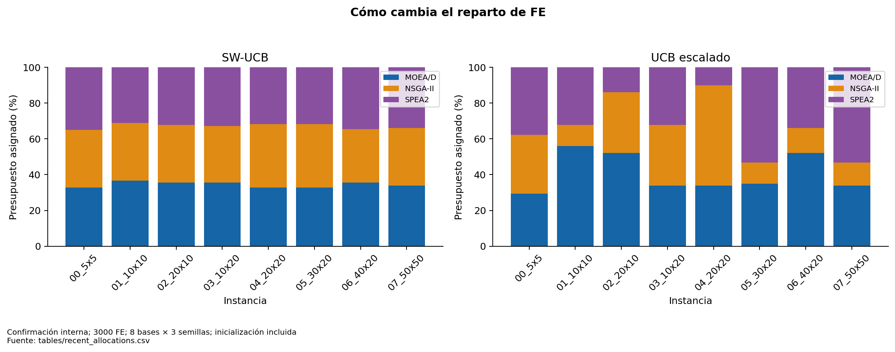

**Figura 05. Cómo cambia el reparto de FE.** Confirmación interna; 3000 FE; 8 bases × 3 semillas; inicialización incluida. Mayor desigualdad por sí sola no demuestra adaptación efectiva. Comparar con figura 02. Fuente: [tables/recent_allocations.csv](tables/recent_allocations.csv).

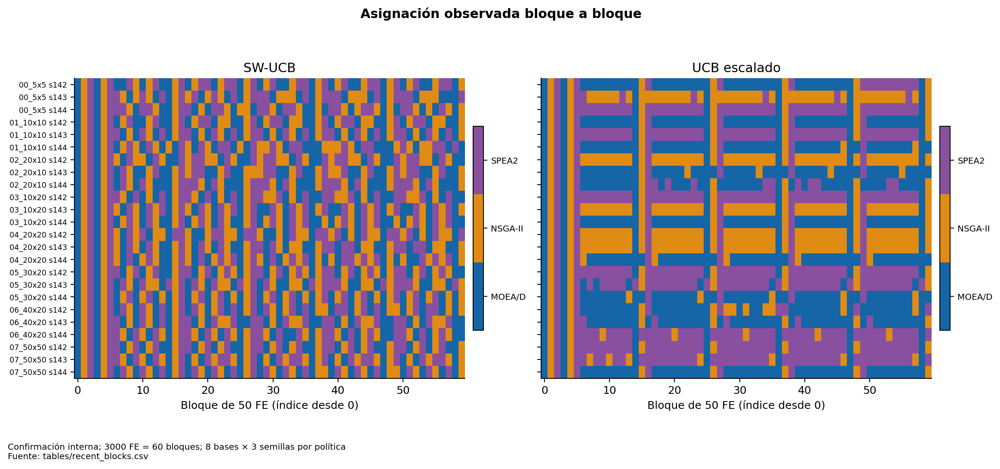

**Figura 15. Asignación observada bloque a bloque.** Confirmación interna; 3000 FE = 60 bloques; 8 bases × 3 semillas por política. Las revisitas se mantienen incluso con UCB escalado. La figura muestra decisiones, no ganancias causales por brazo. Fuente: [tables/recent_blocks.csv](tables/recent_blocks.csv).

## Padre externo y cooperación activa

Capítulo específico: [20_analisis_cooperacion.md](20_analisis_cooperacion.md).

**Compartir genotipos mejora descriptivamente el portafolio original bajo la asignación controlada, pero no está demostrado como la mejor política autónoma ni supera a MOEA/D a igual FE de tratamiento.**

#### Mecanismo observado en código

1. El selector/replay determina el receptor del siguiente bloque; el donante no determina el receptor.
2. Se toma el ND global actual. Los candidatos deben ser de la misma instancia, estar ausentes del archivo local y tener primera observación en otro brazo.
3. Se escoge el candidato que maximiza su distancia mínima euclidiana en objetivos normalizados al archivo local. Empates por ID genotípico. Un solo donante queda congelado durante el bloque.
4. Cada brazo mantiene un contador persistente de eventos de cruce exitoso. Cada diez oportunidades sustituye el segundo padre nativo por el donante disponible; no consume sorteos adicionales para elegir cadencia.
5. POX y mutación nativos generan descendencia. Toda evaluación consume FE y actualiza selección ambiental/decomposición nativas. No se copia el fitness del padre al hijo.
6. Se actualizan archivo local, global y crédito del receptor. La frecuencia efectiva depende de disponibilidad de donante y de la tasa nativa de cruce; no es exactamente una transferencia cada diez FE.

No se mezclan instancias ni máquinas, no se reemplazan poblaciones y no se cambia el problema. Los registros de eventos conservan receptor, padre sustituido, donante e índice de cruce.

#### Comparación controlada y coste

El tratamiento `guidance` reproduce **exactamente la secuencia de asignación de SW-UCB del control**, incluidos presupuestos y fases, para aislar el intercambio genético. La auditoría previa verifica 42 pares con asignaciones idénticas y genotipos finales distintos. La confirmación usa ocho bases y tres semillas.

| treatment | n_bases | mean_delta | ci_low | ci_high | p_signflip | p_holm_confirmatory_hv | wins | losses | cohen_dz |
| --- | --- | --- | --- | --- | --- | --- | --- | --- | --- |
| scaled | 8 | 0.020680 | 0.014084 | 0.027370 | 0.007812 | 0.015625 | 8 | 0 | 1.994887 |
| guidance | 8 | 0.008539 | 0.001655 | 0.013961 | 0.054688 | 0.054688 | 7 | 1 | 0.898190 |

Guía obtiene ΔHV +.008539, ΔAUC +.007885, diversidad genética media +11.84% y coste temporal medio +4.59%. HV mejora en 7/8 bases y cae en 10×10. La p corregida HV .054688 impide presentarlo como resultado confirmatorio fuerte al 5%, aunque el IC bootstrap sea positivo. El efecto es condicionado al replay: ejecutar ambos desde cero cuesta 6000 FE.

#### Por qué aumenta diversidad sin el mejor HV

El donante distante altera combinaciones genéticas y puede ampliar rangos sin desplazar la superficie hacia el ideal ni cubrir una región de gran volumen exclusivo. La distancia genotípica no mide convergencia; rango no equivale a cobertura. El archivo y la selección nativa pueden descartar hijos distantes de baja calidad. La información puede ser redundante en volumen aun sin coincidir sus vectores. Estos mecanismos son explicaciones plausibles, coherentes con los indicadores, pero no se midió el destino de todos los hijos para atribuir cuál domina.

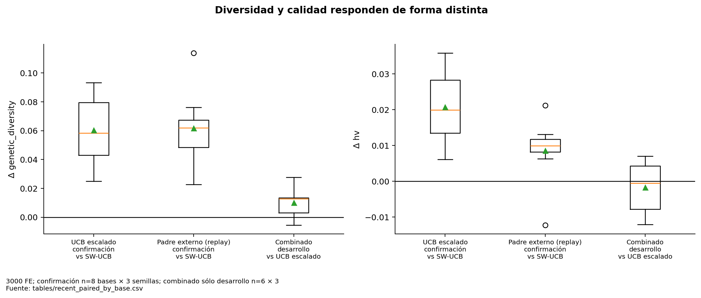

**Figura 10. Diversidad y calidad responden de forma distinta.** 3000 FE; confirmación n=8 bases × 3 semillas; combinado sólo desarrollo n=6 × 3. La diversidad genotípica es una distancia en poblaciones registradas durante la campaña, no cobertura del Pareto óptimo. Fuente: [tables/recent_paired_by_base.csv](tables/recent_paired_by_base.csv).

## Por qué la combinación no añade una mejora demostrada

Capítulo específico: [21_analisis_combinacion_mecanismos.md](21_analisis_combinacion_mecanismos.md).

I3 agrega el mismo padre externo a UCB escalado y utiliza decisiones online. A diferencia del tratamiento de guía aislado, no necesita un control previo de asignaciones. La comparación causal primaria de esta iteración es combinado − escalado, con igual FE, operadores y seis bases de desarrollo × tres semillas.

| metric | n_bases | mean_delta | ci_low | ci_high | wins | losses | p_signflip |
| --- | --- | --- | --- | --- | --- | --- | --- |
| hv | 6 | -0.001742 | -0.007521 | 0.003813 | 3 | 3 | 0.562500 |
| auc_hv | 6 | -0.002773 | -0.008144 | 0.002597 | 2 | 4 | 0.406250 |
| seconds | 6 | -0.666759 | -1.642065 | 0.213045 | 3 | 3 | 0.406250 |
| unique_vectors | 6 | -0.833333 | -5.777778 | 5.555556 | 2 | 4 | 0.875000 |
| archive_size | 6 | -2.166667 | -6.222222 | 2.277778 | 2 | 4 | 0.468750 |
| mean_nn_distance | 6 | -0.000108 | -0.000929 | 0.000626 | 3 | 3 | 0.781250 |
| genetic_diversity | 6 | 0.010187 | 0.001645 | 0.018182 | 4 | 2 | 0.125000 |

El ΔHV medio es −.001742, IC que incluye cero, tres bases favorables y tres desfavorables. ΔAUC es −.002773, favorable en dos de seis bases. La diversidad genética media sube ligeramente, mientras HV y cardinalidad no acreditan una ganancia. Se decidió **no adoptarlo ni llevarlo a confirmación**, no declarar que siempre perjudica.

Hay una interacción real en el flujo: el padre externo cambia hijos, archivos y recompensas; escalado convierte esas recompensas en decisiones que alteran qué algoritmo recibe más profundidad. La ganancia condicional de guía con replay no se puede sumar algebraicamente a la ganancia de escalado. El resultado combinado no sigue la misma asignación que ninguno de los controles.

Hipótesis pendientes: donantes distantes poco útiles bajo la nueva asignación; cambios de crédito que desvían FE; información redundante después de que escalado profundiza el brazo fuerte; o incertidumbre estocástica con pocas bases. Ninguna se identificó mediante un factorial completo con replay común a las cuatro celdas. No elegir retrospectivamente sólo las bases favorables ni ajustar la cadencia usando confirmación.

Un siguiente ensayo debe acordar una ablación con asignación común: sin guía y con guía bajo trazas fijas SW-UCB y escalado, más políticas online claramente diferenciadas. Contar el coste de las trazas externas. Primero definir un objetivo de mecanismo (convergencia, región o diversidad), luego elegir métricas primarias y tamaño de muestra. Ese ensayo se propone para después de la reunión.

## Qué eficiencia está respaldada

Capítulo específico: [23_eficiencia.md](23_eficiencia.md).

Eficiencia significa calidad del conjunto de soluciones en relación con **evaluaciones y tiempo**, incluida la evolución durante la búsqueda. Una política más rápida con peor HV no es automáticamente más eficiente para el objetivo de tesis. Tampoco HV/FE final aislado describe la trayectoria.

| Dimensión | Resultado respaldado | Límite |
|---|---|---|
| Calidad a igual FE | Escalado mejora HV de SW-UCB original y uniforme a 3000 FE | Sigue debajo de MOEA/D en media |
| Calidad durante búsqueda | AUC escalado − original = +.014673; ocho bases favorables | AUC de individuales mayor en media; muestreo de 50 FE |
| Coste de tiempo | Escalado: +1.46% de tiempo medio, guía +4.59% | Sin desglose de overhead; pequeña base escalado +37.8% |
| Umbral pareado | Escalado alcanza HV final original en 22/24; FE truncada media 2062.5 | Dos censuras; umbral depende de control de cada semilla |
| Coste de cooperación | Evaluación de hijos incluida en FE nativas | Replay necesita control adicional; no es política autónoma de 3000 FE |
| Selección y archivo | Incluidos en tiempo de búsqueda medido | No hay cronómetros aislados para atribuir sus costes |

Hay una mejora de eficiencia **relativa al portafolio original**: mejor calidad con el mismo B y cambio temporal agregado pequeño, además de mejor calidad acumulada. No se demuestra dominancia sobre el mejor individual, que sigue ofreciendo mayor HV/AUC medios con tiempo similar. Las comparaciones de calidad por segundo dependen fuertemente del tamaño; conviene revisar cada base antes de decidir un compromiso operacional.

El tiempo por FE aumenta con operaciones, selección ambiental y tamaño de archivo; su correlación no identifica un coste puro del decodificador. Se conservan tiempos por bloque y por corrida. No se añade consumo energético de CPU: E es un objetivo del calendario industrial, distinto del coste energético de ejecutar el software.

Ver [tiempo y censura](13_eficiencia_computacional.md), [recent_summary](tables/recent_summary.csv), [threshold_baseline_final_hv](tables/threshold_baseline_final_hv.csv). La comparación global de la campaña, los ensayos previos de reproducción y las FE de auditoría están separados de FE de búsqueda.

## Qué adaptabilidad está respaldada

Capítulo específico: [24_adaptabilidad.md](24_adaptabilidad.md).

Conviene distinguir tres propiedades que requieren evidencias diferentes.

| Propiedad | Evidencia disponible | Conclusión |
|---|---|---|
| Adaptación dentro de una corrida | Ventana de recompensas, términos UCB, cambios de brazo y diferencias por etapa | Implementada y observada; el escalado mejora su utilidad frente al control |
| Adaptación entre instancias | Cuotas distintas, ganadores distintos y respuestas de perfiles | Heterogeneidad observada; no existe todavía una regla validada basada en rasgos |
| Generalización | Nuevas bases de confirmación del mismo generador y perfiles por tamaño | Confirmación interna limitada; test final y familias externas pendientes |

El reparto desigual no basta: se exige que cambiar la política produzca una mejora bajo controles. I2 ofrece esa evidencia frente a SW-UCB original, con las ocho bases favorables. La reconstrucción de recompensas respalda que el mecanismo usa progreso reciente. Aun así, no demuestra que seleccione el mejor brazo posible en cada etapa: ese oráculo exige contrafactuales que no se ejecutaron.

La primera base pequeña asigna recursos y tiene ganadores distintos; la mayor parte del resto favorece MOEA/D. La relación con características no es causal porque perfil y geometría se confunden en la campaña reciente. Las correlaciones históricas tampoco se mantienen necesariamente al cambiar B. Por eso “adaptativo” describe una regla dependiente de observaciones, no una garantía de generalización.

PH detecta disminución de una señal global, pero esa señal disminuye naturalmente al refinar el archivo y depende de los algoritmos ejecutados antes. Sus alarmas no prueban cambios reales de régimen ni identificación de un nuevo mejor brazo. El resultado negativo respalda una decisión de parsimonia y sugiere estudiar escala del crédito antes de añadir más detectores.

Ver [selección](17_analisis_adaptabilidad.md), [recompensas](18_analisis_recompensas.md), [presupuesto](19_asignacion_presupuesto.md). Mantener intacto el holdout final es necesario para una futura afirmación de generalización.

## Por qué el portafolio aún no supera a MOEA/D

Capítulo específico: [22_por_que_no_supera_moead.md](22_por_que_no_supera_moead.md).

**El hecho demostrado es una brecha de rendimiento bajo presupuesto total compartido. No hay una causa única demostrada.** En confirmación, HV medio MOEA/D=.951055 y escalado=.931368, diferencia −.019687. Escalado pierde frente a MOEA/D en siete de ocho medias de base; en 5×5 lo supera, pero allí SPEA2 es el mejor individual. La AUC también favorece a MOEA/D. Este resultado no implica superioridad universal en cualquier B o distribución.

| Hipótesis | Explicación | Evidencia favorable | Evidencia contraria / límite | Nivel de respaldo | Experimento necesario |
| --- | --- | --- | --- | --- | --- |
| H1 Fragmentación | Cada brazo recibe fracción de B y se inicializan tres poblaciones | Escalado sigue con sólo 40.83% medio para MOEA/D; individual usa 100%; uniforme equivale a unión de flujos cortos | Escalado mejora sin eliminar brazos; en 5×5 un individual alternativo gana | Respaldo descriptivo; causa parcial plausible | Igual total FE, cuotas fijas predefinidas, control del arranque y ablación de 2/3 brazos |
| H2 Menor profundidad | Pausas y menor FE por brazo reducen refinamiento de subproblemas | Ventaja histórica MOEA/D persiste a 5000 FE; mejora al aumentar FE | Estado persiste; pausar no equivale a reiniciar; no hay control puro de profundidad | Plausible, no separada de H1 | Replay con cuotas iguales y distinto orden, y MOEA/D al mismo FE que recibe en portafolio |
| H3 Complementariedad insuficiente | La ganancia exclusiva no cubre el coste de dividir B | Unión histórica gana sólo .006493/.008617/.009547 con coste 3B; aportes MOEA/D predominan | NSGA-II/SPEA2 sí aportan MC positivo y hay bases donde ganan | Respaldo geométrico fuerte; eficacia presupuestaria no aislada | Ablaciones con igual FE total y cuotas de exploración mínimas predefinidas |
| H4 Guía genética poco eficaz para HV | Diversidad genética puede no mejorar convergencia de volumen | Guía sube diversidad pero queda por debajo de MOEA/D; combinación sin ganancia adicional | Guía mejora al control original en 7/8 bases y AUC en 8/8 | Efecto limitado observado; no inutilidad de cooperación | Registrar supervivencia, ganancia física e HV de hijos guiados frente a nativos con asignación común |
| H5 Crédito inmediato incompleto | Beneficio futuro o donación se acredita al receptor o no recibe crédito | Recompensa global no registra ascendencia; archivos parciales no muestran aprendizaje oculto | Escalado simple ya mejora con el mismo crédito inmediato | Hipótesis sin contraste causal | Una variante aislada de crédito retardado/procedencia, con protocolo previo y coste igual |
| H6 Explorar/explotar subóptimo | Bonos dominan recompensa cruda; revisitas aún cuestan FE | I2 aislada mejora 8/8 bases; términos reconstruidos y asignación cambian | No se demostró c,W óptimos; más explotación puede perder complementariedad | Evidencia del defecto de escala; óptimo desconocido | Analizar sensibilidad limitada en desarrollo y confirmar política congelada, sin usar test |
| H7 Heterogeneidad de instancias | El mejor algoritmo y mecanismo dependen de rasgos y B | Excepción 5×5; perfiles históricos y pérdidas de guía en 10×10 | MOEA/D gana 7/8 recientes; tamaño/perfil confundidos | Heterogeneidad observada; regla general pendiente | Bases replicadas por geometría, tratamientos cruzados y varios B por trayectoria |

H1 y H2 están relacionadas y las métricas actuales no separan sus efectos. La cooperación de I1 sí aísla un cambio genético condicionado a una traza fija; la comparación entre escalado e individual cambia simultáneamente presencia de otros brazos y profundidad, de modo que no identifica una razón mecánica única. La ventaja de MOEA/D a 5000 FE históricos apoya estudiar profundidad y complementariedad, pero proviene de otra cohorte.

La evidencia más sólida de mecanismo es H6 a nivel de política: cambiar sólo la escala de explotación mejora SW-UCB manteniendo condiciones. No se ha identificado si su ventaja depende enteramente de asignar más FE a MOEA/D o también del orden y los retornos a otros brazos.

Para la reunión conviene decir: “hemos reducido la brecha del portafolio con una corrección de crédito, pero el beneficio complementario observado no demuestra aún compensación del presupuesto dividido”. Evitar “MOEA/D siempre es mejor”, “los otros brazos no sirven” y “el problema es únicamente fragmentación”.

Gráficas de apoyo: [01 calidad final](figures/01_hv_confirmacion.png), [03 progreso](figures/03_hv_fe.png), [05 cuotas](figures/05_asignacion.png), [13 presupuesto histórico](figures/13_presupuestos_historicos.png), [20 MC a distintos FE](figures/20_complementariedad_fe.png). Todas están explicadas y enlazadas a sus datos en el [catálogo de figuras](FIGURAS.md).

## Relación con la pregunta y los objetivos de tesis

Capítulo específico: [25_relacion_objetivos_tesis.md](25_relacion_objetivos_tesis.md).

La pregunta de investigación se puede sostener como el estudio de **cómo asignación y cooperación afectan la eficiencia y adaptabilidad de un portafolio MO-JSSP**, sin imponer que siempre gane al mejor constituyente.

| Objetivo | Trabajo y evidencia | Estado |
|---|---|---|
| Resolver Cmax, tardanza y energía | Representación común, decoder factible, archivos Pareto, controles individuales | Implementado; optimalidad global desconocida |
| Integrar algoritmos complementarios | Tres brazos pausables, archivos locales/global, MC y solapamiento | Integración y complementariedad observadas |
| Asignar FE inteligentemente | RR, SW-UCB, UCB1/PH y escalado; trazas y ablación I2 | Mejora interna de escala respaldada |
| Compartir información útil | Padre externo, replay y eventos trazables | Señal favorable condicionada; autonomía y crédito pendientes |
| Mejorar eficiencia | HV/AUC a igual FE, tiempo y umbrales con censura | Frente al portafolio original sí; frente a MOEA/D no |
| Adaptarse a instancias | Instancias perfiladas, variación de cuotas y análisis exploratorio | Falta confirmación factorial con bases replicadas |
| Validez y reproducibilidad | Datos preservados, fuente congelada reciente, hashes, semillas, análisis por base | Fuerte para campaña reciente; procedencia histórica parcial |

Los aportes científicos defendibles son: detectar y corregir una desproporción entre explotación y exploración; separar cooperación genética de agregación mediante control de asignación; cuantificar complementariedad con sustitutos preservados; identificar límites de PH y de combinar mecanismos; y diseñar una evaluación que no confunda variantes ni semillas con bases independientes.

La tesis gana precisión al registrar también resultados negativos: mayor diversidad no asegura mayor HV, unión de búsquedas completas no prueba ventaja presupuestaria y combinar mejoras no garantiza aditividad. La auditoría muestra qué preguntas necesitan nuevos controles y evita presentar como resuelta la generalización.

Una redefinición del objetivo hacia “superar siempre a MOEA/D” no está respaldada por los datos ni es necesaria para justificar el estudio. La decisión académica es acordar el alcance de la contribución y un experimento final acotado, con resultados favorables y desfavorables igualmente publicables.

## Limitaciones, datos ausentes y próximos experimentos

Capítulo específico: [31_limitaciones_y_pendientes.md](31_limitaciones_y_pendientes.md).

| Pregunta pendiente | Qué falta | Por qué | Cómo obtenerlo / experimento | Momento |
| --- | --- | --- | --- | --- |
| Especialización general | Varias bases independientes por geometría/perfil y más cantidad de modos | Separar efectos confundidos y estimar variación entre bases | Diseño cruzado con hipótesis dirigida, semillas comunes y análisis por base | Después; acordar mañana |
| Causa de brecha con MOEA/D | Ablaciones de composición, cuota y orden a igual FE | MC geométrico no reasigna FE ni controla profundidad | Cuotas/replay y 2/3 brazos, una mejora aislada | Después |
| Guía autónoma | Tratamiento online con control de asignación y coste completo | El replay reutiliza una traza obtenida externamente | Ablación controlada; informar coste 2B cuando proceda | Después |
| Crédito retardado y ascendencia | Genealogía completa y destino de hijos, incluidos descartados | Primera observación no identifica donación causal | Instrumentación futura congelada, luego una variante aislada | Después |
| Diversidad genotípica histórica | Poblaciones o genotipos ausentes en archivos antiguos | Vectores objetivo no permiten reconstruir genomas | Declarar no disponible; sólo una reproducción autorizada generaría esos datos | No necesaria antes |
| MC reciente continuo por FE | Archivos locales de todos los brazos por bloque | Milestones globales no reconstruyen sustitutos locales antiguos | Guardar snapshots futuros; no sustituir por suma ΔHV | Después |
| Coste aislado de selector/archivo | Cronómetros separados bajo el mismo trabajo de búsqueda | Tiempo total mezcla operaciones y distintos archivos | Instrumentación de costes que no cambie RNG ni FE | Después |
| Procedencia histórica exacta | Instantánea de fuentes cargadas y parámetros efectivos | Commit reportado puede omitir cambios sucios del experimento | Preservar metadata disponible y reconocer incertidumbre; no inventar hashes cargados | Documentado antes |
| Generalización | Test final y familias no usadas para hipótesis | Confirmación actual comparte generador/perfiles | Protocolo congelado y apertura única de test, validación externa posterior | Después del acuerdo |
| Unidad física energética y modelo ampliado | Documentación de unidades y energía ociosa si forma parte del problema | E implementada no es energía de CPU ni se ha validado una unidad kWh | Mantener definiciones actuales; consultar alcance académico | Discutir mañana |
| Categoría mediana | Más de una base de 20×20 en cohorte reciente | IC entre bases no estimable con n=1 | Replicar geometría y perfiles manteniendo grupos y FE | Después |
| Archivos reservados e inválidos | Acceso autorizado a test sólo para final; errores de archivos inválidos documentados | Inventario no debe contaminar hipótesis ni esconder errores | Mantener metadatos reservados y estados explícitos | Ya aplicado |

Las ausencias no se rellenan con estimaciones de otras campañas. Las propuestas no se ejecutaron en esta tarea. La prioridad para mañana es comunicar qué sí se sabe y acordar un contraste acotado; aumentar indefinidamente semillas de las mismas ocho bases no resuelve falta de diversidad estructural.

No se recomienda usar el archivo histórico sin split como nuevo test por conveniencia. Su historia de exposición no está clara. Si se usa, debe etiquetarse desarrollo/exploración hasta demostrar separación previa.

## Discusión y conclusiones

La complementariedad existe, pero su volumen exclusivo no prueba que compense el presupuesto repartido. La cooperación genética tiene efecto condicionado a asignación fija y no ha demostrado ser el mejor mecanismo online. La corrección de escala mejora eficiencia y utilidad adaptativa frente al portafolio original. El liderazgo medio de MOEA/D permanece y debe ser el control de referencia. Sus causas se mantienen como hipótesis separadas y contrastables.

La relación algoritmo–tipo de instancia es una pregunta abierta: los datos apoyan heterogeneidad y un ensayo dirigido de cuello de botella, no una taxonomía predictiva consolidada. La confirmación interna no reemplaza un test final reservado. No se debe ajustar con resultados de ese test ni presentar las variantes correlacionadas como nuevas bases.

## Trabajo futuro y decisiones

| Decisión | Alternativas | Evidencia | Ventajas | Riesgos | Recomendación provisional | Información adicional |
| --- | --- | --- | --- | --- | --- | --- |
| 1. Criterio de éxito de tesis | Mejorar portafolio base / vencer mejor individual / compromiso multiindicador | Escalado mejora control; pierde media frente a MOEA/D | Objetivo centrado en mecanismos es verificable y permite resultados negativos | Cambiar criterio después de ver test induciría sesgo | Mantener eficiencia/adaptabilidad y MOEA/D como referencia fuerte | Acordar mínimo efecto relevante, restricciones y métrica primaria |
| 2. Composición y fragmentación | Tres brazos / MOEA-D+NSGA-II / MOEA-D+SPEA2 / control con cuotas fijas | MC asimétrico y ganadores locales; 40.83% FE medio a MOEA/D en escalado | Ablación a igual B separa utilidad presupuestaria | Eliminar por media puede perder 5×5 u otras regiones | Acordar una ablación pequeña con bases replicadas y mismas FE totales | Precisión/potencia por base y cuota mínima predefinida |
| 3. Alcance de cooperación | Ensayo de mecanismo con replay / política online / congelar línea por ahora | Guía positiva media, p corregida .054688; combinación no adicional | Replay aísla genética; online sirve como política deployable | Coste externo de replay y crédito cruzado sin genealogía completa | No vender replay como política autónoma; decidir si financiar una ablación de asignación común | Costes totales, supervivencia de hijos guiados, trazas comparables |
| 4. Hipótesis de especialización | Contraste dirigido de cuello de botella / factorial amplio / modelo predictivo | NSGA-II Δrel +.014506 en 8/8, Holm ocho pruebas .0625; una base por geometría | Contraste dirigido reduce preguntas y permite replicación estructural | Modelo complejo sobre ocho bases sobreajustaría | Priorizar cuello de botella con varias bases por geometría y efecto mínimo | Generación/split previo y potencia/IC objetivo; modos constantes no responden su efecto |
| 5. Validación final y multiplicidad | Nueva confirmación interna / abrir test final una vez / benchmark externo | Test intacto; confirmación actual mismo generador y confusión tamaño-perfil | Protocolo congelado sostiene generalización y trazabilidad | Abrir para afinar contamina la evaluación final | Congelar política y análisis antes de abrir test; decidir una única familia principal | Presupuesto acordado, bases/semillas, reglas de parada, hashes y plan para resultados negativos |

## Referencias y procedencia

Ver [REFERENCIAS.md](REFERENCIAS.md), [inventario de campañas](tables/campaign_inventory.csv), [manifest](evidence_manifest.json) y [auditoría final](30_auditoria_final.md).
## Ampliación: preservación y línea paralela

### Preservación, trazabilidad y corte de evidencia

Se inició en el checkout experimental `mojssp-loop-agent`, rama `experiment/pareto-archive-cooperation`, HEAD `1d695f3efa45d261da89bd7ba832730c33c9d4ca`. Git registra sólo este worktree: el checkout es una copia independiente. No se cambió de rama ni se hizo push.

Antes del análisis se registraron 5236 archivos de fuente, scripts, tests, datos y resultados en cuatro checkouts. El estado Git ya contenía cambios de la campaña reciente: tres brazos modificados, cooperación, scripts y resultados sin seguimiento. Se conserva el [diff inicial](evidence/preexisting_algorithm_changes.diff). Los scripts de esta auditoría sólo escriben en el directorio de reunión.

| Checkout | Rama / HEAD inicial | Conservación observada |
|---|---|---|
| mojssp-loop-agent | experiment/pareto-archive-cooperation / 1d695f3 | Fuente y resultados previos sin cambios; sólo nuevos productos de reunión |
| mojssp-dmab | experiment/page-hinkley-dmab / 47af7eb | Consulta en lectura; estado inicial conservado |
| mojssp-dmab - copia | experiment/page-hinkley-dmab / 47af7eb | Desapareció externamente durante la tarea; no se restauró |
| mojssp-pareto-cooperation | experiment/pareto-archive-cooperation / 1d695f3 | Otro proceso produjo P7 y actualizó su diseño; corte adicional separado |

La [preservación inicial](evidence/preservation_before.json) no se sobrescribe. La [verificación final](evidence/verification.json) distingue integridad del checkout autorizado, del repositorio original y cambios externos observados. No se certifica inmutabilidad global de directorios externos. El recuento de 1336 contenidos/2746 copias corresponde al inicio; algunas rutas de copias desaparecidas ya no existen, aunque sus hashes permanecen registrados.

| campaign | date | code_version | FE | n_instances | n_base_clusters | n_seeds | n_records |
| --- | --- | --- | --- | --- | --- | --- | --- |
| phase1_40_profiles | 2026-10-14 17:38:56 | not_recorded | 1000 | 40 | 8 | 5 | 600 |
| technical_benchmark | 2026-10-14 16:40:01 | not_recorded | 1000 | 8 | 8 | 1 | 40 |
| phase2_pilot | 2026-10-14 19:09:43 | a5566d477b352d20d39b40e3cf9c05d6fd6bb24b | 1000 | 10 | 10 | 3 | 150 |
| phase2_budget | 2026-10-14 19:45:10 | a5566d477b352d20d39b40e3cf9c05d6fd6bb24b | 1000;3000;5000 | 10 | 10 | 3 | 450 |
| page_hinkley_final | metadata/file_times_only | not_recorded | 5000 | 10 | 10 | 3 | 90 |
| legacy_raw | metadata/file_times_only | not_recorded | 500;1000 | 12 | 12 | 3 | 180 |
| legacy_pilot | metadata/file_times_only | not_recorded | 1000 | 5 | 5 | 5 | 125 |
| legacy_f86 | metadata/file_times_only | not_recorded | 1000 | 5 | 5 | 10 | 200 |
| legacy_f865 | metadata/file_times_only | not_recorded | 1000 | 37 | 37 | 10 | 1480 |
| legacy_f86_uniform | metadata/file_times_only | not_recorded | 1000 | 5 | 5 | 10 | 50 |
| legacy_c_calibration | metadata/file_times_only | not_recorded | 1000 | 3 | 3 | 5 | 105 |
| loop_development | 2026-10-15 | 1d695f3 + frozen source snapshots; baseline provenance correction | 3000 | 6 | 6 | 3 | 144 |
| loop_confirmation | 2026-10-15 | 1d695f3 + frozen source snapshots; baseline provenance correction | 3000 | 8 | 8 | 3 | 168 |
| page_hinkley_calibration | October 2026; exact runtime date not recorded | experiment/page-hinkley-dmab; loaded source snapshot absent | 5000 | 10 | 10 | 3 | 270 |
| p5_c_sensitivity | 2026-10-15T20:55:37.499964+00:00 | Sibling checkout 1d695f3 + P6 working tree; snapshot of current source, loaded-state not certified | 1000 | 2 | 2 | 1 | 8 |
| p6_injection_pilot | 2026-10-15T20:55:37.499964+00:00 | Sibling checkout 1d695f3 + P6 working tree; snapshot of current source, loaded-state not certified | 1000 | 2 | 2 | 1 | 8 |
| p6_fixed_control | 2026-10-15T20:55:37.499964+00:00 | Sibling checkout 1d695f3 + P6 working tree; snapshot of current source, loaded-state not certified | 1000 | 2 | 2 | 1 | 2 |
| p7_partial_external | 2026-10-15T20:55:37.499964+00:00 | Sibling checkout 1d695f3 + P6 working tree; snapshot of current source, loaded-state not certified | 1000 | 10 | 10 | 5 | 317 |

El [inventario completo](tables/campaign_inventory.csv) contiene métodos, FE, semillas, configuración, métricas, rutas y limitaciones. Los 450 cortes históricos son 150 trayectorias; las 30 filas PH C5 se reutilizan de calibración. Las fuentes recientes están congeladas en cuatro árboles y un índice SHA-256, con una corrección explícita del código cargado de la base. Un commit histórico no garantiza capturar cambios sucios usados al ejecutar.

Las instancias reservadas sólo se inventarían con metadatos/hashes. No se analizó rendimiento de holdout. P7 tiene una instantánea fija a 2026-10-15T20:55:37.499964+00:00, sin iniciar ni esperar nuevas optimizaciones. Sus resultados provisionales no sustituyen la confirmación reciente de 3000 FE.

### Línea paralela P5/P6/P7: sensibilidad e inyección de incumbentes

Esta línea está en `mojssp-pareto-cooperation`, distinta de la campaña reciente de padre externo en `mojssp-loop-agent`. Sus artefactos P5/P6 ya estaban en el inventario inicial. P7 siguió produciendo datos durante esta auditoría y se capturó una instantánea **a 2026-10-15T20:55:37.499964+00:00**. No se ejecutó, detuvo ni modificó esa campaña. No se actualiza silenciosamente este corte.

## P5: disminuir c no equivale a escalar recompensas

Dos bases, semilla 42, 1000 FE: RR y c=.01/.03/.07 con W=10. En 5×5 c=.01 concentra 71.43% de **las FE adaptativas**, pero sólo 600/1000 FE totales en MOEA/D. En 20×10 asigna 35.71% de FE adaptativas a MOEA/D y su HV es inferior al RR. Por tanto, la frase de un diseño “más del 70% al dominante” describe una base y un denominador, no un resultado general.

| instance_name | policy_name | total_fe | final_hv | auc_hv | adapt_pct_moead | adapt_pct_nsga2 | adapt_pct_spea2 |
| --- | --- | --- | --- | --- | --- | --- | --- |
| base_c01_5x5_b03 | Round-Robin | 1000 | 0.990285 | 0.897325 | 35.710000 | 35.710000 | 28.570000 |
| base_c01_5x5_b03 | SW-UCB_c0.01 | 1000 | 0.987354 | 0.908745 | 71.430000 | 14.290000 | 14.290000 |
| base_c01_5x5_b03 | SW-UCB_c0.03 | 1000 | 0.987504 | 0.908043 | 57.140000 | 21.430000 | 21.430000 |
| base_c01_5x5_b03 | SW-UCB_c0.07 | 1000 | 0.989177 | 0.898276 | 42.860000 | 28.570000 | 28.570000 |
| base_c03_20x10_b04 | Round-Robin | 1000 | 0.821503 | 0.763838 | 35.710000 | 35.710000 | 28.570000 |
| base_c03_20x10_b04 | SW-UCB_c0.01 | 1000 | 0.814190 | 0.761402 | 35.710000 | 28.570000 | 35.710000 |
| base_c03_20x10_b04 | SW-UCB_c0.03 | 1000 | 0.815910 | 0.765144 | 28.570000 | 28.570000 | 42.860000 |
| base_c03_20x10_b04 | SW-UCB_c0.07 | 1000 | 0.814190 | 0.765088 | 35.710000 | 28.570000 | 35.710000 |

## P6: transferencia directa de soluciones evaluadas

El código `CooperativePortfolio` del checkout paralelo ofrece hasta dos soluciones **ya evaluadas** a las estructuras internas del receptor antes del bloque, desde índice 6. No cobra una segunda FE por reutilizar los objetivos deterministas del incumbente; cada nuevo hijo sí se evalúa. Es diferente del padre externo: éste cambia el segundo padre de cruce y no inserta incumbentes en poblaciones.

La selección efectiva de ofertas ordena lexicográficamente Cmax,T,E y toma primero/último. El diseño proponía criterios diferentes por algoritmo, que no deben confundirse con la implementación observada. Se exige procedencia extranjera activa; el receptor filtra duplicados y decide supervivencia conforme a sus estructuras. No se afirma que esos extremos lexicográficos maximicen cobertura del frente.

Piloto de dos bases y una semilla:

| instance_name | condition | final_hv | auc_hv | moead_fe | nsga2_fe | spea2_fe |
| --- | --- | --- | --- | --- | --- | --- |
| base_c01_5x5_b03 | MOEAD_Standalone | 1.011508 | 0.923114 | 1000 | 0 | 0 |
| base_c01_5x5_b03 | Portfolio_RoundRobin | 0.990285 | 0.897325 | 350 | 350 | 300 |
| base_c01_5x5_b03 | Portfolio_SWUCB_Passive | 0.987354 | 0.908745 | 600 | 200 | 200 |
| base_c01_5x5_b03 | Portfolio_SWUCB_Cooperative | 0.988580 | 0.899499 | 650 | 200 | 150 |
| base_c03_20x10_b04 | MOEAD_Standalone | 0.846003 | 0.778802 | 1000 | 0 | 0 |
| base_c03_20x10_b04 | Portfolio_RoundRobin | 0.821503 | 0.763838 | 350 | 350 | 300 |
| base_c03_20x10_b04 | Portfolio_SWUCB_Passive | 0.814190 | 0.761402 | 350 | 300 | 350 |
| base_c03_20x10_b04 | Portfolio_SWUCB_Cooperative | 0.824371 | 0.767441 | 400 | 250 | 350 |

Control posterior de secuencia fija:

| instance_name | condition | final_hv | auc_hv | moead_fe | nsga2_fe | spea2_fe |
| --- | --- | --- | --- | --- | --- | --- |
| base_c01_5x5_b03 | Cooperative_FixedSequence_Control | 0.995187 | 0.899787 | 600 | 200 | 200 |
| base_c03_20x10_b04 | Cooperative_FixedSequence_Control | 0.818510 | 0.764400 | 350 | 300 | 350 |

En 5×5 el control fijo alcanza .995187 frente a .987354 pasivo, pero MOEA/D logra 1.011508. En 20×10 .818510 frente a .814190, con MOEA/D .846003. Los incrementos no convierten dos bases/una semilla en validación general. Las fracciones 42.4%/57.6% de un informe son particiones aritméticas de una corrida, no una descomposición causal identificada. Sumar eventos de supervivencia por bloques tampoco cuenta genotipos únicos retenidos al final.

## P7: corte parcial, separado de la confirmación principal

Plan: 10 bases nominales de desarrollo × 5 semillas × 7 condiciones =350 corridas de 1000 FE, c=.01, bloques50, población30, κ=2 desde bloque6. El corte contiene **317/350 filas**, 10 bases observadas y **9 bases completas** en las siete condiciones y cinco semillas (315 filas). Se resume sólo ese subconjunto equilibrado; el criterio es completitud, no rendimiento. La última geometría incompleta limita representatividad por tamaño. No se calculan p confirmatorias ni se mezcla con 3000 FE.

| condition | n_complete_bases | mean_hv | mean_auc | mean_seconds |
| --- | --- | --- | --- | --- |
| MOEAD_Standalone | 9 | 0.912168 | 0.842305 | 1.486693 |
| NSGA2_Standalone | 9 | 0.906653 | 0.843554 | 1.728498 |
| Portfolio_Coop_FixedSequence | 9 | 0.896995 | 0.827392 | 1.760202 |
| Portfolio_RoundRobin_Passive | 9 | 0.874743 | 0.815889 | 1.683967 |
| Portfolio_SWUCB_Cooperative | 9 | 0.897042 | 0.827550 | 1.768300 |
| Portfolio_SWUCB_Passive | 9 | 0.885444 | 0.822243 | 1.705627 |
| SPEA2_Standalone | 9 | 0.902645 | 0.839068 | 1.760251 |

En este corte, coop online − pasivo es +.011598 HV medio y fijo − pasivo +.011551. MOEA/D mantiene mayor HV medio (.912168) que coop online (.897042). Son cifras **provisionales de nueve bases**, no el resultado final P7. NSGA-II tiene mayor AUC media que MOEA/D en este subconjunto a 1000 FE: presupuesto y cohorte importan al hablar de eficiencia.

Las columnas P7 `marginal_loo_hv_*` eliminan del **archivo global final** las soluciones etiquetadas por primera observación en un brazo. Miden marginalidad de esa partición de procedencia, sin recuperar archivos locales completos. No equivalen al MC de retirar el archivo del algoritmo entero y no se mezclan con él. La etiqueta tampoco es ascendencia genética.

## Inconsistencias narrativas pendientes

El protocolo declara 100 holdout, pero el split preservado contiene 80 variantes/16 bases. Describe MOEA/D como “límite superior” aunque sólo es un control empírico. El tamaño genotípico tampoco es N!×5ᴺ para una secuencia de trabajos repetidos: con M operaciones por trabajo el número de secuencias es N!/∏ⱼ(M!) antes de considerar equivalencias fenotípicas. Los informes originales se preservan sin corregirlos aquí.

Fuente y hashes: [corte adicional](evidence/additional_campaign_cutoff.json); [copia de archivos usados](evidence/additional_campaign_snapshot/). Datos completos del corte: [p7_partial_snapshot.csv](tables/p7_partial_snapshot.csv); medias equilibradas: [p7_partial_complete_base_means.csv](tables/p7_partial_complete_base_means.csv). Se verificó split de desarrollo y 1000 FE. Todas las lecturas permanecieron estables durante la captura. No se certificaron aún fuentes cargadas por corrida, telemetría completa de inyección ni cierre final. Cuando termine P7 corresponde otra auditoría en otro corte/directorio, conservando éste.

Esta ampliación no cambia las conclusiones de la cohorte principal. La nueva campaña observada no fue iniciada por esta auditoría y su cierre queda pendiente.
