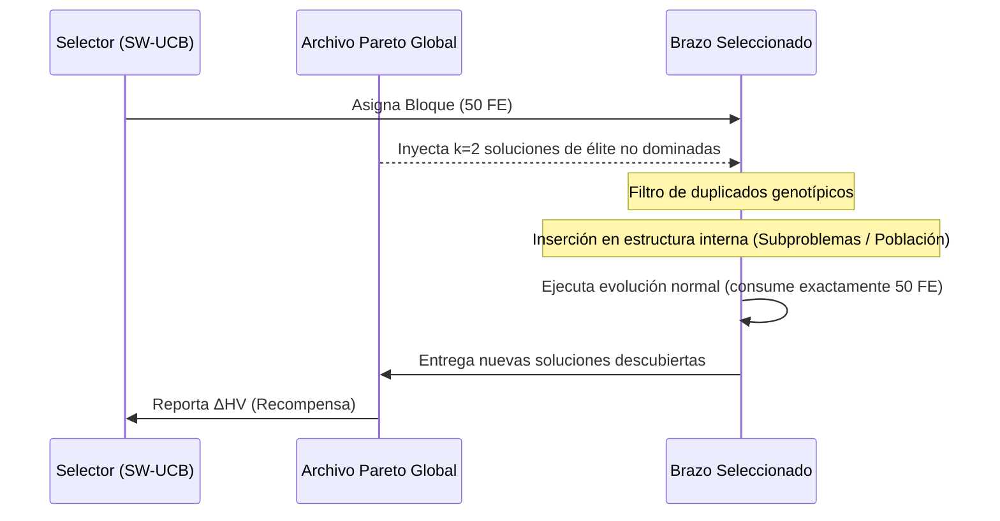

# Informe de Diseño Arquitectónico y Metodológico: Cooperación Activa (P6)

**Fecha:** 2026-10-15  
**Contexto:** Portafolio Algorítmico MO-JSSP — Transición de Portafolio Pasivo a Cooperativo  
**Worktree:** `..\mojssp-pareto-cooperation` (Rama: `experiment/pareto-archive-cooperation`)  
**Estado:** Documento de diseño arquitectónico y metodológico previo a implementación.

---

## 1. Resumen Ejecutivo y Motivación

En la Fase P5 se comprobó empíricamente que la sintonización del selector (SW-UCB con $c=0.01$) logra romper el ciclado ciego y concentrar más del $70\%$ de las evaluaciones adaptativas en el algoritmo dominante (MOEA/D). No obstante, dicha selectividad **no superó al algoritmo ejecutado de forma standalone** ni resolvió el estancamiento en instancias complejas como `base_c03` ($20 \times 10$).

La causa raíz identificada es la **penalización por fragmentación del presupuesto**: en un portafolio pasivo, cada algoritmo evoluciona su propia población aislada. Al repartir 1000 FE entre 3 algoritmos, cada uno recibe sólo una fracción de las evaluaciones, reduciendo drásticamente su profundidad generacional.

La **Fase P6** investiga si es posible revertir esta fragmentación mediante **cooperación activa**: permitir que las soluciones no dominadas descubiertas por un algoritmo e incorporadas al Archivo Pareto Global sean inyectadas en las poblaciones de los otros algoritmos, transfiriendo material genético de alta calidad sin alterar la equidad computacional.

---

## 2. Auditoría Arquitectónica de los Brazos (Estado Interno)

Cada brazo posee una estructura de datos algorítmica especializada:

| Algoritmo | Estado Poblacional Principal | Representación Interna | Mecanismo de Reemplazo / Supervivencia | Espacio de Búsqueda |
| :--- | :--- | :--- | :--- | :--- |
| **MOEA/D** | `_subproblems: List[Subproblem]` (longitud $N$, típicamente 30) | Cada `Subproblem` contiene `(weight, neighborhood, solution, schedule, objectives, norm_objs)` | Escalarización de Tchebycheff $g^{te}$ frente al punto ideal $z^*$. Reemplaza hasta $n_r$ vecinos en el vecindario $B(i)$. | Descomposición en $N$ direcciones sobre el símplex unitario. |
| **NSGA-II** | `_population: List[Individual]` (longitud $N$) y `_offspring_in_progress` | `Individual(solution, schedule, objectives)` con atributos dinámicos `rank` y `crowding_distance` | Ordenamiento no dominado rápido + distancia de apiñamiento (crowding distance) sobre unión $(P_t \cup Q_t)$. | Frente Pareto completo guiado por dominancia y dispersión. |
| **SPEA2** | `_archive_population: List[SPEA2Individual]` (tamaño $K$) y `_population: List[SPEA2Individual]` (tamaño $N$) | `SPEA2Individual(solution, schedule, objectives, norm_objs, strength, raw_fitness, density, fitness)` | Selección ambiental en unión $(P_t \cup \bar{P}_t)$: Raw Fitness $R(i) = \sum S(j)$, densidad $k$-NN y truncamiento determinista lexicográfico. | Archivo ambiental fijo que preserva extremos y minimiza aglomeración. |

---

## 3. Análisis de Inyección por Algoritmo

### 3.1. Recepción en MOEA/D sin violar la descomposición
- **Restricción canónica:** MOEA/D no admite una población amorfa; cada individuo pertenece a un subproblema $i$ asociado al vector de pesos $\lambda^i$.
- **Mecanismo de inyección compatible:** Para una solución candidata externa $x_{ext}$ con vector normalizado $f(x_{ext})$:
  1. Se actualiza el punto ideal de referencia $z^*$ si $f_k(x_{ext}) < z^*_k$.
  2. Se identifica el subproblema $i^* = \arg\min_i g^{te}(f(x_{ext}) \mid \lambda^i, z^*)$ para el cual la solución es más afín.
  3. Se evalúa el reemplazo en el vecindario $B(i^*)$: para cada vecino $j \in B(i^*)$, si $g^{te}(f(x_{ext}) \mid \lambda^j, z^*) < g^{te}(f(x_j) \mid \lambda^j, z^*)$, se reemplaza la solución incumbente del subproblema $j$ (hasta un máximo de $n_r$ reemplazos).
- **Validez:** Respeta formalmente la invariante de subproblemas y el principio de descomposición.

### 3.2. Recepción en NSGA-II respetando selección y diversidad
- **Restricción canónica:** Reemplazar individuos arbitrarios destruiría la diversidad de apiñamiento o el elitismo de frentes.
- **Mecanismo de inyección compatible:** Las soluciones inyectadas se incorporan como parte del conjunto de candidatos a selección ambiental. Al inicio del bloque del brazo:
  - Si la población $P_t$ está completa, las soluciones inyectadas compiten en un reemplazo elitista contra los peores individuos del frente más dominado (mayor `rank`, o menor `crowding_distance` en el último frente aceptado).
  - Alternativamente, se inyectan en el pool de padres para el torneo binario sin alterar el tamaño fijo $|P_t| = N$.

### 3.3. Recepción en SPEA2 respetando archivo ambiental y truncamiento
- **Restricción canónica:** SPEA2 mantiene un archivo ambiental $\bar{P}_t$ de tamaño estrictamente fijo $K$. El fitness total $F(i) = R(i) + D(i)$ depende de las relaciones de dominancia mutua de todo el conjunto.
- **Mecanismo de inyección compatible:** Las soluciones inyectadas se añaden al archivo ambiental previo $\bar{P}_{t-1}$ antes de la selección ambiental de la siguiente generación, o se insertan en $\bar{P}_t$ ejecutando inmediatamente el procedimiento canónico `environmental_selection(union, archive_size=K)` con truncamiento lexicográfico.
- **Validez:** Garantiza que si la solución inyectada está dominada o es redundante espacialmente, es eliminada naturalmente por el truncamiento determinista de SPEA2.

---

## 4. Presupuesto Computacional, Evaluaciones (FE) y Prevención de Sesgos

### 4.1. El Dilema de la Doble Contabilización de FE
- **Pregunta:** Si la solución $x_{ext}$ ya fue decodificada y evaluada por el Brazo A (consumiendo 1 FE en el bloque previo), ¿debe cobrarse una nueva FE cuando el Brazo B la recibe?
- **Respuesta metodológica:** 
  - La solución **ya posee su fenotipo (Schedule) y sus valores objetivos exactos $(C_{\max}, T, E)$**, los cuales están almacenados en el `ArchiveEntry` del Archivo Pareto Global.
  - Re-evaluar $x_{ext}$ mediante `Evaluator.evaluate()` constituiría un **gasto inútil de presupuesto computacional** (desperdicio de FE en una tupla idéntica determinista).
  - No cobrar FE permitiría inyectar información generada en bloques anteriores. Sin embargo, para evitar que el algoritmo receptor reciba "información gratuita ilimitada", la inyección debe estar estrictamente regulada por una **tasa de inyección fija $\kappa$** (ej. máximo $\kappa=2$ soluciones por bloque).
  - La regla de oro es: **El número total de llamadas a `Evaluator.evaluate()` a lo largo de la corrida debe ser exactamente idéntico entre el portafolio pasivo, el cooperativo y los standalones (exactamente 1,000 FE o 5,000 FE).**

### 4.2. Prevención de Duplicados Genotípicos y de Objetivos
- Un riesgo severo de la inyección es la pérdida prematura de diversidad (superpoblación de clones).
- **Filtro estricto de entrada:**
  - **Genotipo idéntico:** Si el `genotype_id` de la solución a inyectar ya existe en la población interna del brazo receptor, **se descarta inmediatamente la inyección**.
  - **Vector objetivo idéntico:** Si el vector objetivo coincide pero el genotipo es distinto, se permite la entrada únicamente si aporta diversidad en una dirección desatendida.

---

## 5. Mecanismo Mínimo Viable de Cooperación Propuesto (MMVC)

Para maximizar la simplicidad, reproducibilidad y garantizar que no se introduzcan efectos colaterales desestabilizadores, se descartan mecanismos complejos como migración masiva en isla o topologías de anillo asíncronas.

### Definición del MMVC: *Inyección Periódica Acotada al Inicio del Bloque (Bounded Elite Injection)*

1. **Momento:** Exclusivamente al inicio de cada bloque adaptativo (`block_index >= 3`, posterior al calentamiento neutral).
2. **Volumen:** Exactamente **$\kappa = 2$ soluciones** por bloque.
3. **Criterio de selección de soluciones a inyectar:**
   - Se seleccionan 2 soluciones del Archivo Pareto Global que **no hayan sido generadas por el brazo receptor**.
   - Para MOEA/D: Las 2 soluciones externas que optimizan las direcciones de pesos con mayor error de escalarización.
   - Para NSGA-II: Las 2 soluciones externas con mayor distancia de apiñamiento en el frente global (extremos o regiones despobladas).
   - Para SPEA2: Las 2 soluciones externas con menor densidad en el espacio normalizado.
4. **Mecanismo de inserción:**
   - En **MOEA/D**: Reemplazo en los 2 subproblemas más afines si mejoran el Tchebycheff actual.
   - En **NSGA-II**: Reemplazo directo de los 2 peores individuos del frente de mayor rango en $P_t$.
   - En **SPEA2**: Inserción en $\bar{P}_t$ ejecutando `environmental_selection` para mantener tamaño $K=30$.

---

## 6. Diseño Experimental Comparativo (P6)

### 6.1. Controles Experimentales
Para aislar rigurosamente el efecto causal de la cooperación activa, se deben comparar 4 configuraciones bajo **exactamente las mismas semillas y presupuesto**:

1. **Control 1: Standalone Óptimo (MOEA/D Standalone):** Límite superior de convergencia sin fragmentación de presupuesto.
2. **Control 2: Portafolio Pasivo Round-Robin:** Portafolio sin cooperación con asignación uniforme.
3. **Control 3: Portafolio Pasivo SW-UCB ($c=0.01$):** Portafolio sin cooperación con alta concentración selectiva.
4. **Tratamiento: Portafolio Cooperativo SW-UCB ($c=0.01$ + MMVC):** Portafolio con inyección activa de soluciones.

### 6.2. Hipótesis Científicas a Contrastar
- **Hipótesis H5 (Superación de la Fragmentación):** La cooperación activa permite que el portafolio supere o iguale el HV final de Standalone MOEA/D al combinar la convergencia de MOEA/D con la cobertura perimetral de NSGA-II/SPEA2.
- **Hipótesis H6 (Aceleración de Trayectoria):** El AUC-HV a 1,000 FE del portafolio cooperativo será superior al del portafolio pasivo ($AUC > 0.91$).
- **Hipótesis H7 (Eficacia de Cruzamiento Inter-Algorítmico):** Las soluciones inyectadas serán seleccionadas como padres en torneos y generarán descendencia no dominada viable.

### 6.3. Métricas de Evaluación
1. **HV Final:** Calidad del frente Pareto al agotar el presupuesto.
2. **AUC-HV $(0, 0)$:** Integral trapezoidal de la trayectoria de convergencia.
3. **Tiempo de pared (Wall-clock time):** Medición de la sobrecarga de la inyección (debe representar $<2\%$ del tiempo de bloque).
4. **Contribución Marginal y Tasa de Supervivencia de Inyecciones:**
   - Cuántas soluciones inyectadas sobreviven al final del bloque en la población del receptor.
   - Cuántas soluciones hijas generadas a partir de una solución inyectada ingresan al Archivo Global.

---

## 7. Criterios Explícitos de Falsificación y Abandono

La cooperación activa **debe ser rechazada o abandonada** si se presentan las siguientes condiciones en el piloto experimental:

1. **Criterio de Incompatibilidad Genética (Deriva Letal):** Si más del $90\%$ de las soluciones inyectadas son expulsadas en la primera generación del brazo receptor por no ser competitivas en sus métricas locales.
2. **Criterio de Homogeneización Prematura:** Si la inyección colapsa la diversidad fenotípica (medida por crowding distance media) y reduce el número de vectores objetivo únicos en más de un $30\%$ frente al portafolio pasivo.
3. **Criterio de Nula Mejora de HV:** Si el tratamiento cooperativo no logra superar el HV final del portafolio pasivo Round-Robin en ninguna de las instancias de desarrollo tras 1000 FE.

---

## 8. Protocolo del Piloto de Desarrollo Propuesto (P6-Pilot)

- **Instancias:** `base_c01_5x5_b03` y `base_c03_20x10_b04`.
- **Presupuesto:** 1,000 FE por corrida (20 bloques de 50 FE).
- **Semilla:** 42.
- **Configuraciones:** Exactamente 4 corridas (Pasivo RR, Pasivo SW-UCB c=0.01, Cooperativo SW-UCB c=0.01 $\kappa=2$, Standalone MOEA/D) $\times$ 2 instancias = **8 corridas totales**.
- **Regla de Ejecución:** No implementar antes de la aprobación explícita de este diseño.

