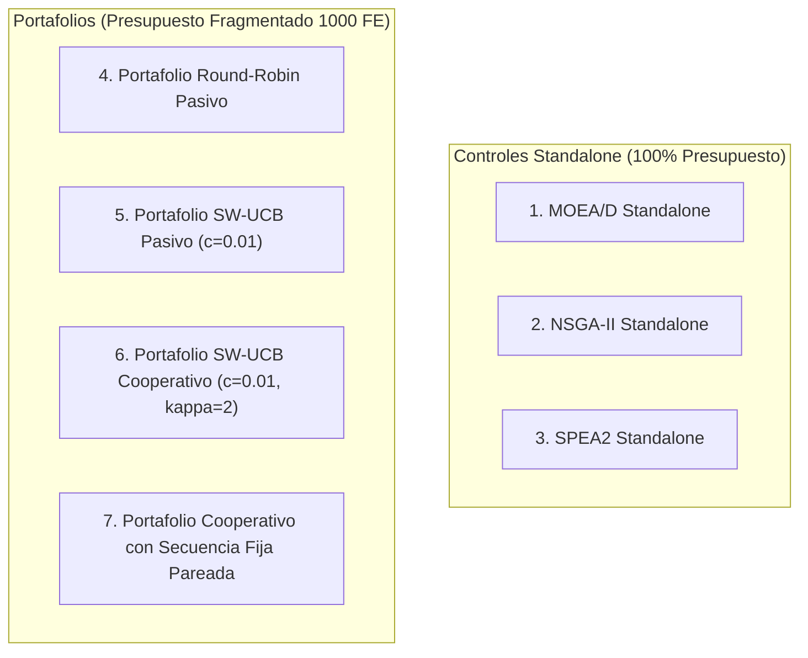
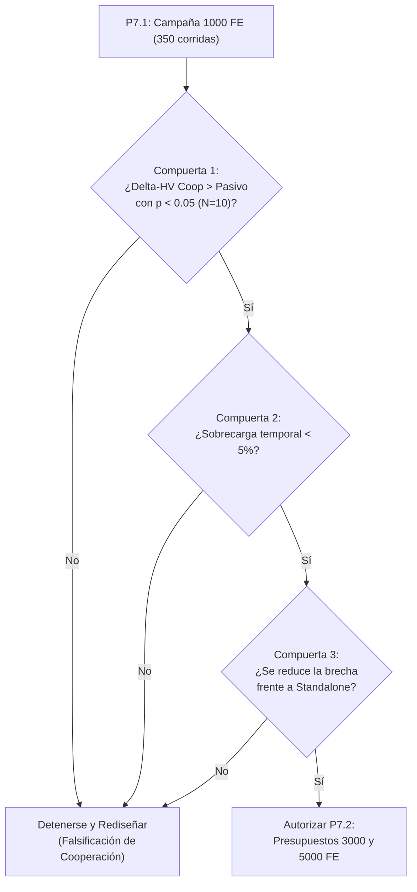

# Protocolo y Diseño Experimental de Validación Ampliada: Cooperación Activa (P7)

**Fecha:** 2026-10-15  
**Contexto:** Portafolio Algorítmico Adaptativo MO-JSSP — Tesis de Ingeniería de Sistemas  
**Worktree:** `..\mojssp-pareto-cooperation` (Rama: `experiment/pareto-archive-cooperation`)  
**Estado:** Documento de diseño metodológico y plan experimental previo a ejecución (sin corridas lanzadas).

---

## 1. Correcciones Metodológicas de la Fase P6

Antes de diseñar la campaña ampliada, se revisaron críticamente los informes preliminares de la Fase P6 ([`p6_cooperation_pilot_report.md`](file:///C:/Users/lenin/Documents/Ingenier%C3%ADa/2026-1/TG1/mojssp-pareto-cooperation/results/pareto_cooperation_research/p6_pilot/p6_cooperation_pilot_report.md) y [`p6_causal_audit_report.md`](file:///C:/Users/lenin/Documents/Ingenier%C3%ADa/2026-1/TG1/mojssp-pareto-cooperation/results/pareto_cooperation_research/p6_pilot/p6_causal_audit_report.md)), rectificando las siguientes afirmaciones:

1. **Corrección de la "Descomposición Causal" ($42.4\%$ vs $57.6\%$):**
   - *Afirmación corregida:* La partición de la diferencia observada en `base_c03` entre cooperación pura ($+0.004320$) y re-asignación dinámica ($+0.005861$) representa una **diferencia aritmética descriptiva en una única corrida pareada**, no una descomposición causal formal identificada ni una fracción de varianza explicada.
   - *Enmienda metodológica:* Solo un diseño factorial completo con múltiples semillas e intervalos de incertidumbre puede estimar la contribución relativa de cada factor y sus efectos de interacción.
2. **Corrección del Récord de Hypervolume ($HV = 0.995187$ en `base_c01`):**
   - *Afirmación corregida:* $0.995187$ fue el valor más alto obtenido **entre las configuraciones de portafolio evaluadas en esa instancia**, pero **NO es el mejor resultado absoluto del proyecto**.
   - *Dato comprobado:* **MOEA/D Standalone alcanzó $HV = 1.011508$** en esa misma instancia y semilla bajo 1000 FE. La jerarquía de rendimiento debe presentarse con exactitud.
3. **Diferenciación entre Atribución Descriptiva, Marginalidad de Archivo y Causalidad:**
   - `first_observed_arm` es una etiqueta descriptiva histórica de qué algoritmo generó la solución por primera vez.
   - La **contribución marginal de archivo** ($\text{HV}(GPA) - \text{HV}(GPA \setminus S_A)$) cuantifica el volumen exclusivo que aporta el subconjunto de soluciones de un brazo al frente final.
   - Ninguna de las dos métricas equivale al **efecto causal de la cooperación**, el cual solo puede estimarse comparando el desempeño del sistema completo frente a un control experimental contrafactual idéntico sin inyección.
4. **Clarificación de la Telemetría de Supervivencia e Inyecciones:**
   - Se distinguen formalmente:
     - *Ofertas totales:* Suma de intentos de inyección al inicio de bloques adaptativos (28 por corrida).
     - *Aceptaciones totales:* Suma de eventos de inserción exitosa en poblaciones receptoras.
     - *Genotipos únicos aceptados:* Cantidad de soluciones físicas distintas aceptadas durante toda la ejecución.
     - *Eventos de supervivencia por bloque:* Conteo acumulado de supervivencia al final del bloque de inyección.
     - *Copias retenidas en poblaciones finales:* Conteo de genotipos inyectados que permanecen en las poblaciones al completarse los 1000 FE.
5. **Corrección sobre Eficiencia Temporal:**
   - Las mediciones reportadas ($0.010\text{ s}$ en `base_c01`, $0.038\text{ s}$ en `base_c03`) corresponden a ejecuciones únicas en entorno Windows.
   - No se afirma que la cooperación sea "más eficiente en tiempo", sino que el costo computacional de la inyección en memoria es de **pocos milisegundos por bloque**, por lo que no impone un cuello de botella algorítmico significativo frente a la evaluación de schedules.

---

## 2. Preguntas Experimentales e Hipótesis Científicas (P7)

La validación ampliada P7 debe responder siete preguntas de investigación con base estadística:

| Pregunta de Investigación | Hipótesis Nula ($H_0$) | Hipótesis Alternativa ($H_1$) | Criterio de Decisión |
| :--- | :--- | :--- | :--- |
| **Q1. ¿Mejora la cooperación el HV final?** | $\Delta\text{HV}_{\text{coop} - \text{pasivo}} \le 0$ | La cooperación activa incrementa el HV final frente al portafolio pasivo. | Test de rangos signados de Wilcoxon pareado ($p < 0.05$). |
| **Q2. ¿Mejora el AUC-HV de la trayectoria?** | $\Delta\text{AUC}_{\text{coop} - \text{pasivo}} \le 0$ | La inyección temprana acelera la convergencia a lo largo de las 1000 FE. | Wilcoxon pareado sobre AUC-HV $(0, 0)$. |
| **Q3. ¿Cuál es el impacto en tiempo de pared?** | $T_{\text{coop}} - T_{\text{pasivo}} > 0.05 \cdot T_{\text{pasivo}}$ | La sobrecarga temporal de inyección representa menos del $5\%$ del tiempo de pared total. | Intervalo de confianza de la razón de tiempos. |
| **Q4. ¿Aporta valor SW-UCB frente a una asignación fija?** | $\text{HV}_{\text{SW-UCB, coop}} \le \text{HV}_{\text{SecFija, coop}}$ | La retroalimentación dinámica de recompensas supera a la secuencia fija pareada. | Diferencia pareada $\Delta\text{HV} > 0$. |
| **Q5. ¿Qué algoritmos aportan soluciones complementarias?** | Las soluciones activas provienen de un único brazo dominante. | Múltiples brazos conservan soluciones en el frente Pareto final con contribución marginal positiva. | Distribución de $\text{Marginal HV} > 0$ por brazo. |
| **Q6. ¿En qué tipos de instancias funciona mejor la cooperación?** | El efecto de cooperación es homogéneo en todas las instancias. | La ganancia relativa de HV se correlaciona positivamente con el número total de operaciones (instancias grandes). | Correlación de Spearman entre $\Delta\text{HV}$ y número de operaciones. |
| **Q7. ¿Puede el portafolio cooperativo acercarse a Standalone MOEA/D?** | $\text{HV}_{\text{coop}} - \text{HV}_{\text{MOEAD, standalone}} \le \text{HV}_{\text{pasivo}} - \text{HV}_{\text{MOEAD, standalone}}$ | La cooperación reduce la brecha de fragmentación frente a MOEA/D standalone. | Reducción de la brecha pareada $|HV_{\text{standalone}} - HV_{\text{portfolio}}|$. |

---

## 3. Matriz de Tratamientos Experimentales

Se evaluarán siete condiciones rigurosamente controladas:

### Definición de las 7 Condiciones:
1. **MOEA/D Standalone:** 1000 FE ejecutadas en un único algoritmo; referencia de convergencia.
2. **NSGA-II Standalone:** 1000 FE ejecutadas en un único algoritmo; referencia de diversidad perimetral.
3. **SPEA2 Standalone:** 1000 FE ejecutadas en un único algoritmo; referencia de archivo ambiental y densidad.
4. **Portafolio Round-Robin Pasivo:** Asignación uniforme cíclica (350/350/300 FE), sin inyección activa.
5. **Portafolio SW-UCB Pasivo:** Asignación adaptativa (ventana 10, $c=0.01$), sin inyección activa.
6. **Portafolio SW-UCB Cooperativo:** Asignación adaptativa libre (ventana 10, $c=0.01$), con inyección activa acotada ($\kappa=2$, desde bloque 6).
7. **Portafolio Cooperativo con Secuencia Fija Pareada:** Inyección activa ($\kappa=2$, desde bloque 6), ejecutando **exactamente la misma secuencia de brazos pre-registrada de la Condición 5 (SW-UCB Pasivo)** para esa misma instancia y semilla.

> [!NOTE]
> **Elección de Hiperparámetro UCB:** Se mantiene formalmente $c=0.01$ como la configuración principal en todas las condiciones de SW-UCB para preservar estricta continuidad metodológica y experimental con la Fase P6. Cualquier exploración con $c=0.07$ queda exclusivamente reservada para análisis de sensibilidad secundario posterior y no como parte de los tratamientos basales.

### Protocolo Pareado Reproducible para la Condición 7:
- Para evitar fuga de información futura o dependencia del tratamiento, la secuencia fija de la Condición 7 se construye **copiando la secuencia histórica de 20 brazos generada por la Condición 5 (SW-UCB Pasivo) bajo la misma instancia y semilla**.
- Esto garantiza que la Condición 7 evalúa: *"¿Qué sucede si aplicamos cooperación manteniendo exactamente la misma asignación de presupuesto y orden que eligió el selector en ausencia de cooperación?"*

---

## 4. Conjunto de Instancias, Semillas y Presupuesto Computacional

### 4.1. Selección de Instancias de Desarrollo
Se utilizarán las **10 instancias base de desarrollo** del proyecto, verificadas contra `experimental_split.csv` y sus archivos `.dzn` con hashes SHA-256 idénticos:

| ID Instancia Base | Configuración ($J \times M$) | Operaciones Totales | Espacio de Búsqueda ($5^N \times N!$) | Razón de Aspecto | Split Asignado |
| :--- | :---: | :---: | :---: | :---: | :---: |
| `base_c01_5x5_b03` | $5 \times 5$ | 25 | Pequeño ($1.8 \times 10^{42}$) | Cuadrada (1.0) | `development` |
| `base_c01_5x5_b05` | $5 \times 5$ | 25 | Pequeño ($1.8 \times 10^{42}$) | Cuadrada (1.0) | `development` |
| `base_c02_10x10_b03` | $10 \times 10$ | 100 | Mediano ($7.4 \times 10^{227}$) | Cuadrada (1.0) | `development` |
| `base_c02_10x10_b04` | $10 \times 10$ | 100 | Mediano ($7.4 \times 10^{227}$) | Cuadrada (1.0) | `development` |
| `base_c03_20x10_b04` | $20 \times 10$ | 200 | Grande ($4.8 \times 10^{514}$) | Alta carga de trabajos (2.0) | `development` |
| `base_c04_10x20_b04` | $10 \times 20$ | 200 | Grande ($4.8 \times 10^{514}$) | Alta carga de máquinas (0.5) | `development` |
| `base_c05_20x20_b03` | $20 \times 20$ | 400 | Muy grande ($1.8 \times 10^{1148}$) | Cuadrada (1.0) | `development` |
| `base_c06_30x20_b03` | $30 \times 20$ | 600 | Muy grande ($1.3 \times 10^{1827}$) | Alta carga de trabajos (1.5) | `development` |
| `base_c07_40x20_b03` | $40 \times 20$ | 800 | Masivo ($1.5 \times 10^{2538}$) | Alta carga de trabajos (2.0) | `development` |
| `base_c08_50x50_b03` | $50 \times 50$ | 2500 | Masivo ($1.4 \times 10^{9150}$) | Cuadrada masiva (1.0) | `development` |

- **Invariante de Holdout:** Las 100 instancias del split `holdout_test` permanecen **completamente intactas y no tocadas**. Ninguna de las 10 instancias seleccionadas pertenece a holdout.
- **Tratamiento de perfiles y factores:** Cada instancia base seleccionada proviene del perfil `base` (`profile == "base"`), evitando sesgos de factores sintéticos de tardiness o energía en esta validación central.

### 4.2. Selección de Semillas
Se utilizarán **5 semillas maestras pseudoaleatorias independientes**:
$$\mathcal{S} = \{42, 101, 202, 303, 404\}$$
- Las semillas derivan internamente los números pseudoaleatorios de cada algoritmo mediante congruencia lineal canónica:
  $$\text{seed}_{\text{arm}} = (\text{seed} \times 10007 + \text{offset}) \pmod{2^{31} - 1}$$
  garantizando reproducibilidad bit a bit y descorrelación estricta entre brazos.

### 4.3. Presupuesto Computacional Exacto (Etapa 1: 1000 FE)
- **Instancias base:** 10.
- **Semillas independientes:** 5.
- **Tratamientos / Condiciones:** 7.
- **Total exacto de corridas:**
  $$10 \text{ instancias} \times 5 \text{ semillas} \times 7 \text{ condiciones} = \mathbf{350 \text{ ejecuciones}}$$
- **Presupuesto por corrida:** Exactamente 1,000 FE (20 bloques de 50 FE).
- **Evaluaciones totales del experimento:**
  $$350 \times 1,000 = \mathbf{350,000 \text{ evaluaciones de schedule}}$$

---

## 5. Plan Estadístico y Reglas de Inferencia

### 5.1. Definición de la Unidad Experimental e Inferencia Agrupada
- **Unidad Principal de Inferencia:** La **instancia base del problema ($n=10$)**.
- **Tratamiento de las Semillas:** Las semillas ($K=5$) actúan como repeticiones estocásticas dentro de cada instancia base, capturando la varianza del algoritmo pero **no agregando grados de libertad a nivel de población de problemas**.
- **Prohibición Epistemológica:** **Bajo ninguna circunstancia se tratarán las $10 \times 5 = 50$ corridas como si fueran 50 instancias independientes.** Declarar significancia estadística inflando el tamaño muestral mediante repeticiones estocásticas sobre las mismas 10 instancias constituiría pseudorreplicación.

### 5.2. Pareamiento Estricto y Contrastes
Todo contraste empírico se calcula primero a nivel pareado para cada combinación $(\text{Instancia}_i, \text{Semilla}_k)$:
$$\Delta Y_{i,k} = Y_{\text{tratamiento}}(inst_i, seed_k) - Y_{\text{control}}(inst_i, seed_k)$$
Posteriormente, se agrega la media de las repeticiones para obtener el efecto resumen por instancia:
$$\overline{\Delta Y}_i = \frac{1}{K} \sum_{k=1}^K \Delta Y_{i,k}$$
Las pruebas de hipótesis macro se realizan sobre el vector de las 10 diferencias agregadas por instancia $\{\overline{\Delta Y}_1, \dots, \overline{\Delta Y}_{10}\}$ ($N=10$).

### 5.3. Métricas y Pruebas Estadísticas
1. **Métricas de Rendimiento:**
   - Hypervolume final ($HV_{\text{norm}}$) con punto de referencia canónico $(1.1, 1.1, 1.1)$.
   - Integral normalizada de trayectoria $AUC\text{-}HV(0, 0)$ bajo 1000 FE.
   - Cardinalidad del archivo Pareto (genotipos y vectores objetivos únicos).
2. **Diferenciación Conceptual de Procedencia y Contribución:**
   - **Procedencia por Primer Descubridor (`first_observed_arm`):** Etiqueta histórica descriptiva que indica qué algoritmo insertó por primera vez la solución en el archivo durante la corrida.
   - **Contribución Marginal Leave-One-Out (LOO):** Diferencia de Hypervolume al remover exclusivamente las soluciones de un brazo del frente final:
     $$\Delta\text{HV}_{\text{LOO}}(A) = \text{HV}(GPA) - \text{HV}(GPA \setminus S_A)$$
   - **Valores de Shapley:** Solo se reportarán formalmente si se evalúan todas las combinaciones de coaliciones ($2^{|A|}$ subconjuntos); de lo contrario, se referenciará estrictamente como contribución marginal leave-one-out.
   - **Efecto Causal:** Se evalúa exclusivamente mediante la diferencia de tratamientos frente a los controles experimentales pareados.
3. **Definición del Benchmark "Mejor Standalone por Instancia" (Virtual Best Standalone - VBS):**
   - El benchmark se define de forma **retrospectiva (ex-post)** como:
     $$HV_{\text{VBS}}(inst_i, seed_k) = \max \left( HV_{\text{MOEAD}}(i,k), HV_{\text{NSGA2}}(i,k), HV_{\text{SPEA2}}(i,k) \right)$$
   - Este benchmark representa el techo teórico de un selector oracular perfecto antes de la ejecución; **no es un algoritmo seleccionable sin información previa**.
4. **Comparaciones Primarias y Secundarias (Control de Pruebas Múltiples):**
   - **Comparaciones Primarias (Familia 1 - Hipótesis Central de Cooperación):**
     1. Condición 6 (SW-UCB Coop) vs. Condición 5 (SW-UCB Pasivo).
     2. Condición 7 (Secuencia Fija Coop) vs. Condición 5 (SW-UCB Pasivo) (aislamiento causal de la inyección).
     - Se aplicará corrección de Bonferroni-Holm ($\alpha = 0.05$).
   - **Comparaciones Secundarias (Exploratorias):**
     - Condición 6 vs. Condición 4 (Round-Robin).
     - Condición 6 vs. MOEA/D Standalone.
     - Condición 6 vs. VBS retrospectivo.
5. **Pruebas No Paramétricas e Intervalos de Incertidumbre:**
   - Prueba de rangos signados de Wilcoxon pareada sobre las 10 instancias base ($N=10$, dos colas).
   - Estimador de tamaño del efecto de Vargha-Delaney ($A_{12}$) pareado.
   - Intervalos de confianza al $95\%$ derivados mediante **Bootstrap jerárquico por conglomerados (Cluster Bootstrap)**, remuestreando instancias base en el nivel superior y semillas en el nivel inferior (10,000 réplicas).

---

## 6. Criterios de Avance a Presupuestos Mayores (3000 FE y 5000 FE)

La Fase P7 se ejecutará inicialmente a **1000 FE**. El avance hacia las etapas de 3000 FE y 5000 FE **NO será automático**; estará condicionado al cumplimiento de las siguientes compuertas metodológicas:

### Reglas Explícitas de Compuerta:
1. **Compuerta de Efectividad ($G_1$):** La condición cooperativa (Tratamiento 6) debe superar al portafolio pasivo (Tratamiento 5) con $p < 0.05$ (Wilcoxon pareado sobre las 10 instancias base) o mostrar ventaja positiva consistente en al menos 7 de las 10 instancias.
2. **Compuerta de Viabilidad Computacional ($G_2$):** La sobrecarga media de tiempo de inyección debe mantenerse por debajo del $5\%$ del tiempo total de pared.
3. **Compuerta de Reducción de Fragmentación ($G_3$):** La brecha frente al mejor standalone retrospectivo en instancias medianas y grandes ($\ge 100$ ops) debe reducirse en promedio al menos en un $15\%$ respecto al portafolio pasivo.

---

## 7. Gestión de Riesgos Metodológicos y Controles

| Riesgo Metodológico | Consecuencia Potencial | Mecanismo de Control Preventivo |
| :--- | :--- | :--- |
| **Fuga de datos de holdout** | Sobreajuste y pérdida de validez externa en la tesis. | Las 100 instancias de holdout no se cargan ni referencian en los scripts de P7. Solo se usan las 10 bases de desarrollo verificadas contra `experimental_split.csv`. |
| **Pseudorreplicación estadística** | Inflar significancia tratando 50 corridas como independientes. | La instancia base es la unidad experimental principal ($N=10$). Las semillas son réplicas agrupadas analizadas mediante bootstrap jerárquico. |
| **Confusión entre cooperación y asignación** | Atribuir a la inyección lo que causó el selector adaptativo. | Inclusión del Tratamiento 7 (Secuencia Fija Pareada), que anula cualquier diferencia de asignación frente al pasivo. |
| **Ventaja artificial por FE no contabilizadas** | Injusticia computacional frente a standalones. | Invarianza estricta verificada: exactamente 1000 llamadas a `Evaluator.evaluate()` en todas las 350 corridas (`fe_overshoot = 0`). |
| **Colapso genético por duplicados** | Homogeneización prematura del archivo global. | Filtro de entrada determinista: rechazo inmediato si el `genotype_id` ya existe en la población interna. |
| **Re-evaluación encubierta** | Consumo oculto de evaluaciones al insertar soluciones. | Los métodos de inyección insertan soluciones ya evaluadas con sus objetivos precalculados y válidos; costo FE = 0. |

---

## 8. Estado del Repositorio y Entregables

- **Informe formal de diseño:** [`results/pareto_cooperation_research/p7_validation_design.md`](file:///C:/Users/lenin/Documents/Ingenier%C3%ADa/2026-1/TG1/mojssp-pareto-cooperation/results/pareto_cooperation_research/p7_validation_design.md).
- **Correcciones aplicadas a P6:** [`results/pareto_cooperation_research/p6_pilot/p6_causal_audit_report.md`](file:///C:/Users/lenin/Documents/Ingenier%C3%ADa/2026-1/TG1/mojssp-pareto-cooperation/results/pareto_cooperation_research/p6_pilot/p6_causal_audit_report.md).
- **Ejecutor canónico P7:** `scripts/run_p7_validation.py`.
- **Suite de pruebas de software:** **369 aprobadas, 0 fallidas, 0 omitidas**.
- **Control de Git:** Sin commits, push, merges ni ejecuciones no autorizadas.

